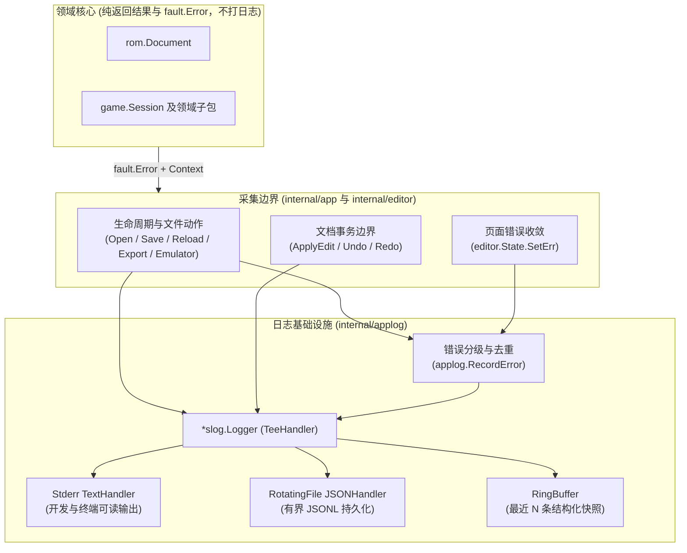

# 应用日志与诊断记录设计

历史方案：已实施并归档，设计核对基线为 `0f82791`。本文保留当时的方案与实施顺序，不再随实现更新；当前日志行为见[错误设计](../../docs/error-design.md#日志采集)，模块边界见[架构](../../docs/architecture.md#应用诊断)，配置与保留策略见[开发说明](../../docs/development.md#日志与诊断)。

- **核对基线**：仓库提交 `0f82791`。当前实现仅在 `fault/error.go` 提供 `fault.LogValue`，并在 `internal/app/app.go` 调用未配置 `slog.Handler` 的默认 `slog.Error` 输出至标准错误流，`main.go` 仍使用 `log.Fatal`。
- **触发条件**：接入桌面端持久化日志、统一后台 I/O 与页面同步编辑的错误诊断记录，或实现[覆盖矩阵](../../docs/coverage.md)中的 `diagnostics.errors`（独立诊断面板）与 `tools.distribution`（问题报告及日志导出）时按本文实施。
- **关联文档**：[错误设计](../../docs/error-design.md)、[架构与代码导航](../../docs/architecture.md)、[覆盖矩阵](../../docs/coverage.md)。

## 现状与问题

当前代码库已具备结构化错误模型（`fault.Error`、`fault.Context` 与 `fault.LogValue`），能够将跨包操作帧和 `errors.Join` 原因树编码为 `slog.Value`，但日志管线尚未闭合：

1. **缺少持久化与 Handler 初始化**：全局 `slog` 未配置 `Handler`，日志仅以默认格式写入 `os.Stderr`。当打包为桌面应用（如 `FEBuilderGBA.app`）脱离终端启动时，标准错误流不可见，问题发生后无法提取诊断文件。
2. **缺少会话生命周期上下文**：`internal/app` 仅在异步操作返回非 nil 错误时输出 `"operation failed"`，没有记录打开、保存、重载 ROM 或启动模拟器的成功上下文（路径、识别版本、字节大小、修订号），导致错误发生时缺乏前置状态轨迹。
3. **页面同步错误未纳入诊断链路**：`internal/pages` 在 UI 线程执行领域 `Plan`／`Apply` 时，将失败直接赋值给 `editor.State.Err`。其中的 ROM 结构损坏（`InvalidData`）、修订或引用冲突（`Conflict`）、容量超限（`Capacity`）仅停留在界面横幅，未进入日志；而用户在输入框键入过程中的高频格式校验错误（`InvalidInput`）若直接记录则会造成严重噪音。
4. **缺少内存诊断缓冲**：后续独立诊断面板（`diagnostics.errors`）与问题报告需要即时读取近期结构化诊断记录，直接反读并解析磁盘日志文件既增加 I/O 复杂度，又受文件降级影响。

## 设计原则与架构边界

1. **领域核心零日志**：
   `rom`、`space`、`gba`、`game/...` 保持纯状态变换与查询职责，不导入日志包，也不持有 `*slog.Logger`。领域层在高频预览、地图绘制和引用扫描中频繁执行，所有失败事实已由 `fault.Error` 的结构化 `Context` 携带，统一在应用与状态边界记录。
2. **零外部依赖**：
   完全基于 Go 标准库 `log/slog`、`os`、`io`、`sync` 构建多路分发、文件轮转与内存缓冲，不引入第三方日志库。
3. **UI 线程非阻塞与并发安全**：
   日志接收器同时服务于 `internal/app` 的后台 worker goroutine 和 UI 主线程。内部锁粒度限于单条记录的序列化与写入，单文件大小有界，避免阻塞界面渲染。
4. **环境变量驱动配置**：
   通过环境变量控制日志级别与目录，不新增自定义 CLI 标志，避免污染[旧版 CLI 契约](../../docs/legacy-inventory.md#cli-参数范围)（`cli.compatibility`）的参数空间。

## 拓扑与模块设计



### 新引入命名与职责说明

| 命名                 | 归属位置          | 含义与职责说明                                                                                                                                 |
| -------------------- | ----------------- | ---------------------------------------------------------------------------------------------------------------------------------------------- |
| `internal/applog`    | 独立内部包        | **Application Logging**：封装 `slog.Handler` 多路组装、有界文件轮转、内存环形缓冲与 `fault.Kind` 分级记录函数。                                |
| `applog.Config`      | `internal/applog` | 启动配置值对象，承载默认日志级别、缓存根目录、是否开发模式、单文件字节上限、保留世代数与内存缓冲容量。                                         |
| `applog.Sink`        | `internal/applog` | 日志运行期句柄，持有组合后的 `*slog.Logger`、日志文件目录路径、底层文件句柄及 `*applog.RingBuffer`，提供 `Close()` 供 `main`／`app` 退出清理。 |
| `applog.Entry`       | `internal/applog` | 内存缓冲中的单条只读日志快照，包含时间戳、级别、消息、顶层操作名及结构化属性副本，供诊断面板直接渲染或复制。                                   |
| `applog.RingBuffer`  | `internal/applog` | 固定容量（默认 200 条）的并发安全环形缓冲区，按时间顺序返回近期 `applog.Entry` 切片。                                                          |
| `applog.RecordError` | `internal/applog` | 统一错误记录入口，替代原 `app.logError`；根据 `fault.CodeOf(err).Kind` 过滤取消事件、降级输入校验错误并附带 `fault.LogValue(err)`。            |
| `State.SetErr`       | `internal/editor` | UI 线程设置窗口当前错误的方法；更新 `State.Err` 并在错误值变化时调用 `applog.RecordError`，避免每帧重绘或重复赋值产生重复日志。                |

### 导入边界（`depguard`）

- `internal/applog` 只允许导入标准库与 `fault`；禁止导入 `github.com/egoist/mygo`、`game`、`rom`、`space`、`gba`、`internal/pages`、`internal/components`、`internal/editor`、`internal/locales`。
- `game`、`rom`、`space`、`gba`、`fault`、`internal/input`、`internal/locales` 禁止导入 `internal/applog`。
- `internal/app` 与 `internal/editor` 允许导入 `internal/applog`；未来诊断组件可通过只读快照回调或 `editor.State` 消费 `applog.Entry` 列表。

## 输出目标（Sinks）与启动配置

### 环境变量

| 环境变量              | 取值范围                         | 默认行为                                                                                            |
| --------------------- | -------------------------------- | --------------------------------------------------------------------------------------------------- |
| `FEBUILDER_LOG_LEVEL` | `debug`、`info`、`warn`、`error` | 未设置或取值非法时：开发模式（`mygo.IsDev()`）默认为 `debug`，生产构建默认为 `info`。               |
| `FEBUILDER_LOG_DIR`   | 本地文件系统目录路径             | 未设置时使用 `os.UserCacheDir()/febuildergba-mygo/logs`（与 `dev-session.json` 共享父级缓存目录）。 |

### 三路输出目标

1. **标准错误流（`os.Stderr`）**：
   - 使用 `slog.NewTextHandler(os.Stderr, ...)`，便于开发模式（`just dev`／`just run`）在终端直接阅读。
2. **有界轮转文件（JSON Lines）**：
   - 路径：`{LogDir}/febuildergba.jsonl`。
   - 使用 `slog.NewJSONHandler`，无损保留 `fault.LogValue(err)` 生成的嵌套 `cause`／`causes` 树。
   - **轮转策略**：写入前检查当前文件尺寸；超过单文件上限（默认 `1 MiB`）时关闭当前句柄，依次将历史世代重命名为 `febuildergba.jsonl.1` 至 `febuildergba.jsonl.3`（默认保留 3 个历史世代），再创建新文件。不依赖外部压缩工具。
   - **优雅降级**：若 `os.UserCacheDir()` 解析失败或日志目录不可写，向 `os.Stderr` 记录一条警告并继续使用标准错误流与内存缓冲，不阻断编辑器运行。
3. **内存环形缓冲（`RingBuffer`）**：
   - 在 `slog.Handler.Handle` 中同步追加克隆后的 `applog.Entry`（容量固定为 200 条），与磁盘可用性解耦，为后续 `diagnostics.errors` 面板及一键复制诊断文本提供数据源。

## 采集截面与错误分级

### 1. 错误分流规则（`applog.RecordError`）

```mermaid
flowchart LR
    Err[收到 err 与顶层 op] --> IsNil{err == nil?}
    IsNil -- 是 --> Ignore[不记录]
    IsNil -- 否 --> Kind{fault.CodeOf(err).Kind}
    Kind -- Canceled --> Ignore
    Kind -- InvalidInput --> Debug["slog.Debug\n(仅在 debug 级别记录)"]
    Kind -- "Conflict / Unsupported" --> Warn["slog.Warn\n(附带 op 与 fault.LogValue)"]
    Kind -- "InvalidData / IO / Capacity /\nPermission / NotFound / Unknown" --> Error["slog.Error\n(附带 op 与 fault.LogValue)"]
```

- **忽略取消事件**：用户在系统打开／保存对话框中点击取消（或返回空路径且 `err == nil`）、以及 `fault.Canceled` 属于正常交互分支，不产生任何错误日志。
- **降级高频输入错误**：`fault.InvalidInput`（如字段数值超出范围、十六进制解析失败、PNG 尺寸或颜色数不满足导入要求、未读先写原始字节等）属于用户输入校验反馈，仅以 `slog.LevelDebug` 记录，不在生产日志中刷屏。
- **保留操作名上下文**：`internal/app` 的 `background(win, a, operation, ...)` 及各文件操作将顶层 `operation`（如 `"app.save"`、`"app.export_resource"`、`"app.launch_emulator"`）显式传入 `applog.RecordError(operation, err)`。

### 2. 页面同步错误收敛（`editor.State.SetErr`）

UI 线程上的页面与组件将对 `state.Err` 的写入收敛为 `state.SetErr(err)`（清除时传入 `nil`）：

- 当 `err == nil` 时，清空 `state.Err`。
- 当 `err != nil` 时，更新 `state.Err`；若本次错误的诊断文本或错误码与上一次已记录的 `state.Err` 不同，则调用 `applog.RecordError("editor.operation", err)`。
- 由此，页面内执行 `Plan`／`Apply` 时触发的 `rom.stale_edit`（`Conflict`）、`space.no_capacity`（`Capacity`）、`game.invalid_*`（`InvalidData`）或引用冲突能够自动进入结构化日志，同时避免立即模式 UI 每帧重绘或输入过程中重复触发同一条日志。

### 3. 事件清单与结构化字段

日志不记录 ROM 原始字节切片、完整 PNG 载荷或长文本草稿正文。固定事件集合如下：

| 截面             | 级别                   | 消息 (`msg`)          | 结构化字段 (`attrs`)                                            |
| ---------------- | ---------------------- | --------------------- | --------------------------------------------------------------- |
| 应用生命周期     | `INFO`                 | `"app started"`       | `dev`、`log_dir`（降级时为空）                                  |
| 应用启动致命失败 | `ERROR`                | `"app exited"`        | `error: fault.LogValue(err)`（替换 `main.go` 中的 `log.Fatal`） |
| 会话打开／重载   | `INFO`                 | `"rom opened"`        | `path`、`version`、`size`、`revision`、`reloaded`               |
| 会话保存         | `INFO`                 | `"rom saved"`         | `path`、`size`、`revision`、`save_as`                           |
| 外部修改检测     | `WARN`                 | `"external change"`   | `path`、`revision`（仅在状态由未变更转为外部已变更时记录一次）  |
| 模拟器启动       | `INFO`                 | `"emulator launched"` | `path`                                                          |
| 文档历史变更     | `DEBUG`                | `"document history"`  | `action`（`apply`/`undo`/`redo`）、`label`、`revision`、`size`  |
| 操作诊断与失败   | `DEBUG`/`WARN`/`ERROR` | `"operation failed"`  | `operation`、`error: fault.LogValue(err)`                       |

## 实施与验证步骤

接入实现时按以下顺序推进并完成验证：

1. **实现 `internal/applog` 与导入规则**：
   - 实现 `Config`、`Sink`、`RingBuffer`、有界 JSONL 轮转写入器与 `RecordError`。
   - 更新 `.golangci.yml` 的 `depguard` 规则，验证允许导入与违规导入检查。
2. **接入 `main.go`、`internal/app` 与 `internal/editor`**：
   - 在 `app.Run` 初始化 `applog.Sink` 并设置默认 `slog.Logger`，`main.go` 改用结构化日志输出启动错误并以非零状态码退出。
   - 将 `internal/app` 中的 `logError` 替换为 `applog.RecordError` 与生命周期 `INFO` 记录。
   - 在 `internal/editor.State` 增加 `SetErr` 并在页面／组件错误设置处接入，同时在 `Undo`／`Redo` 记录 `DEBUG` 级历史事件。
3. **合成测试验证**：
   - 在 `internal/applog` 编写工作流测试（不按函数逐一写单元测试）：使用 `t.TempDir()` 验证 JSONL 中 `fault.LogValue` 原因树保真、按 `fault.Kind` 分流过滤（`Canceled` 忽略、`InvalidInput` 仅 `DEBUG` 输出）、单文件超限后的世代轮转、不可写目录的优雅降级，以及 `RingBuffer` 并发读写与容量覆盖边界。
   - 实施完成后更新 [架构与代码导航](../../docs/architecture.md) 与 [错误设计](../../docs/error-design.md)，并将本方案归入对应实现文档或按 [AGENTS](../../AGENTS.md#文档维护) 处置。
