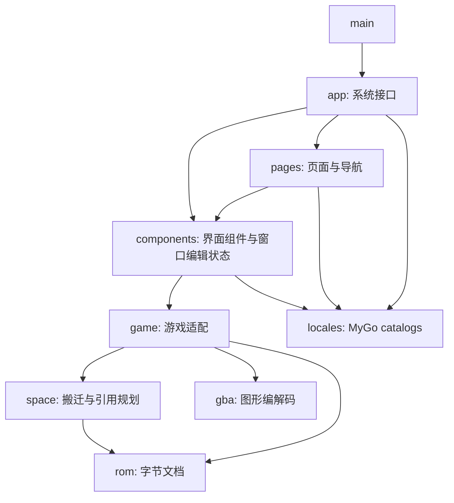

# FEBuilderGBA 原生编辑器

Go + MyGo 原生 UI，Go module 为 `github.com/woxQAQ/febuildergba-mygo`。当前实现 FE8U、FE8J、FE7U、FE7J 和 FE6 的人物、职业、道具与章节配置基础字段编辑；日文适配面向原版。尚未达到旧版完整功能覆盖。

完整范围和开发规则见[重建计划](docs/rebuild-plan.md)，当前能力见[实现记录](docs/implementation-status.md)，逐项实现状态见[覆盖矩阵](docs/coverage.md)，布局与主题见[界面设计](DESIGN.md)。

日常命令统一收录在 [justfile](justfile)。执行 `just` 查看命令及说明：

```sh
just run "/path/to/Fire Emblem.gba"
just dev -lang zh-Hans
just check
just test -run TestName -count=1
just test-race
just test-integration
just build
```

`check` 依次执行 lint、MyGo vet（包含 `go vet`）、翻译检查、默认测试，以及默认和 `CGO_ENABLED=0` 两种构建检查。真实 ROM 测试和 race 检查单独执行；真实 ROM 测试禁用缓存，缺少本地文件时报告跳过。`fmt` 按 `.golangci.yml` 格式化代码，`generate` 更新翻译 API，`inventory` 生成旧版来源索引。

所有命令均在仓库根目录执行，相对路径也以根目录为基准。MyGo 使用 `go.mod` 固定的 `go tool mygo`，lint 和格式化需要 PATH 中的 `golangci-lint`。

## 运行

使用仓库要求的 Go 版本和 `go.mod` 中固定的 MyGo 依赖。在仓库根目录执行：

```sh
go run .
# 也可以通过位置参数直接打开 ROM：
go run . /path/to/FE8U.gba
```

通过“文件 → 打开 ROM…”或 Cmd+O 使用系统文件对话框，每个 ROM 对应独立窗口。当前接受 FE8U、FE8J、FE7U、FE7J（至少 16 MiB）和 FE6（至少 8 MiB），最大 32 MiB。FE7 人物表按原版规则显示 253 条记录。翻译版的自定义字库尚未接入，标头能识别不代表名称显示正确。没有模拟器和旧版 C# 运行环境也可以使用基础编辑器。

- 顶部与系统标题栏合并，仅显示文件名、未保存状态和语言切换；打开、保存、另存为、撤销与重做统一使用原生菜单和快捷键。保留原生窗口按钮、圆角与阴影，文件名过长时自动省略，顶部空白区域可拖动窗口；全屏时自动收回窗口按钮的留白。
- 顶部标签页切换人物、职业、道具、章节、文本和十六进制编辑；记录列表支持名称或十六进制 ID 搜索。Shift 连选、Cmd/Ctrl 多选后，右侧显示字段选择与批量修改预览；点击应用形成一次可撤销操作。改变搜索会清空多选。
- “章节”标签页按实际指针浏览、搜索和多选已有章节，编辑天气、迷雾、战前准备、各阵营音乐、地图与事件资源 ID 等已确认字段。关联文本字段旁的“前往”打开文本页，支持章节名、胜利条件文案及各版专属文本；文本修改预览也会列出章节使用方并可跳回。胜利条件文案只影响显示，实际判定由事件控制。
- 章节布局按版本解析：FE8U／FE8J／FE7J 为 148 字节，FE7U 为 152 字节；FE6 原版为 68 字节，按 `0x2BB12` 的指令识别旧版支持的 72 字节布局。FE6 的音乐 ID 为单字节，其余版本为双字节；FE7 保留两条线路、序章音乐和占卜文本差异。两组图块 ID 分开编辑，FE6／FE7 原版均使用第二组资源。数值按存储范围检查，未解释字节保持原样。
- 章节详情直接显示五版地图预览，按当前图块、调色板、图块配置和地图 ID 组合静态基础地图。支持 50%／100%／200%／400% 缩放、网格、拖动或滚动平移、重置视图；单击格子查看坐标、原始图块值与地形 ID。切换章节会重置格子选择和平移，资源或相关原始字节修改、撤销重做、手动表定位后会刷新；损坏资源显示具体类别，章节字段仍可编辑。
- 预览沿用旧版原生地图上限：宽不超过 60、高不超过 63、总计不超过 1536 格。图块拼接、翻转、调色板和地形数据均进行范围检查；部署视图可叠加当前部署组的序号标记；迷雾、图块动画、事件触发的地图变化及地图绘制尚未接入。
- 章节详情的“部署”视图列出各难度、路线、遭遇战部署，以及开场、回合及区域事件中的已识别静态引用。选择入口后，地图与单位列表联动；可切换起点／终点、重复单击同格单位切换选择，选格后设置位置。支持人物、职业、领队、等级、阵营、自动成长、四个道具与四个 AI 字节，以及新增、复制和删除。职业 0 继承人物职业，未知 ID 保留数值；FE8 终点编辑最后一段移动坐标，之前的路径、速度、等待和其他字节保持不变。
- 部署修改先保留为草稿，经“预览部署”核对数量、目标地址和共用该指针入口的已知章节，再“应用部署”。写入在 ROM 末尾追加记录与需要修改的路径，只更新选定指针；其他指针即使引用同一旧资源也保持原内容。共用同一指针入口的章节会一起变化，其他事件引用尚未完整索引。一次撤销恢复记录、路径、入口和原文件长度；保存后可重开继续编辑。切换章节或入口保留草稿，ROM 或表布局改变后保留冲突草稿并要求重新读取。
- 部署读取不执行事件条件或 ASM。动态引用、未知指令、递归或发现上限会提示解析不完整，已有入口仍可编辑；地图显示所选组的编码坐标，不表示实际开场状态。FE8 带目标单位的相对移动不叠加终点，不能用绝对格子按钮覆盖它。当前每组最多 256 个单位，事件发现最多 128 个入口、16 层调用及 8192 条指令；完整路径编辑、对话／击破等其他触发条件与通用事件脚本编辑待实现。
- 章节详情的“回合增援”视图浏览原生回合表，编辑类型 2 条件的起止回合、触发阵营阶段、完成标志，以及 FE7 的路线／难度；其他条件记录保持原始字节，可查看或删除。结束回合 0 表示仅起始回合，255 表示无上限；非零完成标志会阻止重复执行，并在执行前设置。触发阶段与单位阵营分别保存。
- “新增回合增援”创建默认第 3 回合敌军阶段的增援，在同页使用地图和部署属性编辑单位。预览后一次追加条件表、“加载单位 → 等待移动结束 → 结束事件”脚本、部署记录及需要修改的 FE8 路径，只更新当前章节事件头的回合表指针。共用此指针位置的章节一起变化，其他指针入口继续使用旧表；已有事件脚本及其他条件字节保持原样。
- 回合条件和新建增援共用一次预览、应用及历史操作，支持删除事件、空表创建、冲突重新读取、保存重开；每表上限 256 条。已有事件中的已识别部署组可前往“部署”单独编辑，不重写原脚本。静态解析不执行条件或 ASM，未知脚本仍可保留并编辑对应的已知回合条件；区域条件见下述工作流，对话、击破等条件和完整脚本编辑待实现。
- “区域事件”读取五版常驻条件表，编辑类型 `0B` 的两个端点和完成标志。范围包含端点，坐标支持 `-128…127`；FE6／FE7 要求端点 1 不大于端点 2，FE8 接受倒序。地图按原生有效范围叠加序号，可单击选择条件，重复单击循环选择重叠区域；选格后分别设置两个端点。常驻表中的胜利、标志、ASM 和其他条件保留原始字节，可查看或删除。
- “新增区域增援”创建默认 `(0,0)…(0,0)` 的区域和独立敌军部署组，与回合增援共用单位、地图、预览及历史流程。完成标志默认 0，允许重复触发；单次触发需填写未使用的非零完成标志，编辑器不自动分配。区域条件检查的是引擎检查时的活动单位位置，不模拟游戏状态或限制为自军。
- 区域写入复制完整常驻表，追加新建增援的脚本、部署及修改路径，只更新选定章节事件头的常驻表指针；共用此指针位置的已知章节列在预览中，独立入口及旧资源保留。支持空表、新增／删除、过期预览、冲突重新读取、原始字节、撤销重做和保存后继续编辑；已有脚本的已识别部署可前往部署页单独修改。
- 章节也可使用批量编辑、手动表定位、原始字节入口和已有表搬迁。搬迁更新规则确认的引用，保留旧表及结束记录，形成一次撤销操作。新增章节记录、地图绘制、其他触发条件、通用事件脚本和模拟器跳章尚未实现。
- 职业能力按基础、成长率、上限、转职加成并列显示；人物使用个人加值与成长率。没有对应字段的单元格显示 `—`。宽窗口将武器熟练度放在能力矩阵旁，窄窗口自动换行；其他属性采用标签与数值同行的布局。
- 五个版本的记录详情均提供名称输入：FE8U／FE7U 使用可打印 ASCII，FE8J／FE7J／FE6 使用 Shift-JIS，并支持原版紧凑职业名的反向编码。点击“预览名称”查看共享文本 ID 的已知名称、描述及使用描述字段，再“应用名称”。同一文本 ID 的所有用途会同步变化；其他文本 ID 即使指向同一旧文本也保持原内容。写入复用 ROM 的 Huffman 树，在末尾追加压缩文本并更新入口，形成一次可撤销操作；Cmd+S 保存。文本 ID 0 不写入，自定义字库及新增文本 ID 待接入。
- 五个版本的详情均提供多行描述正文和道具使用描述：英文版支持 ASCII，日文版支持 Shift-JIS、半角片假名及原版紧凑字形。编辑正文及换行后，点击“预览文本”核对共享字段，再“应用文本”并保存。控制码以 `[A]`、`[ToggleRed]`、`[LoadFace][0x0141]` 等可读指令表示，也接受原始 `[0xNNNN]` 标记。已支持的指令可以增删及修改参数；字面 `[` 和反斜杠分别写作 `\[` 与 `\\`。无法无损解码的字符、未支持的控制码和不完整参数保留原始表示并只读。描述与名称复用同一写入及历史机制。
- “文本”标签页浏览已有非零文本 ID，可搜索正文或输入十六进制 ID（例如 `900` 或 `0x0900`），查看指令参考和 ROM 中的原始控制单元。修改后预览共享影响并应用，已知引用可跳回人物、职业或道具。切换记录保留草稿；原文在 ROM 中改变时保留草稿并提示重新读取。入口指向 RAM 或文本损坏时显示错误，其他条目仍可浏览；恢复地址仅供读取。
- 通用文本支持五版原版字符集和已确认的控制指令。`[NL]` 等同于换行，`[Wink]` 是完整的 `0x80 0x1F` 指令；`[LoadFace][0x0141]` 后的参数保持 16 位，不按字符拆分。参数低字节必须非零，且需存在可用的 Huffman 编码：例如 FE7U／FE6 原版不能编码 `0x0101`，FE6 原版不能编码 `[Wink]`，预览时会拒绝。新建文本 ID、文本表扩展、自定义字库／引擎及游戏画面预览尚未实现。
- 普通表的有效数值字段输入立即进入内存文档；部署、回合与区域条件数值先保留为草稿并经预览应用。不完整或超范围的输入保留为草稿，并显示允许范围。Tab 切换字段，上下键微调；选中字段的加减按钮集中在编辑区底部。
- Cmd+Z / Cmd+Shift+Z 及原生“编辑”菜单按焦点选择撤销、重做：数值字段和记录视图操作 ROM 历史；搜索、名称、描述、通用文本、部署、回合与区域条件数值草稿、批量值、表定位和未应用的十六进制草稿使用自己的文本历史。
- Cmd+S 保存，Cmd+Shift+S 另存为；首阶段面向 macOS。
- 人物和职业显示 ROM 内的头像／职业卡，道具显示实际图标；可用 `2×` 放大预览。旁边提供“导出 PNG”和“替换 PNG”：选择图片后先显示完整素材表的实际写入颜色和已知共享字段，应用后形成一次可撤销操作。修改素材 ID 或原始数据后，预览跟随文档修订刷新。
- 五版图标使用 16×16 PNG，并严格保留共享调色板；普通头像使用原版 128×112 素材表，包含小头像、眼睛与嘴部动画图块，职业卡保持导出尺寸。头像接受最多 15 种不透明颜色加透明色，颜色转换为 GBA 的 BGR555 后预览；拒绝半透明和素材表空白区中的非透明像素。原有坐标保持不变，扩展头像格式暂只提供原有预览。
- 素材写入沿用末尾追加与已确认引用：头像分别追加图块和调色板，其他头像 ID 的旧别名保持原内容；图标连续存储，因此每次替换复制整个 255 槽可寻址区（32,640 字节），更新图标表入口并保留其他图标及共享调色板。相同素材 ID 的其他用途一起变化；旧区不回收，连续替换会增长 ROM，仍受 32 MiB 上限约束。
- “前往”定位关联职业；打开“原始数据”后，底部显示当前字段的地址、十六进制值及字节编辑入口，页面另显示高级字段与记录字节。素材的头像记录、图标字节和调色板也提供直接入口。
- “表定位”允许指定地址、记录大小和记录数，沿用当前游戏的字段定义。地址和记录大小需 4 字节对齐，范围必须完整容纳现有字段；这是当前窗口的解析设置，不改写 ROM 指针，也不随文件保存。可恢复自动定位。
- “表定位”下的“预览搬迁”显示源／目标偏移、字节数、已确认引用数量及搬迁后大小；“应用搬迁”将现有表复制到 ROM 末尾，更新规则确认的引用，形成一次可撤销操作。支持 FE8U／FE8J／FE7U／FE7J／FE6 的人物、职业、道具与章节表，包含 FE6 隐藏人物记录及解析结束记录；需要自动定位，记录数不变。源数据保留，未知引用仍使用旧副本；预览后文档改变需重新预览。Cmd+S 才写入磁盘。
- 十六进制编辑接受 ROM 偏移或 `08`／`09` 开头的 GBA 地址，每次读取 1–4096 字节。应用时保持长度不变，并检查读取后的文档修订；文档已改变时保留草稿，重新读取后才能应用。
- 右上角切换中文／英文，通过 MyGo 的 `App.SetLocale` 同步所有窗口、原生控件与系统菜单，并由框架保存语言偏好。首次运行按系统语言选择，未支持的语言回退到英文。

保存使用一致的字节快照，在同目录写临时文件后替换目标；磁盘 I/O 不持有文档状态锁。保存点对应实际写出的快照，期间的新修改仍保持未保存状态。修改前的完整文件保存在 `<ROM 文件名>.backups/`，备份目前不会自动删除。保存前及窗口重新聚焦时检查磁盘内容，发现外部修改后可重新载入或另存。关闭有未保存修改的窗口会询问保存、放弃或取消。

模拟器启动优先使用 `FEBUILDER_EMULATOR` 指定的可执行文件，其次使用 PATH 中的 `mgba`，macOS 还支持 `/Applications/mGBA.app`。参数通过独立 argv 传递，不通过 shell；指定值应为可执行文件路径，不能包含额外命令参数。试运行前需保存 ROM。

也可构建本地 macOS 应用和安装镜像：

```sh
go tool mygo build
open build/darwin-arm64/FEBuilderGBA.app
```

当前生成本地签名的开发产物，尚未发行公证。

## 构建与静态分析

```sh
go test ./...
golangci-lint run ./...
go vet ./...
go tool mygo vet .
go tool mygo i18n check
go build ./...
CGO_ENABLED=0 go build ./...
```

## 覆盖索引

```sh
go run ./cmd/legacy-inventory
```

从旧版 `.csproj`、源码中的静态窗口调用和配置目录按需生成旧版来源索引，默认输出到仓库根目录的 `.cache/legacy-inventory.csv`。`.cache/` 已由 Git 忽略，生成结果不纳入版本管理。索引仅记录来源，不能当作功能完成率；行为状态维护在覆盖矩阵中。生成器应从仓库根目录执行，或显式设置 `-root`、`-out`。

## 工程组织

根目录的 `main.go` 只负责启动。页面组合、可复用组件、共享编辑状态与桌面系统接口分别组织：

```text
main.go
fault/                    错误码、处理类别、操作上下文与原因树
rom/                      字节文档、修改历史、保存与备份
space/                    空间分配、资源搬迁规划与已确认引用更新
gba/                      GBA 图形编解码
game/                     游戏适配、表与字段定义、文本编解码和图像读写
internal/
  locales/                JSON catalogs、MyGo 生成的 API 与字段标签解析
  app/                    窗口生命周期、原生菜单、文件对话框、模拟器启动
  pages/
    workspace.go          标签导航、页面组合和窗口动作回调
    empty.go              未打开 ROM 的页面
    records/              记录列表、搜索、多选、表定位和批量编辑
    texteditor/           文本 ID 导航、指令参考及编辑草稿
    hexeditor/            十六进制页面及其草稿
  components/
    chrome.go             主题、标题栏、状态栏与通知
    state.go              单窗口共享编辑状态与撤销重做
    input.go              数值与地址解析
    errtext.go            领域错误到 catalog 文案的映射
    textdraft.go          尚未应用的文本输入与撤销焦点
    recordform/           字段布局、数值与文本草稿、素材预览／替换和字段检查器
    mapview/              章节地图画布、格子拾取、部署标记与区域范围
    chapterview/          章节上下文、部署／回合／区域条件、草稿和写入预览
  testutil/               合成 ROM fixture 构造
cmd/
  ui-probe/               原生控件原型
  legacy-inventory/       旧版来源索引工具
tests/
  integration/            使用真实 ROM 的可选检查（integration build tag）
```



错误处理见[结构化错误设计](docs/error-design.md)：`fault.Code` 定义稳定错误码和处理类别，`fault.Error` 保留操作、上下文与原因。UI 文案不依赖 `Error()` 的格式；文件操作在应用边界记录结构化日志，全局错误横幅悬停可查看诊断详情。

页面保留自己的筛选、选择和草稿状态；组件通过参数与回调接入页面，组件不导入页面或窗口协调层。`components.State` 的修改在 UI 线程进行，后台 I/O 通过 `Window.Update` 回到窗口。`game`、`rom`、`space`、`gba` 不依赖 MyGo。新增游戏通过游戏适配接入，普通布局由字段定义描述。

## 国际化

`mygo.json` 将 `internal/locales` 配置为翻译目录：`en.json` 是源语言，`zh-Hans.json` 是简体中文。静态文案调用生成的类型化函数，动态字段 ID 由 `internal/locales/labels.go` 映射到 catalog key，领域错误文案由 `internal/components/errtext.go` 按结构化错误码显式映射；语言匹配、回退、复数与原生控件翻译由 MyGo 处理。`locales` 不导入领域包，所有层都可以依赖它。

修改 JSON 后执行：

```sh
go tool mygo generate
go tool mygo i18n check
```

`catalog_gen.go` 与 JSON 一起纳入版本管理，普通 `go build` 无需预先执行生成命令。生成文件不要手工修改；`mygo dev` 和 `mygo build` 会自动重新生成。可用 `MYGO_LOCALE=zh-Hans go run .` 或 `MYGO_LOCALE=en go run .` 临时预览语言，该环境变量不会改写保存的语言偏好。
