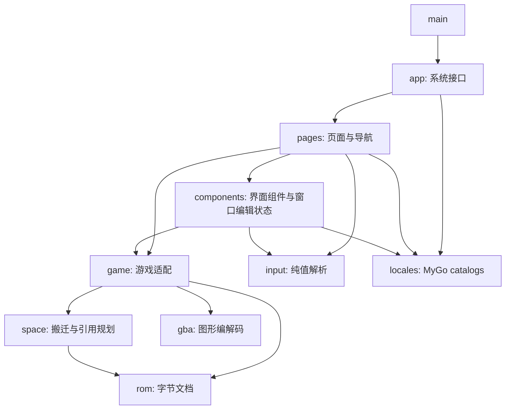

# 架构与代码导航

本文描述当前实现和所有权边界。目标范围与尚未实施的方向见[重建计划](rebuild-plan.md)，开发执行约束见 [AGENTS](../AGENTS.md)。

## 模块职责

| 模块         | 代码                                                                                                                                                                                                                                                                               | 职责                                                                                                                      |
| ------------ | ---------------------------------------------------------------------------------------------------------------------------------------------------------------------------------------------------------------------------------------------------------------------------------- | ------------------------------------------------------------------------------------------------------------------------- |
| ROM 文档     | [document.go](../rom/document.go)                                                                                                                                                                                                                                                  | 管理字节、修订、撤销重做和保存点。检查过期操作，执行备份和外部修改检测。保存快照时不持有状态锁。                          |
| 空间与引用   | [write.go](../space/write.go)、[relocation.go](../game/relocation.go)                                                                                                                                                                                                              | 分配末尾或明确声明的区间，按 4 字节对齐。预览表搬迁，更新已确认的引用并保留源数据。                                       |
| 游戏会话     | [session.go](../game/session.go)                                                                                                                                                                                                                                                   | 选择游戏适配器，提供表、字段、单记录及批量编辑。                                                                          |
| 高级操作     | [advanced.go](../game/advanced.go)                                                                                                                                                                                                                                                 | 设置当前窗口的表布局。原始字节写入检查文档身份、长度和修订。                                                              |
| 游戏规则     | [format.go](../game/format.go)、[fe8u.go](../game/fe8u.go)、[fe8j.go](../game/fe8j.go)、[fe7u.go](../game/fe7u.go)、[fe7j.go](../game/fe7j.go)、[fe6.go](../game/fe6.go)                                                                                                           | 定义版本标头、表和文本位置、字段差异及素材布局。                                                                          |
| 文本读写     | [text.go](../game/text.go)、[text_encode.go](../game/text_encode.go)、[text_edit.go](../game/text_edit.go)、[text_value.go](../game/text_value.go)、[text_controls.go](../game/text_controls.go)、[text_index.go](../game/text_index.go)、[narrow_font.go](../game/narrow_font.go) | 读写 Huffman、anti-Huffman、Shift-JIS 和紧凑字形，处理文本索引、控制指令、共享预览及原子写入。NarrowFont 映射前检查字形。 |
| 图像读写     | [graphics.go](../gba/graphics.go)、[portrait.go](../game/portrait.go)、[assets.go](../game/assets.go)、[asset_edit.go](../game/asset_edit.go)、[asset_sheet.go](../game/asset_sheet.go)、[graphics_encode.go](../gba/graphics_encode.go)                                           | 解析 LZ77、4bpp 和 BGR555，读写五版标准 PNG 素材并原子替换。已知头像扩展仅提供预览。                                      |
| 页面与组件   | [pages](../internal/pages)、[components](../internal/components)                                                                                                                                                                                                                   | 提供导航、搜索、多选、字段矩阵、批量预览、素材预览、表定位和十六进制编辑。                                                |
| 共享编辑状态 | [state.go](../internal/components/state.go)                                                                                                                                                                                                                                        | 保存各窗口的会话、忙碌与错误状态、历史及草稿修订。                                                                        |
| 系统接口     | [app](../internal/app)                                                                                                                                                                                                                                                             | 管理窗口、异步文件对话框、关闭确认、外部修改检测、菜单和模拟器启动。                                                      |
| 显示语言     | [locales](../internal/locales)                                                                                                                                                                                                                                                     | 使用 MyGo catalogs，匹配系统语言，提供英文回退、全应用切换和语言偏好保存。                                                |
| 原生控件原型 | [ui-probe](../cmd/ui-probe/main.go)                                                                                                                                                                                                                                                | 验证像素缩放与拾取、输入法和 10,000 行代码编辑器。                                                                        |
| 旧版来源索引 | [legacy-inventory](../cmd/legacy-inventory/main.go)                                                                                                                                                                                                                                | 扫描旧版项目和配置，生成来源及静态调用关系 CSV。                                                                          |

领域功能继续集中在 `game` 的会话和适配器中；包名不表示已经完成元数据或编解码分层。新增抽象由具体功能推动，[元数据设计](metadata-design.md)仍为已确认、暂缓实施。

## 依赖方向

`main.go` 只负责启动。`fault` 提供错误模型，领域核心不依赖 MyGo；`locales` 不导入领域包，UI 使用生成的文案 API。

## 文档与编辑操作

每个窗口拥有独立的 `rom.Document` 和 `game.Session`。文档保存字节、修订、撤销历史与保存点；会话结合当前 ROM 和版本规则解析表、字段及引用。手动表定位属于窗口解析设置，不改写 ROM 指针。

普通字段的有效数值直接进入文档；文本、批量、素材、地图、部署和事件使用草稿及预览。草稿保留输入，计划绑定文档身份、修订和布局。应用前统一校验，多处字节、指针和文件长度一次提交、一次撤销，UI 不持有可直接改写的底层切片。

空间管理默认末尾追加，也接受带来源的明确可用区间。引用更新核对当前值，未选定的独立引用继续使用旧资源；保留未知字节不等于可以自动搬迁未知结构。写入机制见[ROM 与空间参考](reference/rom-editing.md)。

保存基于一致快照，在同目录写临时文件后替换目标，保留原文件备份。磁盘 I/O 不持有状态锁，保存点对应写出的快照，期间新修改仍保持未保存。外部修改目前在保存和窗口聚焦时检测。

错误由发现问题的包定义 `fault.Code`，跨包操作补充上下文并保留原因。UI 根据错误码映射文案，应用边界记录结构化日志。规则和示例见[错误设计](error-design.md)。

## 界面与线程

`app` 管理窗口生命周期、原生菜单、文件对话框和模拟器启动，通过 `pages` 组合界面。`pages/workspace.go` 负责标签导航与窗口动作回调，各页面保留自己的筛选、选择和草稿。

`components` 根包拥有窗口外观、共享编辑状态和通用控件；`AssetEditor` 提供头像与道具图标共用的 PNG 流程。`recordform`、`chapterview`、`mapview` 是记录页内部的详情、条件事件和地图组件。`chapterview` 保存各章节的地图草稿并组合绘制、尺寸输入及影响导航；`mapview` 只处理位图、坐标和手势，尺寸改变后清理选格与未完成手势。图块合法性、布局快照历史、坐标影响检查及 ROM 写入由 `game` 决定；UI 消费类型化影响，不按显示文字推断资源或坐标规则。独立文本、头像及脚本页通过回调导航，不直接复用记录页内部堆栈。

[架构检查](../tests/architecture_test.go)检查 app 不直接依赖 components，以及独立页面不导入记录页内部组件。组件通过参数与回调接入，不反向导入页面或应用层。纯数值和地址解析位于 `internal/input`。

`components.State` 在 UI 线程修改，后台 I/O 通过 `Window.Update` 返回窗口。缓存随文档修订及布局变化失效；切换文档或布局后，旧异步结果和旧预览不能直接应用。

## 专题入口

- [ROM 与空间](reference/rom-editing.md)：版本布局、固定字段、引用和搬迁。
- [文本与静态图像](reference/text-and-images.md)：编码、控制指令、PNG 和调色板。
- [章节与事件](reference/chapters-and-events.md)：地图、部署、REDA、条件和脚本。
- [人物与职业](record-editor-design.md)、[头像](portrait-editor-design.md)：页面行为、原生字段和设计理由。
- [开发说明](development.md)：开发启动、国际化和打包。
- [测试说明](../tests/README.md)：验证方法和本地数据。
