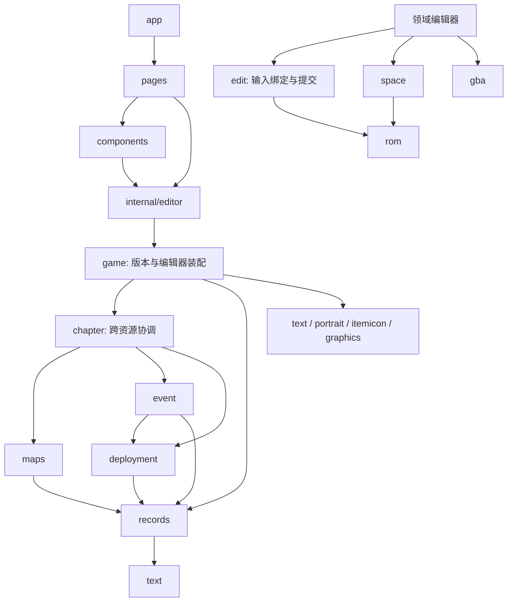

# 架构与代码导航

本文描述当前实现和所有权边界。产品范围与逐项状态分别见[重建计划](rebuild-plan.md)和[覆盖矩阵](coverage.md)，开发执行约束见 [AGENTS](../AGENTS.md)。

## 模块职责

| 模块         | 代码                                                                                                    | 职责                                                                                                 |
| ------------ | ------------------------------------------------------------------------------------------------------- | ---------------------------------------------------------------------------------------------------- |
| ROM 文档     | [rom](../rom)                                                                                           | 字节、修订、撤销重做、保存点、备份与外部修改检测。                                                   |
| 空间与引用   | [space](../space)                                                                                       | 根据明确声明的区间和引用规划写入、追加与搬迁，不自行猜测资源含义。                                   |
| GBA 编解码   | [gba](../gba)                                                                                           | 地址边界、LZ77、4bpp、BGR555 与背景图块等原生编码。                                                  |
| 错误模型     | [fault](../fault)                                                                                       | 稳定错误码、结构化上下文和原因链，不依赖 UI。                                                        |
| 版本与装配   | [game/session.go](../game/session.go)、[game/format.go](../game/format.go)、[版本配置](../game/fe8u.go) | 识别固定基线版本，组合领域编辑器。`Session` 保存这些编辑器及同一个文档入口。                         |
| 编辑有效性   | [game/edit](../game/edit)                                                                               | 绑定文档身份、修订和解析设置，冻结完整写入计划；提供原始字节编辑。                                   |
| 记录         | [game/records](../game/records)                                                                         | 表与字段、手动布局、单项及批量写入、搬迁、人物与职业规则、资源引用选择。                             |
| 文本         | [game/text](../game/text)                                                                               | 文本表、Huffman／anti-Huffman、Shift-JIS、NarrowFont、控制语言、浏览与替换计划。                     |
| 原生静态图像 | [game/portrait](../game/portrait)、[game/itemicon](../game/itemicon)                                    | 头像部件、帧与元数据，以及道具图标和共享调色板约束。                                                 |
| 图像文件流程 | [game/graphics](../game/graphics)                                                                       | 通过原生图像后端校验 PNG、组合替换预览与原子写入。                                                   |
| 部署         | [game/deployment](../game/deployment)                                                                   | 单位记录、FE8 REDA 路径、草稿与载荷编码，不扫描章节脚本。                                            |
| 事件         | [game/event](../game/event)                                                                             | 条件表、事件指令、控制流、槽与队列、FE6／FE7 手动路径、脚本草稿和写入。                              |
| 地图         | [game/maps](../game/maps)                                                                               | 底图、图块集、变化表、绘制与尺寸历史、原生 ID／坐标目标查找。                                        |
| 章节协调     | [game/chapter](../game/chapter)                                                                         | 章节表布局、资源发现、共享引用、地图变化引用审核与尺寸影响检查；为原生编辑器提供明确的外部资源输入。 |
| 页面与组件   | [pages](../internal/pages)、[components](../internal/components)                                        | 页面拥有选择、导航与草稿；组件提供复用的显示和交互。                                                 |
| 窗口编辑状态 | [internal/editor](../internal/editor)                                                                   | 当前会话、忙碌与错误状态、历史和文本焦点，由 UI 线程修改。                                           |
| 系统接口     | [app](../internal/app)                                                                                  | 窗口、文件对话框、关闭确认、菜单、外部修改检测和模拟器启动。                                         |
| 显示语言     | [locales](../internal/locales)                                                                          | MyGo catalogs、系统语言匹配、英文回退与语言偏好保存。                                                |
| 开发工具     | [ui-probe](../cmd/ui-probe)、[legacy-inventory](../cmd/legacy-inventory)                                | 原生控件试验与旧版来源索引；索引生成到 `.cache/`。                                                   |

目录层级表达领域关系，`import` 表达实际依赖，每个包独立封装。子包不访问父包私有成员，父包也不需要为子包逐项转发 API。`Session.Records`、`Session.Texts` 等字段直接提供所属包的编辑器；章节协调器与会话引用的是同一组地图、事件和部署编辑器。

文件数量不是拆包依据。记录的字段、布局、搬迁及人物／职业规则共享同一编辑模型，保留在 `records` 包内；只有具备独立含义的资源能力才形成独立包。[元数据设计](metadata-design.md)仍为已确认、暂缓实施，不为本次分层引入通用 schema 或空的未来领域包。

包名表达稳定职责：`edit` 管理提交有效性，`internal/editor` 管理窗口编辑状态；`portrait`、`itemicon` 管理原生资源，`graphics` 管理共享 PNG 流程。

文件是包内的阅读与修改单元，按具体对象、操作或工作流组织。文件名应说明内容；同包存在条件表、脚本等多个对象时，保留必要限定。同一流程的状态、操作及紧密相关的私有辅助实现放在一起，独立的读取、编码与替换规划分别归位。拆合取决于修改关系，不按文件长度或声明种类机械划分。

| 文件入口                                                                                                                                                                                         | 包内职责                                                                                           |
| ------------------------------------------------------------------------------------------------------------------------------------------------------------------------------------------------ | -------------------------------------------------------------------------------------------------- |
| [event/instructions.go](../game/event/instructions.go)、[instruction_sizes.go](../game/event/instruction_sizes.go)                                                                               | 已确认指令的字段定义，以及用于有界解码的原生指令长度。具体命令按控制、场景、单位等主题组织。       |
| [event/deployment_discovery.go](../game/event/deployment_discovery.go)                                                                                                                           | 部署发现的结果、入口读取与脚本追踪；版本布局留在 `format.go`。                                     |
| [text/table.go](../game/text/table.go)、[encode.go](../game/text/encode.go)、[replacement.go](../game/text/replacement.go)                                                                       | 文本表、编码与不可变替换计划；写入保护和计划提交与替换操作放在一起。                               |
| [maps/map_draft.go](../game/maps/map_draft.go)、[map_plan.go](../game/maps/map_plan.go)                                                                                                          | 底图绘制、尺寸调整与草稿历史，以及完整写入计划；变化表使用独立的 `changes.go`、`changes_plan.go`。 |
| [portrait/editor.go](../game/portrait/editor.go)、[record_preview.go](../game/portrait/record_preview.go)                                                                                        | 头像读取、帧与元数据编辑，以及消费人物／职业选择的预览。                                           |
| [pages/records/text.go](../internal/pages/records/text.go)、[assets.go](../internal/pages/records/assets.go)                                                                                     | 名称和描述共用的文本草稿、预览与提交，以及图像缓存、预览与编辑入口。                               |
| [pages/chapters/page.go](../internal/pages/chapters/page.go)、[deployments.go](../internal/pages/chapters/deployments.go)、[deployment_scene.go](../internal/pages/chapters/deployment_scene.go) | 页面组合、部署选择与提交，以及部署在地图上的展示和位置交互。                                       |

导入通常直接使用包名。局部变量用 `condition`、`plan`、`versionID` 等名称表达具体含义；同时引用领域 `records` 与记录页面 `records` 时，页面使用 `recordspage` 别名。

领域行为测试跟随所属包，跨资源协调测试位于 `chapter`，根 `game` 只保留会话装配等整体工作流。测试通过公开操作验证行为，共享样本构造位于 `internal/testutil`；具体归属和约束见[测试说明](../tests/README.md)。

## 依赖方向

图中展示主要依赖。`main.go` 只负责启动；领域包不依赖 MyGo，`locales` 不导入领域包。原生编辑器不接收整个 `*game.Session`，通过所属格式、编辑上下文及具体资源输入工作。

`event` 解释指令并输出类型化的地图操作数、可确认坐标和不确定性；`chapter` 再查找地图资源、关联共享章节并汇总影响。`maps` 不读取事件解释器的私有指令行，`deployment` 不反向扫描事件图。资源所有者提供已确认区域和引用，当前操作负责组合保护范围；这些事实不代表完整的全 ROM 引用证明。

## 文档与编辑操作

每个窗口拥有独立的 `rom.Document` 和 `game.Session`。`rom` 保存字节、修订、撤销历史与保存点；领域编辑器各自保存解析结果和缓存。手动表定位由 `records` 管理，并向共享的 `edit.Context` 发布解析设置；它不改写 ROM 指针，也不增加 ROM 修订。

`edit.Stamp` 是文档身份、修订和适用解析设置的绑定。解析设置恢复为相同内容时，解释身份也相同。原始字节操作只依赖文档与字节修订；解释表、图像、部署、事件或地图的操作还必须检查布局。记录编辑器只有在新布局校验成功后才同时发布表和新的绑定。

普通字段的有效数值直接进入文档；文本、批量、素材、地图、部署和事件保留草稿及不可变计划。包边界不决定事务边界：例如条件事件创建增援时，事件编码与部署编码分别由所属包完成，条件、脚本、单位载荷、指针及文件长度仍组成一个计划，通过一次 `rom.Document.ApplyEdit` 提交和撤销。失败、跨文档或过期操作不得留下部分修改。

记录负责选择头像引用、职业回退和通用小头像编号，头像编辑器消费该选择并解释原生资源。文本及图像替换消费记录提供的使用处、手动区域和保护信息；它们不从 UI 标签或显示名称推断规则。

空间管理默认末尾追加，也接受带来源的明确可用区间。引用更新核对当前值，未选定的独立引用继续使用旧资源；保留未知字节不等于可以自动搬迁未知结构。写入机制见[ROM 与空间参考](reference/rom-editing.md)。

保存基于一致快照，在同目录写临时文件后替换目标并保留备份。磁盘 I/O 不持有状态锁，保存点对应写出的快照，期间新修改仍保持未保存。外部修改在保存和窗口聚焦时检测。

错误由发现问题的包定义 `fault.Code`，跨包操作补充上下文并保留原因。错误码 ID 保持稳定；调用方不解析 `Error()` 文本。规则见[错误设计](error-design.md)。

## 界面与线程

`app` 通过 `pages` 组合界面，不直接依赖组件。`pages/workspace.go` 负责标签导航和窗口动作，各页面保留自己的筛选、选择与草稿。

`pages/records` 同包内的 `form` 实现字段表单、人物／职业详情及素材引用。记录页提供通用表导航，章节详情由 `pages/chapters.Page` 组合底图、部署、条件、路径及变化表编辑；现有章节标签和导航流程保留。独立文本、头像和脚本页通过回调跳转，不导入记录页私有实现。

`components` 保存窗口外观和通用控件，`AssetEditor` 复用 PNG 流程。`components/mapview` 接收地图预览、读取错误和交互回调，只维护位图、缩放、坐标、选择与手势；它不持有 `Session` 或读取 ROM。章节页面缓存领域预览，检查文档、修订和布局后再复用；尺寸变化清理选择和未完成手势。

组件不反向导入页面或应用层。纯数值和地址解析位于 `internal/input`。`editor.State` 只在 UI 线程修改，后台 I/O 通过 `Window.Update` 返回窗口；切换文档、改变布局或产生新修订后，旧异步结果和预览必须重新校验。

## 后续领域的接入

支持关系、商店、成长与移动规则应按自身数据和操作建立边界；记录保存关联 ID 或指针，不接管被引用内容。世界地图、动画和音频分别拥有原生资源解析与编码，章节或具体操作组合它们的共享影响。

补丁、诊断与重打包根据可确认的结构生成完整编辑计划，复用文档历史和空间规划。外部工具、CLI 与运行时调试通过领域结果和系统适配器接入，不把文件对话框、进程生命周期或平台逻辑加入领域包。新增能力按具体需求提取定义，功能状态仍只维护在覆盖矩阵。

## 专题入口

- [ROM 与空间](reference/rom-editing.md)：版本布局、固定字段、引用和搬迁。
- [文本与静态图像](reference/text-and-images.md)：编码、控制指令、PNG 和调色板。
- [章节与事件](reference/chapters-and-events.md)：地图、部署、REDA、条件和脚本。
- [人物与职业](record-editor-design.md)、[头像](portrait-editor-design.md)：页面行为、原生字段和设计理由。
- [开发说明](development.md)、[测试说明](../tests/README.md)：工具、验证方法和本地数据。
