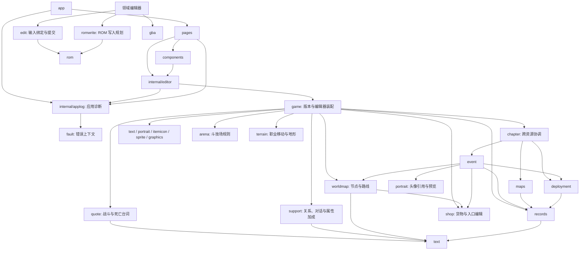
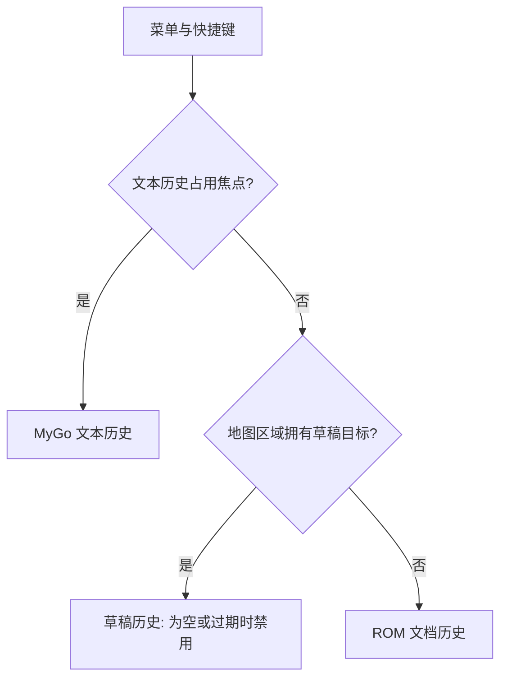

# 架构与代码导航

[约束](#约束)是实现必须遵守的规则；模块与操作章节描述当前实现，[未决问题](#未决问题)记录既有例外及决策触发条件。产品范围、功能状态和执行要求分别由[重建计划](rebuild-plan.md)、[覆盖矩阵](coverage.md)与 [AGENTS](../AGENTS.md)维护。

## 约束

### 依赖方向

图中展示主要依赖。`cmd/app/main.go` 只负责启动。下列直接导入约束由 `.golangci.yml` 的 `depguard` 随 `just lint`／`just check` 自动检查，包含子包和测试文件：

- `game`、`rom`、`romwrite`、`gba`、`fault` 不导入 MyGo 或界面层。
- `game` 的领域子包不导入 `game/version`；版本身份由组合根选择。
- `app` 只经 `pages` 根包组合界面，不导入组件或页面子包。
- 组件不反向导入页面或 app，页面不导入 app；文本、头像、脚本、商店、支援、斗技场、战斗／死亡对话及世界地图页面不直接导入记录页。
- `locales` 不导入领域包；错误到文案的映射由组件承接。
- `internal/applog` 只依赖标准库与 `fault`；`game`、`rom`、`romwrite`、`gba`、`fault`、`internal/input`、`internal/locales` 不导入它。
- `internal/input` 不导入 MyGo；该包独立承载纯数值和地址解析。

### 人工审查的设计约束

以下规则不由 depguard 证明，代码审查需结合实际调用和领域工作流验证：

- **版本事实**：生产配置中的绝对 ROM 地址（指针位置、hook、指令位置、恢复地址、补丁特征位置）只放在 `game/feXX.go`。领域包以命名值定义结构差异，例如 `support.FE7Layout()`、`chapter.FE6Layout()`、`records.FE7ClassFields()`；不以布尔值或版本 ID 选择版本，也不自行推导版本地址。页面通过领域 Format 的能力字段读取规则，如 `quote` 的 `BattleConditions`／`SilentDeath`。depguard 只覆盖上节的 `game/version` 导入限制，不检查地址或布局的放置。既有字面量例外见[未决问题](#未决问题)。
- **资源声明**：`romwrite.Claim` 表示带所有者（Owner）的字节区间，Host 表示容纳指针站点的宿主记录。指针写入与声明重叠时，只允许写入者自己的站点声明或其宿主记录，由 `romwrite.CheckPointerWrite` 执行；原地载荷写入由 `romwrite.CheckRangeWrite` 检查整段区间，只允许自己的声明及自己容纳的指针站点，其余均冲突。各领域声明自己的已确认资源，会话汇总；新增领域提供 Claims 来源，不给其他领域增加成对排除分支。实现审查检查来源是否齐全，领域流程检查冲突和失败原子性；已有声明不等于完整的全 ROM 引用证明。
- **包与资源边界**：子包不访问父包私有成员，父包不为子包逐项转发 API。原生编辑器接收所属格式、编辑上下文及具体资源输入，不接收整个 `*game.Session`。拆包依据是独立领域含义，不是文件数量。
- **状态与事务**：线程、异步结果、不可变计划及原子提交遵循 [AGENTS 的实现边界](../AGENTS.md#实现边界)；验证范围见 [AGENTS 的命令与验证](../AGENTS.md#命令与验证)。导入检查不能证明这些行为。

## 模块职责

| 模块           | 代码                                                            | 职责                                                                                                               |
| -------------- | --------------------------------------------------------------- | ------------------------------------------------------------------------------------------------------------------ |
| ROM 文档       | `rom`                                                           | 字节、修订、撤销重做、保存点、备份与外部修改检测。                                                                 |
| ROM 写入规划   | `romwrite`                                                      | 根据明确声明的区间和引用规划写入、追加与搬迁；资源声明（Claim）的归属与字节写入检查，不猜测资源含义。              |
| GBA 编解码     | `gba`                                                           | 地址边界、LZ77、4bpp、BGR555 与背景图块等原生编码。                                                                |
| 错误模型       | `fault`                                                         | 稳定错误码、结构化上下文和原因链，不依赖 UI。                                                                      |
| 版本与装配     | `game/session.go`、`game/format.go`、版本配置（`game/fe8u.go`） | 识别固定基线版本，组合领域编辑器。`Session` 保存这些编辑器及同一个文档入口。                                       |
| 编辑有效性     | `game/edit`                                                     | 绑定文档身份、修订和解析设置，冻结完整写入计划；提供原始字节编辑。                                                 |
| 记录           | `game/records`                                                  | 表与字段、手动布局、单项及批量写入、搬迁、人物与职业规则、资源引用选择。                                           |
| 文本           | `game/text`                                                     | 文本表、Huffman／anti-Huffman、Shift-JIS、NarrowFont、控制语言、浏览与替换计划。                                   |
| 原生静态图像   | `game/portrait`、`game/itemicon`、`game/sprite`                 | 头像部件、帧与元数据，道具图标和共享调色板约束，以及只读待机首帧、武器类别与属性图标。                             |
| 图像文件流程   | `game/graphics`                                                 | 通过原生图像后端校验 PNG、组合替换预览与原子写入。                                                                 |
| 部署           | `game/deployment`                                               | 单位记录、FE8 REDA 路径、草稿与载荷编码，不扫描章节脚本。                                                          |
| 商店货物       | `game/shop`                                                     | 两字节货物、已确认入口与共享用途；准备／默认／世界地图的独立写入计划，章节提交由事件操作协调。                     |
| 职业地形       | `game/terrain`                                                  | 原生移动消耗与加成列、草稿和按列独立追加计划；当前职业入口由会话提供。                                             |
| 支援           | `game/support`                                                  | 人物关系、反向同步、现有支援对话、全局属性加成及原子写入；人物入口由会话提供。                                     |
| 斗技场规则     | `game/arena`                                                    | 原生职业抽取列表、基础／升级武器和 FE8 联机名单；独立草稿、消费者与原子写入。                                      |
| 战斗与死亡对话 | `game/quote`                                                    | 原生台词表、已知消费者、文本使用处、记录草稿及整表追加计划；保留独立引用与未知字节。                               |
| 事件           | `game/event`                                                    | 条件表、事件指令、控制流、槽与队列、FE6／FE7 手动路径、FE6 章节 PLIST／FE7／FE8 独立世界地图入口、脚本草稿和写入。 |
| 地图           | `game/maps`                                                     | 底图、图块集、变化表、绘制与尺寸历史、原生 ID／坐标目标查找。                                                      |
| 章节协调       | `game/chapter`                                                  | 章节表布局、资源发现、共享引用、地图变化引用审核与尺寸影响检查；为原生编辑器提供明确的外部资源输入。               |
| 世界地图       | `game/worldmap`                                                 | 原生节点、路线、移动控制点和道路草稿、独立追加与原子写入；底图／道路预览及所属资源声明。                           |
| 页面与组件     | `internal/pages`、`internal/components`                         | 页面拥有选择、导航与草稿；组件提供复用的显示和交互。                                                               |
| 窗口编辑状态   | `internal/editor`                                               | 当前会话、忙碌与错误状态、历史命令目标、按构建的历史声明和文本焦点，由 UI 线程修改。                               |
| 应用诊断       | `internal/applog`                                               | `slog` 多路输出、有界 JSONL 轮转、并发安全的近期日志快照与错误分级。                                               |
| 系统接口       | `internal/app`                                                  | 窗口、文件对话框、关闭确认、菜单、外部修改检测和模拟器启动。                                                       |
| 显示语言       | `internal/locales`                                              | MyGo catalogs、系统语言匹配、英文回退与语言偏好保存。                                                              |
| 开发工具       | `cmd/ui-probe`、`cmd/legacy-inventory`                          | 原生控件试验与旧版来源索引；索引生成到 `.cache/`。                                                                 |

`Session.Records`、`Session.Texts` 等字段直接提供所属编辑器；会话与章节协调器共享同一组地图、事件和部署实例。记录模型留在 `records`，独立资源归所属领域。`edit` 管理提交有效性，`internal/editor` 管理窗口状态。元数据提取见[接入条件](metadata-design.md#何时实施与如何接入)。

领域工作流测试跟随所属包，跨资源协调测试放在 `chapter`，根 `game` 验证会话装配；共享样本与证据解释见[测试说明](../tests/README.md)。

## 文档与编辑操作

### 输入与提交

每个窗口拥有独立的 `rom.Document` 和 `game.Session`。文档管理字节、修订、撤销历史与保存点，领域编辑器管理解析和缓存。`records` 向共享 `edit.Context` 发布经校验的手动布局；该设置只改变解释，不改 ROM 指针或文档修订。

`Capture()` 将只读快照与同次捕获的 `edit.Stamp` 组成 `edit.Input`。stamp 绑定文档、修订与适用解析设置；草稿保留原始 stamp，重新捕获不能延长旧草稿寿命。恢复相同设置会恢复相同解释身份。仅原始字节操作可用 `CaptureBytes()` 忽略布局；表、图像、部署、事件和地图仍须校验解释设置。

写入经过两层计划：

1. `romwrite.Builder` 在同一快照上组合分配、编码、原地覆盖和引用修改。`AppendEncoded`／`ReplaceEncoded` 在分配位置确定后调用领域编码器；`PointerSite` 携带所有者和完整 `ExpectedWord`，`Repoint` 接收文件偏移，清零另用 `ClearPointer`。`Protection` 提供指针和区间检查，缺少对应检查时拒绝写入已有字节。每项先检查引用、归属、边界和交叠，成功后才加入计划；失败不消耗空间或改变已累积操作。
2. `Builder.Plan()` 返回尚未绑定文档的 `romwrite.WritePlan`。`edit.NewCommit` 再冻结原始 stamp、历史标签和写入，`Commit.Apply` 核对来源后交给 `rom.Document.ApplyEdit` 一次提交。领域 `Plan` 同时保留这份提交和影响信息。

默认分配在末尾追加，也接受带来源的明确可用区间。`Builder.Relocate` 处理源范围与内部偏移引用；源区在同一构建器内不可写，复用已有区间仍检查保护。旧载荷及未选定的独立引用保留。具体机制与示例见[ROM 与空间参考](reference/rom-editing.md#空间分配与表搬迁)和 `romwrite/doc.go`。

### 资源保护

`game/claims.go` 按 stamp 汇总各领域声明，并核对传入字节与缓存输入一致；旧快照和预演字节不能发布成当前缓存。领域拥有 Claims 来源，会话只组合，不建立逐对领域排除规则。声明的允许交叠和写入判定见[资源声明约束](#人工审查的设计约束)。

章节头、条件表、脚本、地点载荷和部署组分开声明，所有者以确认的原生位置识别。共享事件头得到相同声明；已确认代码使用 `event.ScriptCodeOwner`，共享入口与内部入口可编辑同一段代码。指针站点保留独立所有者，指令内调用及部署操作数以代码为宿主。脚本参数修改检查整段代码与全部会话声明，仅写变化指令。

### 保存

保存基于一致快照，在同目录写临时文件后替换目标并保留备份。磁盘 I/O 不持有状态锁，保存点对应实际写出的快照。未保存标记依据当前字节及长度与保存点的差异，编辑、撤销和重做按影响范围更新差异计数；手动改回保存内容会清除标记，但保留历史，修订号仍单调递增。保存期间继续编辑时，成功发布保存点后重新核对当前内容的差异。保存与窗口聚焦时检测外部修改。

## 领域协作

`game/*_sources.go` 连接当前记录布局、资源校验和外部声明；领域编辑器接收具体输入，跨资源操作在计划层组合。下表列出需要共同理解的边界，字段与格式细节由专题参考维护。

| 领域             | 协作边界                                                                                                                                                                                                                                                                                                              | 参考                                                                                |
| ---------------- | --------------------------------------------------------------------------------------------------------------------------------------------------------------------------------------------------------------------------------------------------------------------------------------------------------------------- | ----------------------------------------------------------------------------------- |
| 章节、条件与脚本 | `event` 解释指令，输出类型化资源、坐标与不确定性；`chapter` 查找地图并汇总共享及尺寸影响。地点通过 `OperandKind` 区分脚本、奖励、商店等，只有确认脚本进入调用图。`maps` 不读解释器私有行，`deployment` 不反向扫描事件图。`event.Layout` 组合版本指令集与有界解码规则，运行时不按版本身份分派。                        | [章节与事件](reference/chapters-and-events.md)                                      |
| 增援与章节商店   | 条件草稿持有独立部署或 `shop.Draft`；条件表、脚本、单位／货物、指针和长度组成一次计划。独立商店的 `EntryDraft`／`EntryPlan` 绑定具体入口，只重定向选定引用。                                                                                                                                                          | [条件、商店与写入](reference/chapters-and-events.md#五版回合增援)                   |
| 地图布局与素材   | 布局、图块定义、配色和图像分别拥有草稿及计划。`PreviewWithTileset` 只组合同一输入和章节的布局／定义预览，不合并历史。PNG 图像联合配色在同一个计划内组合变化资源，分别发现共享用途；无关资源损坏不遮蔽可确认的独立操作。                                                                                               | [地图资源](reference/chapters-and-events.md#五版章节地图)                           |
| 世界地图         | `worldmap` 拥有节点、路线、轨迹、道路及图像；节点与商店独立提交，路线端点原地写入，变化的轨迹／道路一起追加。节点宿主及商店指针声明属于 `worldmap.Format.Claims`。`event` 持有各版演出入口和指令；FE6 使用章节 PLIST，FE7／FE8 使用独立目录。关联章节不充当演出的战场上下文；头像操作数通过 `Source.Portraits` 验证。 | [世界地图](reference/worldmap.md)                                                   |
| 地形             | 当前职业布局决定移动与加成列；变化列分别追加，只更新所选职业入口，保护原表及重叠引用。页面数值属于草稿，不直接写 ROM。                                                                                                                                                                                                | [职业地形](reference/terrain.md)                                                    |
| 支援             | 人物关系、已有反向数值同步、对话和属性加成各有草稿；对话与加成无需人物关系可读。回想、存档统计等确认消费者随所属计划更新，跨页导航由组合层连接。                                                                                                                                                                      | [支援](reference/supports.md)                                                       |
| 斗技场           | 职业组与联机组独立；基础武器和升级表共用草稿，确认的武器消费者一致并一起更新。会话提供职业层级和有效引用，页面不从名称判断规则。                                                                                                                                                                                      | [斗技场](reference/arena.md)                                                        |
| 战斗与死亡对话   | `quote.Format` 表达命名布局、终止规则和能力。检测、播放、终章入口属于同表消费者，一起更新；共享地址的其他独立表保留。脚本首部声明只提供最小保护，不建立全局执行图。                                                                                                                                                   | [对话](reference/battle-and-defeat-dialogue.md)                                     |
| 记录与静态图像   | `records.Format` 声明道具预设、效果与独立特性；页面只消费定义副本。记录负责头像引用及职业回退，资源包负责解码。`itemicon.Reader` 提供带 stamp 的图标表，记录按有效布局发现使用处：道具 0 是无道具哨兵，图标 0 有效；其他记录不按名称过滤。PNG 使用同一引用规则，由 `graphics` 组合计划。                              | [记录](reference/rom-editing.md#道具字段预设)、[图像](reference/text-and-images.md) |
| 文本文件         | `text.File` 捕获不可变输入供后台解析与预编码；`ImportPlan` 在 UI 线程确认当前用途及保护，与单条替换共用计划机制。批量载荷和指针先在一份预演字节中读回，再冻结提交。                                                                                                                                                   | [文本文件](reference/text-and-images.md#文本文件)                                   |

## 界面与线程

### 窗口与页面

`pages/workspace.go` 管理导航、窗口缩放与动作，各页拥有自己的选择、输入和草稿。章节配置字段仍由 `pages/records` 表单持有，通过渲染回调进入章节工作区；死亡对话实例由工作区按人物持有，嵌入人物详情。独立领域页以回调导航，不导入记录页私有实现。

记录页的 `Page.Footer` 通过工作区进入已有 `StatusBar` 的渲染槽，组件不依赖页面。定位输入与搬迁审核分别绑定来源；前者改变解释，后者消费领域搬迁计划。操作步骤见[定位与搬迁](user-guide.md#高级操作)。

主区及嵌套标签以 `Grow(1)` 使用相邻栏之间的剩余高度，滚动容器在此边界内增长。`Context.SetZoom` 统一缩放布局与输入，地图只换算自身倍率。`Sidebar` 分开保留用户首选宽度与当前显示宽度，在窄窗口让出编辑空间。字号层级由 `components/typography.go` 集中维护。

跨构建保留页面数据、控件状态、`ui.Handle` 和可复用 Bitmap，不保留构建期 Context 或 Element。字段、列表和路径使用稳定身份；重排、错误提示或展开状态不应替换其输入身份。

| 共享组件                             | 所有状态与边界                                                                                                   |
| ------------------------------------ | ---------------------------------------------------------------------------------------------------------------- |
| `NumberCells`、`TextDraft`、引用控件 | 管理未确认输入、确认／取消、焦点与显示。页面提供稳定键、范围、可编辑条件和领域写回，负责实际引用修改及计划失效。 |
| `AssetEditor`、`Thumbnails`          | 复用 PNG 审核与图像显示；缓存绑定来源，图像规则和用途由领域返回。                                                |
| `mapview`                            | 消费领域预览、错误与回调，保留位图、倍率、坐标、选择和未完成手势；不持有会话或读取 ROM。笔画完成后交给领域草稿。 |
| `shopview`                           | 共享货物列表、道具选择和补丁参数，消费所属草稿的可编辑状态及预览失效回调，不负责入口写入。                       |
| `actions.go`、`reference.go`         | 提供图标动作、开关、工具选择和资源打开入口，保留完整提示、可访问名称及键盘行为；页面负责解析目标和导航。         |

### 后台文件操作

`app/resource_png.go`、`tileset_config.go`、`text_file.go` 在后台处理不可变领域输入，系统对话框及 I/O 留在 app；共享 `resource_file.go` 检查读取上限、导出路径及已打开 ROM 的覆盖。

结果经 `Window.Update` 回到 UI 线程，再核对会话、stamp、资源身份与页面／导航代次，错误和迟到回调不能覆盖当前输入。文件审核与原手动草稿分离，取消返回原输入；文本批量应用只清理实际修改 ID 的本页草稿。页面停用、重置、重新选择或新导入使旧回调失效。

### 撤销路由

`editor.State.History` 是菜单和快捷键的共同入口。每次构建先清空 `HistoryClaim` 与 `DraftHistory`；焦点控件显式声明文本或文档历史：`TextDraft` 使用文本历史，`DocumentField` 使用 ROM 历史，外层文本草稿可覆盖内层声明。没有声明时，构建后使用 MyGo 的 `FocusTakesText`。

页面与弹层构建完后，工作区调用 `ResolveHistoryFocus` 一次求值，`State.History`、`Workspace.UsesTextHistory`、菜单和根快捷键读同一结果。地图区按稳定 Handle 注册草稿回调，只捕获草稿和页面数据。空或过期草稿仍占有历史目标；执行时再次检查新鲜度，过期禁用导致失焦时保留目标，直到进入其他区域。

macOS 系统菜单跟随焦点窗口；Linux／Windows 的常驻窗口菜单各读所属工作区。构建引发的菜单变化经 `Window.Update` 延后刷新，避免 GTK 绘制中替换原生菜单。原生对话框输入仍由系统处理；忙碌期间阻止文档和领域草稿操作。

纯数值和地址解析留在 `internal/input`。线程规则及 UI 复核范围分别见 [AGENTS](../AGENTS.md#实现边界)和[开发说明](development.md#原生界面复核)。

## 应用诊断

`internal/applog.Sink` 持有 `slog.Logger`、日志目录和并发安全的近期 `RingBuffer`。`app.Run` 安装 logger，退出时先等待开发路径记录，再记录致命错误并关闭文件；`cmd/app/main.go` 按返回值设置退出码。文本 stderr、轮转 JSONL 与内存并行接收；文件失败直接向其余输出发警告，避免递归调用失败 Handler。配置与保留策略见[开发说明](development.md#日志与诊断)。

`Entry.Sequence` 在接收锁内递增，缓冲淘汰不复用身份；快照隔离属性，`Entry.JSON()` 使用标准 `slog.JSONHandler`，与磁盘格式一致，内存序号不写入文件。`app/log_viewer.go` 管理一个独立于 ROM 窗口及开发恢复的日志窗口，`pages.LogViewer` 在 UI 线程检查序号并读取快照。筛选、暂停、所选副本和清空界限属于查看器，不改变采集与文件。操作见[应用日志](user-guide.md#应用日志)。

领域核心只返回结果和 `fault.Error`。`State.SetErr` 更新横幅并记录，`State.Report` 保留页面局部提示位置，两者按错误码和诊断文本去重。`State.Edit` 仅在提交成功且修订变化时记录 `apply`，同一状态入口记录文档 `undo`／`redo`，草稿历史与空写入不产生日志。文件回传使用显式操作名记录后再交页面，避免重复；外部修改只记录状态转变。错误分级、字段与上下文见[错误设计](error-design.md#日志采集)。

## 未决问题

`records.Rule` 的 Stride／Count／Probe 与 `quote.Rule` 的终止规则仍以字面量留在 `game/feXX.go`；尚未决定是否将这些结构参数提取为领域命名布局，仅在版本文件保留地址与布局选择。这是[版本事实约束](#人工审查的设计约束)的既有例外，不是新增版本分派的许可。

当新增或修改表结构导致多个版本重复维护同一组参数，或需要独立组合、验证结构规则时，在该功能的设计审查中决定是否拆分，并同步更新本节。仅增加 FE7J 的表指针时，把地址放在 `game/fe7j.go` 并复用适用布局，不触发通用框架重构。

## 后续领域的接入

成长与其他移动规则应按自身数据和操作建立边界；记录保存关联 ID 或指针，不接管被引用内容。世界地图、动画和音频分别拥有原生资源解析与编码，章节或具体操作组合它们的共享影响。

补丁、诊断与重打包根据可确认的结构生成完整编辑计划，复用文档历史和空间规划。外部工具、CLI 与运行时调试通过领域结果和系统适配器接入，不把文件对话框、进程生命周期或平台逻辑加入领域包。新增能力按具体需求提取定义，功能状态仍只维护在覆盖矩阵。
