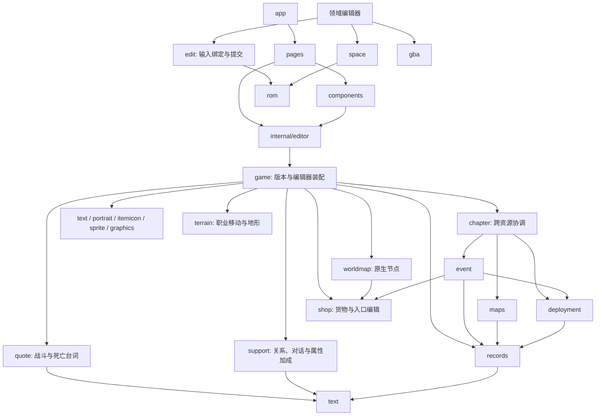
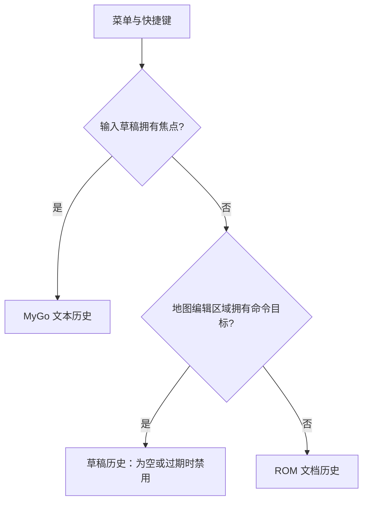

# 架构与代码导航

本文的模块与操作章节描述当前实现；[约束](#约束)是实现必须遵守的设计规则，不能随实现偏差改写；[未决问题](#未决问题)记录尚未选定的设计及决策触发条件。产品范围与逐项状态分别见[重建计划](rebuild-plan.md)和[覆盖矩阵](coverage.md)，开发执行约束见 [AGENTS](../AGENTS.md)。

## 模块职责

| 模块           | 代码                                                            | 职责                                                                                                  |
| -------------- | --------------------------------------------------------------- | ----------------------------------------------------------------------------------------------------- |
| ROM 文档       | `rom`                                                           | 字节、修订、撤销重做、保存点、备份与外部修改检测。                                                    |
| 空间与引用     | `space`                                                         | 根据明确声明的区间和引用规划写入、追加与搬迁；资源声明（Claim）的归属与指针写入检查，不猜测资源含义。 |
| GBA 编解码     | `gba`                                                           | 地址边界、LZ77、4bpp、BGR555 与背景图块等原生编码。                                                   |
| 错误模型       | `fault`                                                         | 稳定错误码、结构化上下文和原因链，不依赖 UI。                                                         |
| 版本与装配     | `game/session.go`、`game/format.go`、版本配置（`game/fe8u.go`） | 识别固定基线版本，组合领域编辑器。`Session` 保存这些编辑器及同一个文档入口。                          |
| 编辑有效性     | `game/edit`                                                     | 绑定文档身份、修订和解析设置，冻结完整写入计划；提供原始字节编辑。                                    |
| 记录           | `game/records`                                                  | 表与字段、手动布局、单项及批量写入、搬迁、人物与职业规则、资源引用选择。                              |
| 文本           | `game/text`                                                     | 文本表、Huffman／anti-Huffman、Shift-JIS、NarrowFont、控制语言、浏览与替换计划。                      |
| 原生静态图像   | `game/portrait`、`game/itemicon`、`game/sprite`                 | 头像部件、帧与元数据，道具图标和共享调色板约束，以及只读待机首帧与武器类别图标。                      |
| 图像文件流程   | `game/graphics`                                                 | 通过原生图像后端校验 PNG、组合替换预览与原子写入。                                                    |
| 部署           | `game/deployment`                                               | 单位记录、FE8 REDA 路径、草稿与载荷编码，不扫描章节脚本。                                             |
| 商店货物       | `game/shop`                                                     | 两字节货物、已确认入口与共享用途；准备／默认／世界地图的独立写入计划，章节提交由事件操作协调。        |
| 职业地形       | `game/terrain`                                                  | 原生移动消耗与加成列、草稿和按列独立追加计划；当前职业入口由会话提供。                                |
| 支援           | `game/support`                                                  | 人物关系、反向同步、现有支援对话、全局属性加成及原子写入；人物入口由会话提供。                        |
| 战斗与死亡对话 | `game/quote`                                                    | 原生台词表、已知消费者、文本使用处、记录草稿及整表追加计划；保留独立引用与未知字节。                  |
| 事件           | `game/event`                                                    | 条件表、事件指令、控制流、槽与队列、FE6／FE7 手动路径、脚本草稿和写入。                               |
| 地图           | `game/maps`                                                     | 底图、图块集、变化表、绘制与尺寸历史、原生 ID／坐标目标查找。                                         |
| 章节协调       | `game/chapter`                                                  | 章节表布局、资源发现、共享引用、地图变化引用审核与尺寸影响检查；为原生编辑器提供明确的外部资源输入。  |
| 世界地图节点   | `game/worldmap`                                                 | 原生节点、地名与三个货物指针的只读解释及资源保护范围。                                                |
| 页面与组件     | `internal/pages`、`internal/components`                         | 页面拥有选择、导航与草稿；组件提供复用的显示和交互。                                                  |
| 窗口编辑状态   | `internal/editor`                                               | 当前会话、忙碌与错误状态、历史命令目标和文本焦点，由 UI 线程修改。                                    |
| 系统接口       | `internal/app`                                                  | 窗口、文件对话框、关闭确认、菜单、外部修改检测和模拟器启动。                                          |
| 显示语言       | `internal/locales`                                              | MyGo catalogs、系统语言匹配、英文回退与语言偏好保存。                                                 |
| 开发工具       | `cmd/ui-probe`、`cmd/legacy-inventory`                          | 原生控件试验与旧版来源索引；索引生成到 `.cache/`。                                                    |

`Session.Records`、`Session.Texts` 等字段直接提供所属包的编辑器；章节协调器与会话引用的是同一组地图、事件和部署编辑器。

记录的字段、布局、搬迁及人物／职业规则共享同一编辑模型，位于 `records` 包内；独立资源由各自领域包承接。[元数据设计](metadata-design.md)的接入触发条件见 [AGENTS](../AGENTS.md#开始修改)。

包名表达稳定职责：`edit` 管理提交有效性，`internal/editor` 管理窗口编辑状态；`portrait`、`itemicon` 管理原生资源，`graphics` 管理共享 PNG 流程。

文件组织和命名遵循 [AGENTS](../AGENTS.md#实现边界)。以下是当前主要阅读入口。

| 文件入口                                                                                                                   | 包内职责                                                                                           |
| -------------------------------------------------------------------------------------------------------------------------- | -------------------------------------------------------------------------------------------------- |
| `game/event/instructions.go`、`game/event/instruction_sizes.go`                                                            | 已确认指令的字段定义，以及用于有界解码的原生指令长度。具体命令按控制、场景、单位等主题组织。       |
| `game/event/deployment_discovery.go`                                                                                       | 部署发现的结果、入口读取与脚本追踪；版本布局留在 `format.go`。                                     |
| `game/text/table.go`、`game/text/encode.go`、`game/text/replacement.go`                                                    | 文本表、编码与不可变替换计划；写入保护和计划提交与替换操作放在一起。                               |
| `game/maps/map_draft.go`、`game/maps/map_plan.go`                                                                          | 底图绘制、尺寸调整与草稿历史，以及完整写入计划；变化表使用独立的 `changes.go`、`changes_plan.go`。 |
| `game/portrait/editor.go`、`game/portrait/record_preview.go`                                                               | 头像读取、帧与元数据编辑，以及消费人物／职业选择的预览。                                           |
| `internal/pages/records/text.go`、`internal/pages/records/assets.go`                                                       | 名称和描述共用的文本草稿、预览与提交，以及图像缓存、预览与编辑入口。                               |
| `internal/pages/chapters/page.go`、`internal/pages/chapters/deployments.go`、`internal/pages/chapters/deployment_scene.go` | 页面组合、部署选择与提交，以及部署在地图上的展示和位置交互。                                       |

导入命名见 [AGENTS](../AGENTS.md#实现边界)；例如同时引用领域 `records` 与记录页面 `records` 时，页面使用 `recordspage` 别名。

领域行为测试跟随所属包，跨资源协调测试位于 `chapter`，根 `game` 只保留会话装配等整体工作流。测试通过公开操作验证行为，共享样本构造位于 `internal/testutil`；具体归属和约束见[测试说明](../tests/README.md)。

## 约束

### 依赖方向

图中展示主要依赖。`main.go` 只负责启动。下列直接导入约束由 `.golangci.yml` 的 `depguard` 随 `just lint`／`just check` 自动检查，包含子包和测试文件：

- `game`、`rom`、`space`、`gba`、`fault` 不导入 MyGo 或界面层。
- `game` 的领域子包不导入 `game/version`；版本身份由组合根选择。
- `app` 只经 `pages` 根包组合界面，不导入组件或页面子包。
- 组件不反向导入页面或 app，页面不导入 app；文本、头像、脚本、商店、支援及战斗／死亡对话页面不直接导入记录页。
- `locales` 不导入领域包；错误到文案的映射由组件承接。
- `internal/input` 不导入 MyGo；该包独立承载纯数值和地址解析。

### 人工审查的设计约束

以下规则不由 depguard 证明，代码审查需结合实际调用和领域工作流验证：

- **版本事实**：生产配置中的绝对 ROM 地址（指针位置、hook、指令位置、恢复地址、补丁特征位置）只放在 `game/feXX.go`。领域包以命名值定义结构差异，例如 `support.FE7Layout()`、`chapter.FE6Layout()`、`records.FE7ClassFields()`；不以布尔值或版本 ID 选择版本，也不自行推导版本地址。页面通过领域 Format 的能力字段读取规则，如 `quote` 的 `BattleConditions`／`SilentDeath`。depguard 只覆盖上节的 `game/version` 导入限制，不检查地址或布局的放置。既有字面量例外见[未决问题](#未决问题)。
- **资源声明**：`space.Claim` 表示带所有者（Owner）的字节区间，Host 表示容纳指针站点的宿主记录。指针写入与声明重叠时，只允许写入者自己的站点声明或其宿主记录，其余均冲突；由 `space.CheckWrite` 执行。各领域声明自己的已确认资源，会话汇总；新增领域提供 Claims 来源，不给其他领域增加成对排除分支。实现审查检查来源是否齐全，领域流程检查冲突和失败原子性；已有声明不等于完整的全 ROM 引用证明。
- **包与资源边界**：子包不访问父包私有成员，父包不为子包逐项转发 API。原生编辑器接收所属格式、编辑上下文及具体资源输入，不接收整个 `*game.Session`。拆包依据是独立领域含义，不是文件数量。
- **状态与事务**：线程、异步结果、不可变计划及原子提交遵循 [AGENTS 的实现边界](../AGENTS.md#实现边界)；验证范围见 [AGENTS 的命令与验证](../AGENTS.md#命令与验证)。导入检查不能证明这些行为。

## 领域协作

`event` 解释指令并输出类型化的地图操作数、可确认坐标和不确定性；`chapter` 再查找地图资源、关联共享章节并汇总影响。`maps` 不读取事件解释器的私有指令行，`deployment` 不反向扫描事件图。地点条件通过 `Condition.OperandKind` 区分脚本、直接奖励、商店和随机奖励等目标；`event` 只把确认的脚本引用加入脚本图，`chapter` 消费地点坐标生成地图尺寸影响。资源所有者提供已确认区域和引用，当前操作负责组合保护范围；这些事实不代表完整的全 ROM 引用证明。

## 文档与编辑操作

每个窗口拥有独立的 `rom.Document` 和 `game.Session`。`rom` 保存字节、修订、撤销历史与保存点；领域编辑器各自保存解析结果和缓存。手动表定位由 `records` 管理，并向共享的 `edit.Context` 发布解析设置；它不改写 ROM 指针，也不增加 ROM 修订。

`edit.Stamp` 是文档身份、修订和适用解析设置的绑定。解析设置恢复为相同内容时，解释身份也相同。原始字节操作只依赖文档与字节修订；解释表、图像、部署、事件或地图的操作还必须检查布局。记录编辑器只有在新布局校验成功后才同时发布表和新的绑定。

普通字段的有效数值直接进入文档；文本、批量、素材、地图、部署和事件保留草稿及不可变计划。包边界不决定事务边界：例如条件事件创建增援时，事件编码与部署编码分别由所属包完成，条件、脚本、单位载荷、指针及文件长度仍组成一个计划，通过一次 `rom.Document.ApplyEdit` 提交和撤销。章节商店同样由条件草稿持有独立的 `shop.Draft`，组合货物载荷和完整地点表，只更新选定地点引用；货物包不读取章节或持有窗口状态。独立商店使用 `shop.EntryDraft`／`shop.EntryPlan` 绑定所选入口、载荷和文件长度；`game/shop_sources.go` 按版本组合章节、默认、准备和节点引用，并保护其他已确认资源。`worldmap` 只解释原生节点，未承接整张世界地图编辑。失败、跨文档或过期操作不得留下部分修改。

`terrain` 按当前职业记录读取移动与加成列，`game/terrain_sources.go` 提供自动／手动布局与资源保护。每个改动列独立追加，仅更新所属指针；共用或部分重叠的原载荷保持不变。`pages/records` 的职业标签消费领域草稿和计划，数值输入不直接写入 ROM。格式见[地形参考](reference/terrain.md)。

`support` 按当前人物指针解释关系，`game/support_sources.go` 提供有效人物布局、文本校验及外部资源保护。人物关系与可选的已有反向数值同步在 `pages/records` 的人物标签编辑；`pages/supports` 独立浏览对话表，使用 `TalkDraft`／`PlanTalks`，无需人物关系可读。两类草稿各自预览、应用，并复用同一领域写入计划；对话消费者包含回想和存档统计入口，表序及未知字节保留。人物、对话与文本通过回调导航；人物页按人物保留关系输入，对话页按原生条目保留文本输入，非法及过期输入都需明确丢弃。全局属性加成由同包的 `BonusDraft`／`BonusPlan` 管理，`pages/supports` 在独立标签内编辑六列原生值；关系、对话和加成各有草稿。加成计划按当前人物布局列出首个匹配项的已知使用处；人物表不可读时报告不完整，有效全局表仍可独立操作。格式见[支援参考](reference/supports.md)。

`quote` 表示战斗与死亡台词领域。`game/quote/format.go` 声明表结构、终止规则及命名能力字段，`editor.go` 绑定草稿与不可变追加计划。检测、播放及终章消费者属于同一原生表的入口，一起更新；共享地址的其他独立表保持原引用。会话通过 `game/quote_sources.go` 提供文本验证与资源保护；没有通用元数据框架。声明的脚本首部只提供最小保护范围，不建立全局脚本执行图。

会话级资源声明由 `game/claims.go` 按 stamp 缓存汇总，涵盖记录表、文本、图像根、商店、支援、地形与章节事件资源。章节内资源以原生位置为所有者身份，共享同一事件头的章节产生相同声明。脚本正文不声明区间，其指针站点（条件操作数、开头／结尾、部署组）单独声明；写入判定遵循[资源声明约束](#人工审查的设计约束)。

`event.Layout` 选择条件记录、地点命令及不可变指令集。指令集分别组合 FE6、FE7J/U、FE8 的编码定义，运行时不再按版本身份分派。字段宽度、条件步长、间接操作数范围由布局表达；字长表和长度前缀各有解码实现。已知指令的编辑字段同时提供资源发现信息，未开放编辑的指令仍保留已确认长度及控制流规则；槽状态追踪与坐标回退作为明确能力保留。

记录负责选择头像引用、职业回退和通用小头像编号，头像编辑器消费该选择并解释原生资源。文本及图像替换消费记录提供的使用处、手动区域和保护信息；它们不从 UI 标签或显示名称推断规则。

空间管理默认末尾追加，也接受带来源的明确可用区间。引用更新核对当前值，未选定的独立引用继续使用旧资源；保留未知字节不等于可以自动搬迁未知结构。写入机制见[ROM 与空间参考](reference/rom-editing.md)。

保存基于一致快照，在同目录写临时文件后替换目标并保留备份。磁盘 I/O 不持有状态锁，保存点对应写出的快照，期间新修改仍保持未保存。外部修改在保存和窗口聚焦时检测。

错误由发现问题的包定义 `fault.Code`，跨包操作补充上下文并保留原因。错误码 ID 保持稳定；调用方不解析 `Error()` 文本。规则见[错误设计](error-design.md)。

## 界面与线程

`app` 通过 `pages` 组合界面，不直接依赖组件。`pages/workspace.go` 负责标签导航、窗口缩放和窗口动作，各页面保留自己的筛选、选择与草稿。窗口缩放通过 `Context.SetZoom` 作用于布局和输入坐标；`mapview` 仍只按自己的地图倍率换算格子，不再次乘窗口倍率。共享 `components.Sidebar` 分开保存用户首选宽度和当前显示宽度，在逻辑窗口变窄时为编辑区留出空间。

`pages/records` 同包内的 `form` 实现字段表单、人物／职业详情及素材引用。记录页提供通用表导航，章节详情由 `pages/chapters.Page` 组合底图、部署、条件、路径及变化表编辑；现有章节标签和导航流程保留。独立文本、头像、脚本、商店及战斗对话页通过回调跳转，不导入记录页私有实现。`Workspace` 按人物持有死亡对话页实例，通过渲染回调嵌入人物详情，分别保存人物／表草稿并按修订失效；文本使用处由组合层返回对应人物标签。共享 `components.Thumbnails` 消费头像和 `sprite` 领域预览，缓存可重用的 Bitmap 及来源 stamp，不保存构建期元素。`pages/shops` 的章节库存仍交给事件计划提交，准备、默认和节点库存交给商店编辑器提交；不同页面草稿互相通过文档修订失效。

`pages/quotes` 的独立战斗面板和嵌入人物详情的死亡表单复用字段、文本阅读和计划操作；FE8 筛选消费 `quote.BattleCondition`，保持共表草稿，正文阅读消费 `text.Value.Plain`。页面按原生表持有独立草稿，用稳定记录 ID 保存输入和排序后的选择；无效输入阻止预览，文档或布局变化使旧计划失效。人物、章节和文本链接通过页面组合回调导航；文本使用处包含对话表并可返回对应记录。脚本引用只关联地址和原始字节，不从页面选择推断章节上下文。

`components` 保存窗口外观和通用控件，`AssetEditor` 复用 PNG 流程。`components/shopview` 共享货物列表、道具选择和第二字节输入，接收所属草稿的可编辑状态及预览失效回调，不负责入口写入；来源标题消费类型化引用。`components/mapview` 接收地图预览、读取错误和交互回调，只维护位图、缩放、坐标、选择与手势；它不持有 `Session` 或读取 ROM。章节页面缓存领域预览，检查文档、修订和布局后再复用；尺寸变化清理选择和未完成手势。

撤销命令由 `editor.State.History` 选择。每次构建先清空焦点与草稿目标，可见地图编辑区按稳定 Handle 的焦点注册可用回调；回调只持有领域草稿与页面数据，不保存 Context 或 Element。空的草稿目标仍占有撤销，过期校验在执行时再次进行；控件因过期被禁用而失去焦点时，保留当前草稿目标，直到焦点进入其他区域。菜单和根快捷键都调用同一状态入口，菜单按文本／草稿／ROM 目标及可用操作更新。原生对话框的输入仍由系统处理，忙碌期间阻止文档与领域草稿操作。

纯数值和地址解析位于 `internal/input`。窗口状态及异步结果遵循 [AGENTS 的线程约束](../AGENTS.md#实现边界)，验证方法见其[命令与验证](../AGENTS.md#命令与验证)。

## 未决问题

`records.Rule` 的 Stride／Count／Probe 与 `quote.Rule` 的终止规则仍以字面量留在 `game/feXX.go`；尚未决定是否将这些结构参数提取为领域命名布局，仅在版本文件保留地址与布局选择。这是[版本事实约束](#人工审查的设计约束)的既有例外，不是新增版本分派的许可。

当新增或修改表结构导致多个版本重复维护同一组参数，或需要独立组合、验证结构规则时，在该功能的设计审查中决定是否拆分，并同步更新本节。仅增加 FE7J 的表指针时，把地址放在 `game/fe7j.go` 并复用适用布局，不触发通用框架重构。

## 后续领域的接入

成长与其他移动规则应按自身数据和操作建立边界；记录保存关联 ID 或指针，不接管被引用内容。世界地图、动画和音频分别拥有原生资源解析与编码，章节或具体操作组合它们的共享影响。

补丁、诊断与重打包根据可确认的结构生成完整编辑计划，复用文档历史和空间规划。外部工具、CLI 与运行时调试通过领域结果和系统适配器接入，不把文件对话框、进程生命周期或平台逻辑加入领域包。新增能力按具体需求提取定义，功能状态仍只维护在覆盖矩阵。

## 专题入口

- [ROM 与空间](reference/rom-editing.md)：版本布局、固定字段、引用和搬迁。
- [文本与静态图像](reference/text-and-images.md)：编码、控制指令、PNG 和调色板。
- [章节与事件](reference/chapters-and-events.md)：地图、部署、REDA、条件和脚本。
- [战斗与死亡对话](reference/battle-and-defeat-dialogue.md)：原生表、匹配、死亡标志及重定位。
- [人物与职业](record-editor-design.md)、[头像](portrait-editor-design.md)：页面行为、原生字段和设计理由。
- [开发说明](development.md)、[测试说明](../tests/README.md)：工具、验证方法和本地数据。
