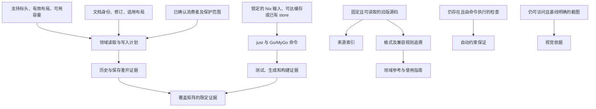

# 文档作为 agent coding harness 的巡检

本次审查基线为 `90ab06203e8bb1194e07116b676110f78b434fd5`；旧版子模块为 `8e3557912ddab708d11bf85ad311b41bb6630fd1`。这是一份完成后冻结的一次性审查，记录该基线下文档如何引导和约束执行，不维护后续功能状态。当前约束与状态仍由 [AGENTS](../../AGENTS.md)、[文档索引](../README.md)、[架构](../architecture.md)、[开发说明](../development.md)、[测试说明](../../tests/README.md)和[覆盖矩阵](../coverage.md)承接。

文档体系仍能引导核心领域工作，事务、版本边界、证据分层及元数据暂缓决策基本一致。需要优先处理的是**执行保证与当前检查脱节**：文档声称存在的架构检查，实际允许违反导入边界的改动通过。其次是错误测试证据、截图、地图状态和文本引用范围的漂移。本轮只记录问题与修复对象，没有修改产品代码、削弱规范或把未执行的验证改成通过。

## 范围与判定方法

从 `AGENTS.md`、根 `README.md` 和 `docs/README.md` 出发，检查当前文档、专题参考、测试与 fixture 约定、仓库技能入口，以及归档的替代关系。结合当前源码、提交差异、静态导入检查和隔离 worktree 中的真实命令，双向追踪重要主张。

主张按句子的作用分类，同一文档可以包含多种类型：

| 类型 | 判定对象 | 所需证据 |
| --- | --- | --- |
| 描述性 | 当前实现、状态、证据或资源是否存在 | 当前源码、实际资源、运行结果；历史记录只能证明过去 |
| 规范性 | agent 必须遵守什么边界 | 权威入口及适用作用域；另查当前实现是否符合、检查是否能发现违反 |
| 操作性 | 按步骤能否完成工作 | 前提、命令、输入、输出、副作用、失败路径与恢复步骤 |
| 决策性 | 已选择的方向、排除项与实施触发条件 | 仍有效的项目决策、相互引用及实现符合情况；不把未来目标当作当前能力 |

状态含义：**已验证**限于列明的静态或运行范围；**与证据冲突**需要可指出的反例；**尚未验证**包括未执行、环境阻塞或现有证据不足；**已被替代**表示已有明确的当前替代入口，不等于旧记录在当时错误。没有找到证据不构成错误判定。

本次“冷启动”是干净的基线 worktree、新命令进程及按入口文档重走任务。主机已有 Nix、devenv、Nix store、Go 模块缓存和可用 ROM；没有创建全新虚拟机或独立、无上下文的 agent 会话。宿主依赖从零获取与独立 agent 的理解复现均未验证。

## 正式入口、作用域与覆盖关系

| 入口与作用域 | 承接的文档 | 权限与覆盖关系 |
| --- | --- | --- |
| `AGENTS.md`：整个项目的修改与执行 | 开发、架构、测试、错误设计、领域参考 | 规定只读子模块、事务、线程、验证与维护约束；领域文档细化，不取消这些约束 |
| 根 `README.md`：产品介绍与首次运行 | 使用指南、开发说明、覆盖矩阵、总索引 | 摘要和导航；功能状态引用覆盖矩阵，不能另行维护矛盾的缺口清单 |
| `docs/README.md`：按任务选择资料与更新位置 | 所有当前专题、设计、来源和归档索引 | 定义状态、行为、命令与约束的维护位置；本轮当前正文的文档导航可达 |
| 重建计划、覆盖矩阵 | 旧版来源说明、专题参考、测试入口 | 计划管目标与依赖；矩阵管功能 ID、状态和剩余范围；来源条目不等于功能 |
| 架构、错误设计、领域参考 | 代码入口、固定版本来源、行为测试 | 架构管所有权和依赖；领域参考管字节及写入语义；“当前有某检查”仍须核实 |
| 开发说明、`justfile`、Nix 配置 | `go.mod`、翻译目录、生成器 | `justfile` 是命令实现；开发说明解释环境与用途；在线依赖获取是额外运行前提 |
| `tests/README.md`、fixture 约定 | 领域外部测试包、`internal/testutil`、可选集成 | 合成、文件流程、UI 与游戏执行是不同证据；跳过不能提升为已验证 |
| `DESIGN.md`、人物／职业与头像设计 | 使用指南、页面和共享组件 | 通用及领域交互约束；截图是支持证据，缺失后不能继续声称可供核对 |
| `.agents/skills/*/SKILL.md` | 技能各自的参考和工具 | 按任务触发；本会话技能目录已公开它们，不能因不在 Markdown 链接图内就判为不可达。项目测试限制继续适用 |
| `docs/archive/README.md` | 四份既有历史审查 | 有基线及当前替代文档；旧版本、旧路径和旧通过结果不升级为当前事实 |

检查了基线中 31 份受版本管理的 Markdown 的普通内联链接、相关标题锚点和当前文档的显式源码路径。发现的 20 个失效链接为：当前设计的 9 个截图链接、历史报告的 9 个截图链接及 2 个旧源码链接；未发现当前正文之间的导航断链。另有一个以行内代码书写的失效测试路径。该检查不验证外部 URL 的在线可用性，也不以链接存在证明主张正确。

## 关键主张矩阵

证据编号 E1–E8 对应下节实际执行记录；它们是本报告的证据编号，不是新增产品功能 ID。下表位置中的行号均对应审查基线。

| 文档位置 | 关键主张 | 主张类型 | 证据 | 状态 | 对 agent 行为的影响 | 建议修复对象 |
| --- | --- | --- | --- | --- | --- | --- |
| `AGENTS.md`；`docs/README.md`“更新哪份文档” | 功能状态、行为、架构与执行约束有各自维护位置 | 规范性 | 正式入口与交叉引用一致；但以下地图和文本行暴露了多个摘要未同步的问题 | 已验证：规则明确，执行存在偏离 | 能选择修改归属；不能仅凭某份摘要决定实现缺口 | 保留所有权规则；具体修复漂移的消费文档 |
| `README.md:7` | 地图绘制尚未覆盖 | 描述性 | `docs/coverage.md:180`、地图使用步骤、`game/maps/editor_test.go`；E3、E4、E5 均包含实际绘制／提交流程 | 与证据冲突 | 可能重复实现绘图功能，或错误排除可用工作流 | README 能力摘要；保留未完成的图块素材、地形定义等真实边界 |
| `DESIGN.md:53` | 导入边界由架构检查覆盖 | 描述性 | `tests/architecture_test.go` 已在 `e17541b` 删除；当前 lint 配置未声明对应规则；E7 的违规导入仍通过完整 `just check` | 与证据冲突 | agent 可能把门禁通过当成架构符合的保证 | `justfile`／依赖检查机制及 DESIGN 的证据说明；不放宽原有边界 |
| `AGENTS.md`；架构“依赖方向”“界面与线程” | 领域包不依赖 MyGo，组件不反向导入页面／app，app 通过 pages 组合 | 规范性 | 扫描当前受版本管理 Go 文件的 imports，所查边界没有违规；E3 编译通过 | 已验证：静态符合 | 当前可沿这些所有权边界开发；E7 表明仍需主动审查 | 保留规则；补可执行门禁，与上一行分开处理 |
| `docs/error-design.md:78` | `game/errors_workflow_test.go` 验证批量错误上下文、恢复、OS 原因及主次错误日志 | 描述性 | 文件已在 `4045d34` 删除；当前未找到原来的两项测试及 `fault.LogValue` 对应测试使用；`rom/errors_workflow_test.go` 只承接部分保存失败行为 | 与证据冲突 | 误以为错误链与恢复规则已有同等回归保障，选不到所称测试 | 错误设计的证据入口及错误工作流测试归属；先确定实际覆盖缺口，不能仅替换成相近文件名 |
| 错误设计“数据模型”“添加上下文” | 稳定错误码与原因链用于决策，业务不解析 `Error()` | 规范性 | `fault/error.go`、`game/records/editor.go`、保存实现；搜索到的生产 `Error()` 使用为展示；E3、E4 验证部分错误与保存恢复 | 已验证：所查调用及保存流程 | 错误测试入口失效不意味着应删除此约束 | 保留错误规范；全错误树优先级与日志场景的等价回归保障仍需补证 |
| `docs/user-guide.md:58`；`docs/reference/text-and-images.md`“草稿与共享影响预览”；`docs/reference/chapters-and-events.md:239` | 文本共享预览只列出记录字段 | 描述性 | `game/session.go:55` 合并 `format.quotes.TextUses`；`game/quote/workflow_test.go:287` 检查死亡及 FE6 终章文本使用处，E4 通过；新对话专题和架构已经说明该能力 | 与证据冲突 | 错估影响范围，重复建立引用索引，漏掉现有文本到对话记录导航 | 通用文本参考及使用指南中的范围摘要；矩阵 `text.shared-preview` 同步精确范围，仍保留全局脚本索引限制 |
| `docs/user-guide.md:7` | 顶部页面入口清单包含当前各编辑页 | 描述性 | `internal/pages/workspace.go` 已有战斗／死亡对话页；同一指南后文有专节，开头清单漏列 | 与证据冲突：清单不完整 | 从开头导航任务时可能漏掉已存在入口 | 指南入口清单，或改成不承诺穷举的导航 |
| 人物设计 `:13`、头像设计 `:13`、`DESIGN.md:49`；归档索引 `:3` | 所链接的实际页面截图可在仓库查看 | 描述性 | 9 张 PNG 已由 `65d7f76` 删除；当前及历史引用合计 18 个失效；归档索引仍称其为现有资源 | 与证据冲突 | agent 无法复核视觉依据，可能虚构已看过截图或用旧版本代替当前状态 | 当前设计的证据入口与归档索引；查明删除决策后选择固定提交追溯或按需更新证据，不自动恢复已删资产 |
| `docs/development.md:7`；README 快速运行 | 安装 Nix／devenv 后可按文档进入环境 | 操作性 | E1 普通启动遇到多个 Cachix TLS／超时错误；离线启动成功但依赖已有 store | 尚未验证：从零在线初始化 | 环境失败使所有运行性证据阻塞，不应转用系统 Go 或自动下载另一版工具链掩盖 | 开发说明的网络／缓存前提与故障导航；此结果不足以判定仓库 Nix 配置错误 |
| `docs/development.md:9`；`AGENTS.md`“命令与验证” | 使用 Nix 提供的工具链，`GOTOOLCHAIN=local` | 操作性 | E1 得到 `go1.27.3 darwin/arm64` 和 `local`；与 `go.mod`、`devenv.nix` 一致 | 已验证：本机隔离 worktree | 可以按项目规则运行，不需要降低 Go 要求 | 无；保留已缓存与首次获取的证据区别 |
| 开发说明“环境与命令” | `just check` 包含 lint、vet、i18n、默认测试和两种构建 | 操作性 | `justfile` 与 E3 的执行输出一致，退出 0；lint 确实使用 `--fix` | 已验证 | 能选择验证入口；审查时须隔离自动修复副作用 | 无；不能从该命令通过外推不存在的架构或 UI 门禁 |
| `AGENTS.md` 翻译条款；开发说明“国际化” | 修改 JSON 后生成、检查，并同时维护生成文件 | 操作性 | E6 临时修改两种语言，生成、i18n 检查与 locales 构建成功；只产生预期三文件 diff，恢复后 diff 为空 | 已验证 | agent 可从说明完成可审查的翻译修改，无需手改生成代码 | 无 |
| `docs/legacy-inventory.md:9` | 固定基线来源索引有 17,376 项，assessment 固定为 unassessed | 描述性 | E2 实际生成；分类数量吻合，17,376 个唯一 ID，assessment 全为 `unassessed` | 已验证 | 可用于定位来源；不能据此计算功能完成率 | 无；基线或扫描器改变时重新核对 |
| `docs/legacy-inventory.md:7`；开发说明 `:14` | 用 `just inventory` 生成旧版来源索引 | 操作性 | 未初始化来源时命令失败；开发说明提供初始化步骤；E2 用已核实基线的 `-root` 成功 | 已验证：提供来源后的流程 | 从“来源说明”直接冷启动仍需跳去开发说明补前提，错误只给缺失路径 | 来源说明在命令旁链接子模块前提；生成器可补可操作诊断，不需要降低固定基线要求 |
| `tests/README.md`“集成输入与范围” | 动态发现 `.gba`，缺输入／能力明确跳过，写入临时副本 | 操作性 | E5 空目录整项 SKIP；8 份改名且大写扩展名的输入均被发现；不适用子流程明确 SKIP；前后哈希不变 | 已验证：选定流程 | 可在不同本地输入集上工作；退出 0 不表示每个子能力都执行过 | 无；继续记录具体跳过项 |
| `AGENTS.md` 事务与未知数据条款；架构“文档与编辑操作” | 计划冻结数据，字节／入口／长度一起提交；过期、跨文档和冲突不留部分写入 | 规范性 | `game/edit/context.go` 的 Stamp／Plan、`rom.Document.ApplyEdit`；E3、E4 的地图与对话工作流验证不可变计划、历史及失败原子性；E5 验证文件重开 | 已验证：抽查领域与场景 | 为组合编辑提供可复用约束；不能把本次通过推广到所有未来操作 | 无；新增领域继续按自身引用与失败路径验证 |
| ROM 参考“空间分配与表搬迁”；对话参考“原生入口与重定位” | 未选定独立引用及未知字节保留，已知消费者分离时停止重定位 | 规范性 | `game/maps/editor_test.go`、`game/quote/workflow_test.go`、商店测试；E3、E4、E5 | 已验证：所选资源 | 不能凭相同地址、全零／FF 或保留旧字节就认定可回收未知结构 | 无；保持引用证明的适用边界 |
| 使用指南“打开与保存”；架构保存条款 | 保存、外部修改冲突、备份失败可恢复，保存点对应实际快照 | 描述性 | `rom/document.go`；E3 文档测试与 E4 保存／外部修改／失败恢复流程 | 已验证：文件与领域层 | 领域操作可以依赖统一保存与历史；UI 关闭和聚焦交互仍是不同证据 | 无 |
| `AGENTS.md` UI 线程条款；架构“界面与线程” | `editor.State` 只在 UI 线程修改，异步结果返回窗口并校验有效性 | 规范性 | 抽查 `internal/app/dialogs.go`、`assets.go`、`window.go` 使用 `Window.Update`；MyGo vet 通过。未执行窗口关闭、切换、焦点及异步交错复现 | 尚未验证：完整交互符合性 | 静态模式和领域 race 不足以证明所有 UI 时序安全 | 在实际涉及这些行为的任务中做限定流程的临时交互复核；本轮不扩建永久 UI 测试 |
| `docs/sources.md`；战斗／死亡及商店参考 | 游戏格式依据使用固定仓库、提交和文件 | 描述性 | 现有三个原生源码 checkout 的 HEAD 与文档一致且干净；抽读 FE8 `src/eventinfo.c` 的两个查找器及 `src/bmshop.c` 的复制循环，与所述规则一致 | 已验证：版本定位与 FE8 抽样 | 可追溯规则，不能把 FE8U 源码直接当作日版／改版的全部运行证明 | 无；未逐条重做日版指令比较与所有来源核对 |
| 重建计划；元数据设计开头及“何时实施” | 元数据设计已确认但暂缓；具体需求触发提取，不先建通用框架 | 决策性 | AGENTS、索引、架构一致；当前定义仍在具体 Go 领域与版本配置中，没有独立 metadata 框架 | 已验证：决策与当前组织一致 | 防止将新功能扩成未经要求的前置重构 | 无；出现真正共享定义／外部导入需求时再按决策触发 |
| 重建计划“盘点与交付边界”；覆盖矩阵开头 | 完整重建是目标，旧版行为盘点尚未完成 | 决策性 | 矩阵保留待盘点组，来源生成器仅枚举静态来源；新商店、对话能力没有被写成整组完整覆盖 | 已验证：目标和当前状态区分清楚 | 不应按文件、窗口或测试数推算完成率 | 无；本报告也不构造覆盖百分比 |
| 覆盖矩阵 shops／quotes 验证行；头像设计验证段 | 曾对商店、对话及头像进行临时 UI 复核 | 描述性 | 文档记录历史观察，但本轮没有运行 UI，相关永久截图又已删除；静态代码与领域通过不能补成当次交互证据 | 尚未验证：既往观察及当前交互 | 不能在本次交付中重述为“已完成 UI 验证” | 保留历史观察的时间／基线边界；需要当前交互证据时按范围复核 |
| `docs/archive/mygo-0.6.3-to-0.7.3-review.md` | 当时 MyGo 为 v0.6.3，建议升级到 v0.7.3 | 决策性 | 归档首段注明旧基线；当前 `go.mod` 已为 v0.7.3，`49d675c` 接入缩放和统一历史路由 | 已被替代 | 应使用当前依赖与架构，不重复执行旧升级计划 | 无；保留归档替代关系，不同步历史报告为当前版本 |
| 其余三份既有归档及归档索引 | 旧基线的测试结果、源码位置和界面调整记录 | 描述性 | 归档显式撤销其当前权威性，分别指向测试说明及领域设计 | 已被替代 | 只用于追溯，不可据旧通过结果跳过当前必要验证 | 修复当前索引的资源可达性描述；不要求历史正文跟随重构 |

矩阵中关于临时 UI 的主张，是审查“它能否作为当前证据”的问题；没有证据认定既往 UI 检查未发生。同样，错误测试被删除证明证据入口失效，并不证明当前错误实现错误。

## 实际执行与证据边界

所有写入性实验在隔离 worktree 中进行。初始主工作区只有旧版子模块内既有未跟踪 `.DS_Store`；未修改这些文件。源码探针与翻译修改已撤回，生成文件经生成器恢复；未新增永久测试。

| 编号 | 实际操作 | 观察结果 | 能证明什么／不能证明什么 |
| --- | --- | --- | --- |
| E1 | 普通 `devenv shell` 路径；随后使用 `devenv --offline shell -- bash -c 'go version && go env GOTOOLCHAIN && just --list'` | 首次有界尝试超时；带日志重试出现 Cachix TLS／超时，环境未成功进入。离线方式成功，Go 1.27.3、local、recipes 可用 | 工具链配置在已有 store 上可用；从零获取及普通在线启动未验证。期间尝试终止阻塞进程，最终日志仍记录下载失败，不能把耗时当作纯配置性能 |
| E2 | 无旧版来源时 `just inventory`；随后 `just inventory -root "$AUDIT_LEGACY_ROOT"` | 前者退出 1，提示 `open FEBuilderGBA/FEBuilderGBA: no such file or directory`。后者退出 0，生成 17,376 项：312 form、13 control、105 source、12 command、4,185 patch-rule、12,749 config | 生成器与声明数量吻合；`AUDIT_LEGACY_ROOT` 指向已核实固定提交的只读 C# 项目目录。没有执行网络子模块初始化，也没有证明完整功能盘点 |
| E3 | `devenv --offline shell -- just check` | lint 0 issues、Go／MyGo vet、1264 条消息的 i18n、默认测试、默认及无 CGO 构建均通过；基线 diff 为空 | 常规门禁可执行；默认测试确实在没有 `.rom/` 的副本运行。未构建安装镜像、未启动 UI |
| E4 | 带 `-count=1 -v -run` 的 `just test-race` | 选定 ROM 历史、保存恢复、五版地图绘制／尺寸、五版对话表／引用／冲突原子性均通过 | 只报告匹配的 `rom`、`maps`、`quote` 流程；其他包的 `[no tests to run]` 不计作 race 行为验证，不声称跑过全量 race |
| E5 | 先在无 `.rom/` 时运行集成；再动态复制本地 8 份输入，统一改名为 `input-NN.GBA`，执行保存、地图、尺寸、独立商店、对话流程 | 空输入明确 SKIP。8 份输入覆盖五种标头，所选流程均通过；四份 FE6／FE7 输入的 preparation、world-map 共 8 个子流程明确 SKIP。源文件与测试输入前后 SHA-256 不变 | 证明所提供输入中的可编辑入口、动态发现、大小写扩展名及临时副本文件流程；不代表所有改版、全部资源或游戏执行 |
| E6 | 隔离副本给 `shop_raw` 的中英文追加临时标识，执行 `just generate`、`just i18n-check`、`go build ./internal/locales` | 退出 0；只改两份 JSON 与生成代码中相应注释。撤回 JSON 修改并再次 generate，`git diff --exit-code` 通过 | 翻译操作路线可复现；未验证界面实际切换语言或显示布局 |
| E7 | 临时在 app 包加入 `import "github.com/woxQAQ/febuildergba-mygo/internal/components"`，以导出变量引用 `components.ApplyTheme`，再运行 `just check` | 完整门禁仍退出 0；探针移除后源码恢复 | 可执行反例证明“架构检查覆盖”不成立；并未改变原规范，也不表示基线已有违规 |
| E8 | 链接／显式源码路径／导入扫描；按固定提交核对三个原生源码仓库并抽读 FE8 消费者；反向查看重要提交 | 得到上述断链、删除记录、范围漂移及当前导入符合结果 | 属静态与来源证据；不代替运行、UI 或逐条游戏规则验证 |

E4 的实际筛选为：

```sh
just test-race -count=1 -v -run '^(TestMapEditingWorkflow|TestMapResizeWorkflow|TestQuoteTableWorkflow|TestQuoteReferencesAndFields|TestQuoteConflictAndFailureAtomicity|TestSaveFailureCanBeDiagnosedAndRecovered|TestDocument_)'
```

E5 的实际筛选为：

```sh
just test-integration -run '^TestROMWorkflows/[^/]+/(save|maps|map-resize|native-shops|quotes)$'
```

这些命令在上述 devenv 离线环境执行。目录、二进制缓存与 ROM 都是前提，不应把 `--offline` 写成适用于全新主机的替代安装流程。

## 代表性冷启动任务

所有任务均没有新增人类回答或业务补充。下列“补充”是执行者从其他文档、当前源码或已有环境找回的知识；它们仍计为文档路线需要关注的额外步骤。

| 任务与起点 | 文档导向的执行路径 | 错误路径或缺失前提 | 额外补充与结果 |
| --- | --- | --- | --- |
| 新 checkout 做常规检查：README → 开发说明 → justfile | 进入环境 → `just check` → 检查 diff | 普通启动被宿主配置的远端缓存连接阻塞；文档没有此恢复分支 | 从 devenv 帮助找到 offline，在已有 store 前提下完成 E1、E3。没有换 Go 或更新锁文件 |
| 查旧版入口：索引 → 来源说明 | `just inventory` → 读取 CSV | 新 worktree 没有初始化子模块；来源说明命令旁没有链接初始化前提 | 开发说明已有初始化命令；本次使用文档允许的 `-root` 和已核实来源完成 E2。缺的是入口衔接，不是全项目完全未记载 |
| 改一条翻译：AGENTS → 开发说明“国际化” | 找源 JSON → 修改两种语言 → generate → i18n-check → 核对生成 diff | 无任务特定缺项；仅依赖已解决的环境前提 | E6 完成并恢复。无需人工提供 catalog key 或手改生成代码 |
| 判断地图能力并验证编辑：README → 矩阵 → 地图参考 → 测试 | README 先给出“未覆盖”，矩阵和使用指南则导向现有编辑器及测试 | 两个当前入口对同一能力结论相反 | 以领域操作和 E3–E5 消解，确认已有绘制与尺寸流程；未把 README 的旧摘要当成新增需求 |
| 修改错误处理前选回归：AGENTS → 错误设计“验证与扩展” | 按所称文件寻找错误上下文与恢复测试 | 文档路径不存在；旧测试被删除而非简单改名 | 当前搜索和历史差异定位到删除提交。ROM 保存恢复已有真实证据，但不能据此声称原错误树／日志场景仍有等价覆盖 |
| 核验导入边界保障：AGENTS → 架构 → DESIGN → `just check` | 假定门禁能拒绝 app 直接导入组件 | 当前检查没有拒绝这个明确反例 | E7 完成；应修复门禁与其证据说明，不能把规范改成允许该依赖 |
| 验证当前 ROM 流程：测试说明 → `just test-integration` | 动态发现输入 → 运行 → 区分 PASS 与 SKIP | 干净 checkout 没有忽略目录 `.rom/`；空跑仍退出 0 | 使用已有输入的改名副本完成 E5。输入集由目录发现；没有加入固定原版文件名、地址或文本预期 |

## 实现到文档的反向追溯

| 实现变化 | 当前承接情况 | 审查结论 |
| --- | --- | --- |
| `49d675c`：MyGo 升级、窗口缩放、统一历史路由 | `go.mod`、Nix 环境、架构、开发、使用指南、矩阵已更新；升级报告明确归档 | 版本与主要边界已同步；当前焦点、菜单、窗口关闭交互本轮未运行 |
| `e5f654f`：默认／准备／世界地图商店统一编辑 | 矩阵、章节参考、来源、架构及使用指南均有对应内容 | 新领域已有完整文档路线；原生加载器抽读及 E3、E5 支持所查范围 |
| `cc9ad01`：战斗／死亡对话及文本使用处接入 | 新专题、来源、架构、矩阵和指南专节已更新 | 通用文本限制与指南顶部导航未同步，产生同一能力的冲突描述 |
| `90ab062`：空工作区打开入口及显示调整 | DESIGN、使用指南与当前入口代码对应 | 静态路线一致；没有据此宣称已看过当前渲染 |
| `4045d34`：删除错误工作流测试 | 错误设计仍指向被删除文件 | 证据删除未传播到当前验证说明 |
| `e17541b`：删除架构测试 | DESIGN 保留自动检查保证 | 保证与执行机制脱节，E7 提供运行反例 |
| `65d7f76`：删除九张截图 | 当前设计、DESIGN 与归档索引仍引用或承诺这些资源 | 资源删除未传播到证据入口；不能用改日期消除断链 |

这几类漂移共有的维护问题是：新增功能通常更新自己的专节，但删除证据或扩展跨领域能力时，没有反查引用它的摘要和保证。并非所有重复信息都应删除：使用指南需要操作后果，格式参考需要具体语义；应避免各处独立维护“是否已实现”“列出哪些使用方”“由什么检查保证”等同一个可变事实。

## 前提及失效传播



| 前提失效 | 首先失效的主张 | 传播范围与处理 |
| --- | --- | --- |
| Nix 输入／缓存不可获取，且本地不具备完整依赖 | “按命令可进入环境” | 测试、生成、构建均无运行证据；源码与文档静态审查仍可继续。不能把网络失败归结为功能错误，也不能切换未授权工具链 |
| 子模块未初始化或偏离固定提交 | 旧来源可读性、索引数量和版本依据 | 全部旧版入口追溯及相关格式判断需重新确认；不影响无需旧运行时的基本 Go 操作。操作文档应把前提链接到使用点 |
| 测试／检查被删除，或被命令范围排除 | “已有回归／门禁保障” | 影响对应错误、架构等维护任务的验证选择。其他测试通过不自动恢复这项保证；应核对检查所有者和替代覆盖 |
| 文档身份、修订或布局变化 | 原计划和缓存仍适用 | 从记录定位传播至文本、图像、地图、部署、事件、商店和对话计划；已有绑定机制应拒绝旧结果。UI 异步交错需另行验证 |
| 已确认入口分离、共享范围不完整或空间不可证明 | 自动搬迁／复用安全 | 限制该操作，不应据此禁止所有编辑；保留独立引用、未知字节、手动布局及原始字节的边界检查 |
| `.rom/` 缺输入或能力不可用 | “本次集成验证了该能力” | 命令可成功结束但相应证据为空；必须保留 SKIP，合成样本和其他版本不能补成该输入的运行证明 |
| 截图删除或实现超出截图基线 | 当前视觉参考可用 | 影响依赖截图的布局／交互判断及历史追溯，不会使领域格式事实自动失效 |
| 新领域扩展共享用途集合 | 旧的范围枚举仍完整 | 应回查通用文本参考、指南、矩阵与导航，不能只维护新领域专节 |

## 修复顺序与未验证范围

优先修复导入约束的可执行检查，并用 E7 这类违反边界的改动确认门禁能拒绝；原规范继续有效。其次处理错误回归证据与删除资产的追溯，再修正地图摘要、文本使用处范围及导航。来源说明补前提链接即可，不需要复制一整份环境文档。

本轮没有执行原生 UI、模拟器、游戏内对话／购买／地图触发、打包安装镜像、签名公证、Windows／Linux、无缓存主机初始化、网络子模块初始化，也没有逐条重新核对所有原生日版指令或旧版外部格式。没有全量运行真实 ROM 集成和 race；其范围以 E4、E5 的筛选为准。历史 UI 声称保留为历史记录，当前交互保持尚未验证。

本报告仅记录此次巡检结果。问题修复后的约束和证据应回到各自当前文档，不继续在本文件维护第二份实时状态。
