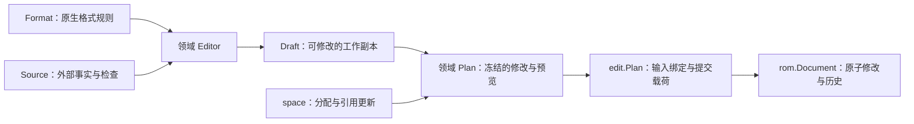

# game 领域格式与编辑流程收敛方案

> 历史方案，已被后续实现替代，不代表当前事实或待办。原稿未记录写作提交；归档核对基线为 `640f0fb`，其中描述的旧接口早于 `a367e36` 的提交路径收敛、`c5b701a` 的资源声明与 `c83e436` 等版本规则调整。两份方案包含不同设计方向，不能据此推断全部建议均被采纳。当前替代文档为[架构与约束](../architecture.md)、[覆盖矩阵](../coverage.md)和 [AGENTS](../../AGENTS.md)。以下保留原始分析及对话措辞，仅供追溯。

本文记录 `game/` 的结构分析与重构方向，属于待实施方案。依据为当前源码及[架构说明](../architecture.md)，不表示下述重构已经完成。功能范围与实现状态继续由[覆盖矩阵](../coverage.md)维护。

目标是统一编辑操作的共同约束、原生格式的声明入口及运行时依赖的职责，同时保留各领域的数据结构、编解码规则和事务组合方式。

## 1. 当前模式与漂移

### 1.1 Format 的含义与声明方式

`Format` 不只描述地址，还包含指针入口、记录步长、字段偏移、终止规则、编码方式及已确认的原生消费者。实际表地址需要结合 ROM 中的指针和手动布局解析。

因此，领域 `Format` 的统一含义应为：某个领域解释 ROM 的原生格式规则。

当前存在以下声明方式：

| 方式                   | 实例                                                           | 配置归属                                 |
| ---------------------- | -------------------------------------------------------------- | ---------------------------------------- |
| 根包直接声明结构       | `maps.Format{...}`、`text.Format{...}`、`portrait.Format{...}` | 地址和格式参数在 `game/fe*.go`           |
| 领域提供完整格式       | `quote.FE6()`、`support.FE6()`                                 | 地址和格式规则都在领域包                 |
| 根据版本再次查询       | `terrain.ForVersion(id)`、`sprite.New(context, id)`            | 领域内部自行选择版本配置                 |
| 根包与领域分别提供参数 | `event.FE6(root)`                                              | 根包提供入口，领域内部还包含其他固定地址 |

具体漂移包括：

- `game/event/format.go` 中，`FE6(root)` 接收外部入口，同时在内部声明 `defeat`、`rout` 等地址，格式配置的所有权分布在两处。
- `game/fe7u.go` 同时调用 `support.FE7(false)` 和 `event.FE7(..., true)`。前者的布尔参数表示 Japanese，后者表示 English，同一版本需要相反的参数值。
- `game/format.go` 没有 terrain、sprite 的完整格式字段。`game/session.go` 装配地形编辑器时调用 `terrain.ForVersion`，`game/terrain_sources.go` 计算保护范围时再次查询；sprite 则在构造读取器时内部选择格式。
- `game/records/schema.go` 的 `Format` 同时保存规则、当前补丁结果、名称读取回调和保护回调，表示某个快照的已解析配置，与其他领域的静态 `Format` 含义不同。

这些差异需要通过明确配置所有权和对象生命周期来收敛。

### 1.2 编辑栈的共同流程

需要预览的编辑操作具有共同流程：



共同约束是：

- 操作绑定文档身份、修订和适用布局。
- 草稿修改期间不写 ROM。
- 计划冻结完整载荷，后续草稿变化不会改变已经生成的计划。
- 载荷、指针和文件长度一起提交、一起撤销。
- 过期、跨文档和校验失败不留下部分修改。

`game/edit/context.go` 已通过 `Context`、`Stamp`、`Plan` 承载其中的共享机制，但各领域尚未统一使用：

- terrain、support、quote、text 和独立商店的计划使用 `edit.Plan`。
- deployment、maps、event 和记录表搬迁仍保存自己的 stamp 与写入数据，再执行检查和 `ApplyEdit`。
- graphics 的替换计划保存 stamp 与 `space.Plan`，通过 `Stamp.Apply` 提交。

这里已有可复用的提交机制，后续应围绕它收敛。

### 1.3 Source 的职责

当前各领域的 `Source` 主要承接运行时协作：

| 领域       | Source 提供的事实或操作                |
| ---------- | -------------------------------------- |
| terrain    | 当前职业布局和指针保护检查             |
| support    | 当前人物入口、文本校验和指针保护检查   |
| shop       | 章节及世界地图等外部入口、指针保护检查 |
| maps       | 外部资源保护、尺寸影响和变化表引用审核 |
| deployment | 章节及事件提供的部署候选和使用处       |

这些输入依赖当前 ROM、手动布局或其他领域。领域定义类型化的需求，`game` 或 `chapter` 提供实现，是合理的依赖方向。

需要厘清的是静态规则、运行时依赖及解析结果的区别，并整理多个 `*_sources.go` 中重复组合的跨领域保护事实。

## 2. 目标职责

| 概念           | 统一职责                           | 共享边界                               |
| -------------- | ---------------------------------- | -------------------------------------- |
| `Format`       | 描述本领域的原生格式规则           | 领域拥有完整定义，装配层选择版本       |
| `Source`       | 提供本领域操作所需的外部事实和检查 | 领域声明类型化需求，组合层实现         |
| `Editor`       | 读取、缓存、协调和执行领域操作     | 复用编辑上下文及输入有效性机制         |
| `Draft`        | 保存可修改的工作副本               | 复用绑定机制，保留领域数据与编辑命令   |
| 领域 `Plan`    | 保存冻结后的提交及领域预览         | 组合 `edit.Plan`，保留影响、引用和诊断 |
| `edit.Plan`    | 冻结提交载荷并校验输入有效性       | 统一原子提交入口                       |
| `space`        | 分配空间、组合字节和明确引用的修改 | 不自行判断领域引用的所有权             |
| `rom.Document` | 保存字节、修订及撤销重做历史       | 最终原子修改边界                       |

简单字段写入继续保持当前交互方式，无需为了形式一致而增加草稿和预览步骤。

## 3. 格式声明收敛

### 3.1 领域拥有完整格式，game 显式装配

领域包提供完整的 `FE6()`、`FE7U()`、`FE7J()` 等格式入口。共享布局通过包内私有函数复用，公开入口明确表达具体版本。

`game/fe*.go` 保留版本识别信息和领域组合。下面是目标形态示意，包含当前尚未提供的字段和构造函数：

```go
func fe6Format() format {
	return format{
		id:       version.FE6,
		header:   "AFEJ01",
		minimum:  8 << 20,
		chapters: chapter.FE6(),
		events:   event.FE6(),
		maps:     maps.FE6(),
		text:     text.FE6(),
		quotes:   quote.FE6(),
		terrain:  terrain.FE6(),
		sprites:  sprite.FE6(),
		// 其他领域同样显式装配。
	}
}
```

实施约束：

- 全局版本识别和装配集中在 `game`。编辑器或读取器接收已选好的格式，不在构造时根据版本字符串重新查找配置。
- 一个领域的地址、布局及原生消费者定义归该领域所有。根包不再与领域构造函数分别维护同一格式的不同地址参数。
- 读取、写入规划和保护范围计算使用装配得到的同一格式。
- 对外的地区布尔参数改为明确的版本入口。领域内部仍可共享布局构造逻辑。
- 格式定义按只读数据使用，避免共享切片被修改后影响其他会话。
- 仅提供有实际支持的格式入口，不为不适用的领域补造配置。

全局版本选择与领域内部对已选方言的处理具有不同职责。编解码中的必要方言差异继续由领域表达。

### 3.2 分离 records 的静态定义与运行时结果

整理 `records.Format` 时，区分三类内容：

1. 原生表和字段规则等静态定义。
2. 名称读取、外部资源保护等运行时依赖。
3. 当前补丁结果、有效布局、解析错误等快照结果。

具体类型和命名在迁移时按实际使用关系确定，不预先创建通用配置框架。手动布局及补丁识别产生的结果仍绑定对应文档与修订。

本次格式收敛使用普通 Go 类型和函数即可。[元数据层设计](../metadata-design.md)保持暂缓，其实施条件不因本次整理而改变。

## 4. 编辑流程收敛

### 4.1 统一使用 edit.Plan

各领域的不可变提交计划组合 `edit.Plan`，由它负责冻结字节、检查文档及布局绑定、提交完整修改。

领域计划继续保存自己的预览信息。例如地图尺寸影响、支援反向同步结果、地形共享列及独立引用，都留在相应领域类型中。

迁移时需要保留：

- 现有事务边界及历史标签。
- 稳定错误码、错误原因链和领域上下文。
- 提交成功后的缓存刷新行为。
- 计划的只读访问方式及切片所有权。
- 文档、修订和布局变化后的失效行为。

同义的领域 `Plan`／`Edit` 名称可以随迁移统一；`rom.Edit` 仍表示底层字节修改载荷。内部 API 直接迁移调用方，不为未发布实现保留兼容包装。

### 4.2 Draft 保留领域结构

共同约束通过 `edit.Stamp` 和领域操作协议表达。草稿的数据结构、编辑命令及局部历史由领域拥有。

例如：

- `shop.Draft` 只拥有货物内容，可以嵌入事件草稿，由外层绑定文档并组合提交。
- 独立商店使用 `EntryDraft` 绑定入口及货物。
- 地图草稿拥有笔画、尺寸调整及局部撤销历史。
- 支援草稿需要表达关系、反向同步和对话内容。

这些差异使事务组合成为设计约束。抽取共同实现时应保留嵌套草稿的能力，不强制每个草稿独立持有文档和提交入口。

### 4.3 提取重复的写入组合

`Move` 在现有代码中具有不同含义：`space.Move` 是搬迁请求，`terrain.Move` 和 `support.Move` 是领域预览结果。名称相同不代表它们具有同一数据模型。

当前多个流程重复执行以下操作：

1. 按对齐规则追加载荷。
2. 编码新地址并更新已选指针。
3. 累积字节修改与最终文件长度。

这部分适合根据实际调用形态向 `space` 收敛。提取时保留当前规划只读、失败无副作用的性质，并支持多个载荷组成一次完整修改。

领域继续决定哪些引用允许更新、哪些共享引用保持原值，以及未知字节如何保留。部署和事件中依赖目标地址的编码也必须按自身规则完成，不能被简单追加接口掩盖。

## 5. Source 与跨领域保护

确立以下边界：

> `Format` 描述本领域如何解释字节；`Source` 提供本领域操作所需的外部事实和检查；`game` 或 `chapter` 负责连接它们。

各领域保留类型化的 `Source`。资源保护的组合应进一步明确：

- 一次规划使用同一份输入快照及适用布局。
- 自动布局与手动布局下的已确认资源具有明确来源。
- 允许写入的入口需要关联具体所有者，不能仅凭地址重合豁免保护。
- 跨领域保护范围由组合层汇集，领域仍提供自己的确认事实和检查。
- 已确认范围不构成全 ROM 引用完整性的证明。

先整理当前重复的范围组合和保护调用，不预先引入全局资源注册框架或通用领域接口。

## 6. 实施顺序与验证

| 步骤                | 修改范围                                                        | 主要验证目标                                                   |
| ------------------- | --------------------------------------------------------------- | -------------------------------------------------------------- |
| 1. 统一版本格式入口 | 领域格式、`game/fe*.go`、会话装配、terrain 和 sprite 的格式传递 | 五版装配保持一致，读取与保护使用同一格式，地区及方言规则未改变 |
| 2. 统一计划提交     | 各领域计划及调用方                                              | 计划冻结、跨文档和过期拒绝、错误上下文、原子提交与撤销         |
| 3. 抽取写入组合     | `space` 与实际重复的追加流程                                    | 对齐、容量边界、多载荷组合、指针更新及独立引用保留             |
| 4. 整理运行时配置   | `records.Format`、领域 `Source`、组合层保护检查                 | 手动布局、补丁解析结果、跨资源冲突及同一快照下的解释一致性     |

每一步独立形成可审查的改动，更新对应架构或行为文档。抽象以实际重复的职责为依据，不按文件数量或声明名称机械拆合。

验证遵循[测试说明](../../tests/README.md)：

- 使用现有领域工作流和合成数据，通过真实装配及公开操作验证行为，不逐函数添加测试。
- 重点检查未知字节、未选定的独立引用、共享与部分重叠载荷、计划冻结、布局失效及失败原子性。
- 多资源操作检查载荷、指针和文件长度一起提交、一起撤销。
- 运行相关测试和 `just check`；涉及文档历史的提交迁移运行 `just test-race`，命令在仓库的 devenv 环境中执行。
- 只有出现现有测试无法覆盖的行为风险时，补充对应工作流场景。
- 如执行真实 ROM 集成，动态发现输入并只修改临时副本；其结果与合成数据验证分别记录。
- 本次领域重构不默认启动 UI 或模拟器，不新增永久 UI 测试。

本方案的完成条件是配置所有权、提交机制和运行时依赖边界得到收敛，同时保持现有领域行为及事务语义。文档输出本身仅检查内容与 diff，不代表上述运行验证已执行。
