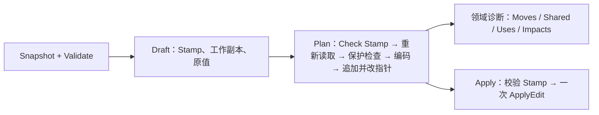
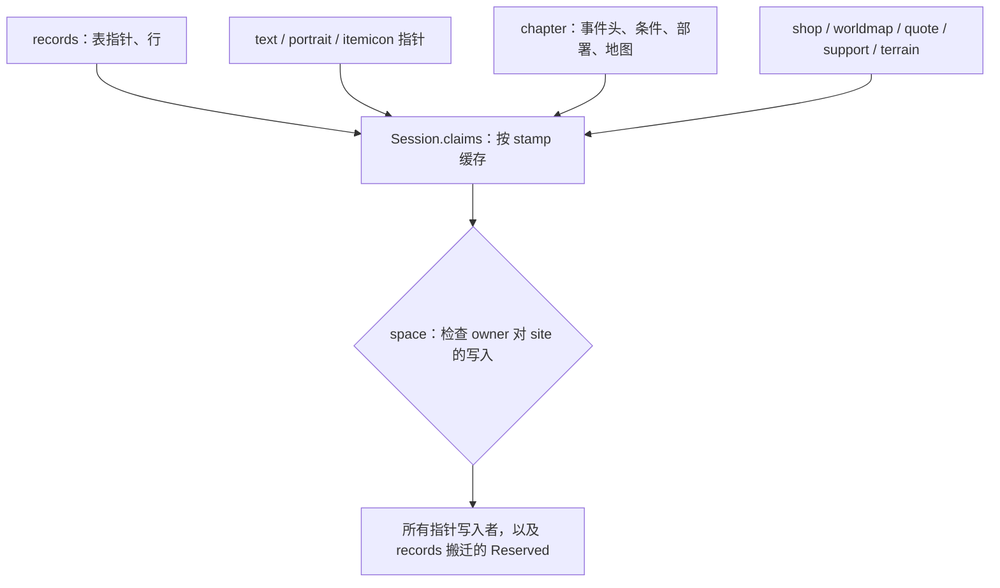

# 编辑栈模式与 Format 漂移分析

> 历史方案，已被后续实现替代，不代表当前事实或待办。原稿未记录写作提交；归档核对基线为 `640f0fb`，其中描述的旧接口早于 `a367e36` 的提交路径收敛、`c5b701a` 的资源声明与 `c83e436` 等版本规则调整。两份方案包含不同设计方向，不能据此推断全部建议均被采纳。当前替代文档为[架构与约束](../architecture.md)、[覆盖矩阵](../coverage.md)和 [AGENTS](../../AGENTS.md)。以下保留原始分析及对话措辞，仅供追溯。

你看到的两个现象都是真的。不过编辑栈里真正重复、值得抽出来的，是比 Draft/Editor/Plan 低一层的提交协议和资源保护。Format 的漂移需要一条写下来、能用工具检查的规则来收拢。下面的判断来自阅读 `game/` 根目录、`edit`、`space` 和各领域的 `format.go`／`editor.go`。我没有改代码，也没有跑测试。

## 1. 编辑栈：共享的是提交协议

各领域重复的是同一套流程：



真正相同的只有几步：Stamp 绑定、提交、追加载荷后改写指针、保护外部资源。Draft 的修改接口（`Set(kind,id,value)`、`Add/Remove/Move`、`SetText(index,rank,id)`）和 Plan 的诊断（`Moves()`、`Shared()`、`Impacts()`、`Missing()`）属于各领域自己，页面靠这些具体类型渲染预览。我不建议做 `Editor[D, P]` 这类泛型接口，原因有三条：

- 没有需要多态的调用方。`internal/pages` 里十几处 `Plan`／`Apply` 调用用的都是具体类型。
- 签名本来就不一样：`support.Plan(d, synchronize)`；`graphics.Plan(ref, content)` 不接收 Draft；文本用 `text.PlanID(...)`。
- 统一接口会把各领域的诊断压成最小公分母。

协议层确实有不一致，这部分应该收拢：

| 步骤         | 现状                                                                                                                                                                                                                                          |
| ------------ | --------------------------------------------------------------------------------------------------------------------------------------------------------------------------------------------------------------------------------------------- |
| 提交         | `terrain`、`support`、`quote`、`shop`、`text` 走 `edit.Plan.Apply`；`maps`、`deployment`、`event` 手写 `Stamp.Check` 加 `Document.ApplyEdit`；`graphics` 用 `Stamp.Apply`；`records.ApplyTableMove` 用 `BindBytes`、`SameDocument` 加布局检查 |
| 过期判断     | `maps.Plan`、`deployment.Plan` 用 `draft.Current(s)` 直接返回 `rom.ErrStale`，丢掉了 `Stamp.Check` 会保留的修订证据                                                                                                                           |
| 追加并改指针 | 调用 `space.PlanAppend` 之后，手写 `0x08000000 + destination` 和 `LittleEndian.AppendUint32`；非测试代码里有 19 处                                                                                                                            |

建议：

1. `edit.Plan` 作为唯一的提交路径。每个领域的计划都持有 `*edit.Plan`，`Apply` 只做提交和必要的 Refresh。`TableMove` 的 `BindBytes` 语义和手动布局检查保留为它自己的前置条件。
2. 在 `space` 加一个原语：追加载荷，并改写指定的指针位置。它要支持同一个计划里多次追加，terrain 和 support 需要这个能力。这仍属于 `space`"按明确声明的区间和引用规划写入"的职责。
3. `Move`、`Shared`、`Uses` 等诊断继续保留各自的类型。

## 2. 第三个模式：资源保护网

比编辑栈更值得处理的是 `game/*_sources.go` 和 `resource_pointers.go`。每个领域写指针前都要确认这 4 字节不属于别人，现在的做法是领域之间两两手写排除规则：

- `protectShopPointer` 排除 quote、support、shop 和世界地图节点。其中 shop 自己的 Default／Preparation 位置、节点自己的槽位是例外。
- support 的 `ProtectPointer` 排除 shop、worldmap、quote。terrain 的排除 shop、worldmap、quote、support。
- `protectRecordPointer` 用 `kind == records.Classes` 给 terrain 开例外，用 `offset 44` 给 support 开例外。
- `protectRecordPointer` 里设置 `chapters.External = nil`，只是为了避开 `nativeRanges` 中调用方自己的范围。

结果是每加一个领域，都要改其他领域的保护函数。support 那次提交（`e83232b`）改了 `quote_sources.go`、`shop_sources.go`、`resource_pointers.go`。terrain 那次提交（`37188ee`）改了 `quote_sources.go` 和 `resource_pointers.go`，还加了一个按 kind 区分的例外参数。维护成本随领域数按平方增长，是否覆盖完整只能靠人读代码判断。

已经能看到覆盖不一致的地方：

- `deployment.Plan` 只检查记录表的指针和行。它的 Source 没有 `ProtectPointer`，所以不检查 quote、support、terrain、shop 和文本指针。
- 同一组原生资源有两套范围计算。`format.supportRanges`／`terrainRanges` 按自动布局（`records.Layout{}`）计算，`Session.supportRanges`／`terrainRanges` 按当前有效布局计算。event、maps 和 records 搬迁经 `chapter.Config.External` 拿到的是前一套。因此当人物表或职业表处于手动布局时，这三类写入保护的是自动识别出的那张表所引用的载荷。这个风险是读代码得出的，我没有构造复现样本。

建议把"范围"升级为带归属的声明，下文称 Claim：

```go
// 放在 space 中。space 仍不解释资源含义，Owner 对它只是一个可比较的值。
type Owner struct {
    Resource string // "support"、"terrain"、"units" 等
    ID, Slot int
}

type Claim struct {
    Range space.Range
    Owner Owner
    Host  Owner // 指针位于某条记录内部时，指向那条记录；否则为零值
}
```

- `Owner`：这段字节归谁。
- `Host`：容纳这个指针位置的那条记录。比如人物支援指针的 Host 是对应人物记录，职业地形指针的 Host 是职业记录，世界地图货物指针的 Host 是节点记录。

写入规则只有一条：所有者 O 改写 site 时，与 `[site, site+4)` 重叠的每个 Claim，要么是 O 自己在这个位置的指针声明，要么是包含该位置的 Host 记录；其他情况一律冲突。现在的 `kind == Classes`、`offset 44`、Default／Preparation 例外、`ownsNode`、`External = nil` 都改由数据表达，不再是代码分支。terrain 现在单独检查的别名情况，即两个不同所有者声明同一个指针位置，也会自然成为冲突。



各领域的 `Ranges(data)` 改为 `Claims(...)`，根包只负责汇总，不再需要知道谁该排除谁。新增领域时只需提供一个 Claims 来源。会话级 Claims 通过闭包引用 `s.Records`，和 `Open` 里 `Texts` 回调引用 `s.Records` 的方式相同，format 级那一套就可以删掉。这是替换现有的重复实现，已有六处以上在用，算不上预建框架。

## 3. Format 漂移

实际上有四种写法：

| 写法                                                               | 例子                                                                                                        |
| ------------------------------------------------------------------ | ----------------------------------------------------------------------------------------------------------- |
| 版本文件中写导出字段的字面量                                       | `maps`、`text`、`portrait`、`itemicon`、`shop`、`worldmap`、`records.Rule`                                  |
| 领域包导出按代际划分的构造函数，地址写在领域包里，用布尔值区分区域 | `support.FE7(japanese)`、`quote.FE7(japanese)`、`event.FE7(root, english)`、`chapter.FE7(pointer, english)` |
| 领域包内按版本 ID 做 switch                                        | `terrain.ForVersion`（根包里调用三处）、`sprite.forVersion`（私有，地址全在里面）                           |
| 根包里按版本做 switch，但不在版本文件里                            | `image_references.go` 的 `genericPortraitFormat`                                                            |

还有几处细节问题：

- 同一个区分用了相反的布尔：有的参数叫 `japanese`，有的叫 `english`。
- `quote.FE7` 的日版地址是用 `delta = 0x7D0` 推导出来的，没法逐个对照旧版来源。
- `quote.Format.version int` 漏到了页面层：`internal/pages/quotes/battle.go` 用 `Quotes.Version() == 8` 判断战斗条件，相当于页面按版本号推断 ROM 规则。

后果是核对 FE7U 的全部地址要打开 `fe7u.go`、`support/format.go`、`quote/format.go`、`event/format.go`、`sprite/reader.go`、`image_references.go`；FE6 还要再加 `chapter/format.go`。而旧版 `ROMFE7U.cs`（子模块 `8e355791`）只是一个文件。

漂移的原因是没有写下来的规则说明版本相关的事实该放在哪里，新领域就照最近的邻居写。我建议三条规则：

1. **版本文件是该版本唯一的地址表。** 绝对 ROM 地址（指针位置、hook、指令位置、恢复地址、补丁特征位置）只出现在 `game/feXX.go`。领域包里不写版本地址，也不推导地址。
2. **领域包把结构差异定义成命名值。** 字段、列、终止规则、容量、编码变体以 `support.FE7Layout()`、`terrain.FE6Columns()` 这样的形式导出。领域包不接收布尔或版本 ID，内部也不按版本 switch。
3. **版本身份只出现在组合根。** 领域包不导入 `game/version`。版本差异带来的规则用 Format 上的能力字段表达，比如 quote 的表是否支持 FE8 战斗条件，页面读取这个能力。这一条可以写成 `depguard` 规则自动检查；领域测试里对 `version` 的导入需要另行处理。

以 support 为例：

```go
// 现在（fe7u.go）
supports: support.FE7(false),

// 之后（fe7u.go）
supports: support.Format{
    Layout:       support.FE7Layout(),
    TalkPointers: []int{0x78A94, 0x78B04, 0x78B64, 0x9B164, 0x9B18C, 0x9EC2C, 0x9ECF4, 0x9EE00, 0x9EE70},
},
```

以字面量写法为目标，有三个原因：它已经是多数领域的写法；它和旧版 `ROMFEINFO` 的组织方式一致；它也符合[元数据设计](../metadata-design.md)的方向，将来按版本的 JSON 定义替换的正是这一层，算法和命名结构留在 Go 里。

各领域需要做的迁移：

| 领域           | 改动                                                                                                                                                                                                 |
| -------------- | ---------------------------------------------------------------------------------------------------------------------------------------------------------------------------------------------------- |
| support、quote | 地址移入版本文件；quote 的日版地址逐个写出；`version int` 换成能力字段                                                                                                                               |
| event、chapter | `defeat`／`rout`，以及 FE6 的章节指针和步长指令位置，移入版本文件；`english` 换成命名变体                                                                                                            |
| terrain        | 列定义改为命名值，由版本文件选择后放进 `format`，去掉三处 `ForVersion`                                                                                                                               |
| sprite         | 导出 Format，地址移入版本文件                                                                                                                                                                        |
| portrait       | `genericPortraitFormat` 移入版本文件；`FE8UMode` 的特征地址移到 `fe8u.go` 的 features；四个版本文件里重复的 Stride、CardMarker 等改为命名结构                                                        |
| records        | `Rule` 拆成版本地址（Pointers）和命名的表结构；`UnitFields(versionID)` 与 `FE6ClassFields()` 两种选择方式统一成一种；`traits.go`、`weapons.go`、`resources.go` 里对 `version.FE6` 的判断改为结构属性 |

## 4. 命名（低优先级）

编辑栈的命名也不统一：

- 计划类型有的叫 `Plan`（terrain、support、quote），有的叫 `Edit`、`EntryEdit`、`ChangesEdit`、`ConditionEdit`、`ScriptEdit`、`TableMove`。
- `shop.New()` 返回货物草稿，而其他包的 `New` 都返回编辑器。
- `Move` 同时表示搬迁诊断、`space` 的请求、表搬迁计划和行重排。

统一命名会波及页面，但都是机械改动，可以放到最后单独做。

## 建议顺序

1. 统一提交路径，加"追加并改指针"原语。改动范围小，现有测试能覆盖。
2. 用 Claim 替换保护网。这一步会补上 deployment 和手动布局的缺口。需要新增跨领域别名冲突的合成样本测试，例如损坏的事件图让部署组指针落在支援对话表上。
3. 按上面的表逐个领域迁移 Format，同时更新 `docs/architecture.md`，加上 `depguard` 规则。这是纯数据搬移，有五个版本的测试兜底。
4. 统一命名。

需要你决定的点：

- **是否接受 Claim/Host 模型？** 这一项改动最大，收益也最大。
- **records 怎么拆？** Format 规则第 2 条是连 `records.Rule` 的步长、数量一起拆，还是把 records 放到最后一批。
- **计划类型叫 `Plan` 还是 `Edit`？** 我倾向 `Plan`：文档里一直称它为"不可变计划"，而 `Edit` 这个名字已经被 `rom.Edit` 占用。

你确认后，我从第 1 步开始。
