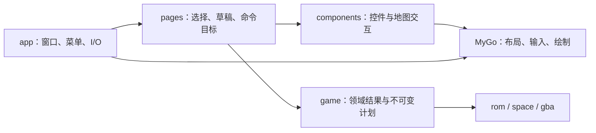

# MyGo v0.6.3 → v0.7.3 评估

> 一次性调研，核对日期：2026-10-30。项目基线为 `44cdc8fe8a5160163c58db8be1ba90cf594e53f6`，并包含调研开始时已有的章节、记录和地图组件工作区修改。本报告不维护后续升级状态；当前依赖以 `go.mod` 为准，架构与开发规则以[架构说明](../architecture.md)、[开发说明](../development.md)和 [AGENTS](../../AGENTS.md) 为准。

## 结论与版本边界

建议把 **v0.7.3 作为下一次依赖升级的目标**，先取得编辑与平台修复，再按具体需求引入新 API。收益主要在原生 UI；这次变化没有要求重新划分 ROM、领域编辑器或页面的所有权。

| 对象              | 核对结果                                                                                 |
| ----------------- | ---------------------------------------------------------------------------------------- |
| 项目当前版本      | `github.com/egoist/mygo v0.6.3`，提交 `15242900157b77228d35ca071f43e94a11bc90a0`         |
| 最新正式版本      | `v0.7.3`，提交 `6f28d7bb07b31177cf218e51586f6a5e99b38016`；发布于 2026-10-29             |
| 调研时的上游 main | `2b66322aa3355057c44317a1c510bb24946b8fa5`；还有尚未进入 v0.7.3 的修复                   |
| Go 要求           | MyGo 从 v0.6.4 起要求 `go 1.27.3`；项目 `go.mod` 和当前实际 `go version` 均为 1.27.1     |
| 证据范围          | Go 模块查询、远端 tags、各版官方 release、固定提交的源码与上游回归测试、项目当前调用路径 |

版本通过 `go list -m -json github.com/egoist/mygo`、`go list -m -json github.com/egoist/mygo@latest`、Git 远端引用和 GitHub release 交叉确认。[完整差异][compare]跨过 v0.6.4、v0.7.0、v0.7.1、v0.7.2 和 v0.7.3，不能只看最后一个补丁版本的发布说明。

本次只分析和记录，没有升级依赖，没有编译或运行升级后的应用，也没有执行 UI、ROM 或游戏回归。下文的优先级表示源码所显示的相关性和影响，不表示已经在本项目复现故障或测得性能收益。

## 可以采用的新能力

| 能力与版本                                                              | 项目中的落点                                                                      | 建议及边界                                                                                                                                                                                                                                                                    |
| ----------------------------------------------------------------------- | --------------------------------------------------------------------------------- | ----------------------------------------------------------------------------------------------------------------------------------------------------------------------------------------------------------------------------------------------------------------------------- |
| `Context.SetZoom`，v0.7.0                                               | `internal/pages/workspace.go` 的整个窗口内容；人物、职业与章节里的密集表单        | 最值得优先产品化。增加界面缩放可以同时放大文字、控件和点击区域；框架同步处理布局、指针、IME 和辅助功能坐标。缩放值属于窗口显示偏好，地图自身倍率继续属于 `mapview.View`。[依据][zoom]                                                                                         |
| 路径的端点、连接样式与虚线，v0.7.0                                      | `internal/components/mapview/paths.go`、`regions.go` 的移动路径、区域和选择覆盖层 | 可以用框架的 `Path.Cap/Join/Dash` 表达预览、选择或不同路径类型，降低手工拼接线段的复杂度。路径代表什么仍由领域结果和页面决定。[依据][paths]                                                                                                                                   |
| `PopoverMenu`／`PopoverMenuButton`，v0.7.2／v0.7.3                      | 头像地址右键菜单、地图操作菜单、章节工具栏                                        | 同一份菜单构造逻辑可以供右键和按钮使用，框架处理子菜单、键盘、焦点恢复和辅助功能。当前头像地址已有系统 `ContextMenu`，只在需要应用内统一样式或更多操作时替换；无需一次替换所有系统菜单。[依据][menus]                                                                         |
| `ui/editor.State.TextBackgrounds`、`ScrollY/SetScrollY/LineTop`，v0.7.0 | `internal/pages/hexeditor/page.go` 的原始／替换双栏；后续文本控制码或脚本诊断展示 | 支持字节片段对应文本的着色和双栏同步滚动。正式页面目前使用 `TextArea` 或类型化指令表，只有 `cmd/ui-probe` 在用代码编辑器；需要主动接入，升级不会自动获得这些功能。[依据][editor]                                                                                              |
| `Element.Hidden(bool)`，v0.7.0                                          | 文本控制码帮助、原始文本、短小的检查面板                                          | 隐藏后不占布局、不接收输入，但可保留控件状态。适合确有保留滚动或编辑状态需求的局部区域。普通隐藏子树仍执行构建，不应把所有重量级页面一起构建再隐藏；隐藏 List 的行构建是特殊的延迟路径。[依据][hidden]                                                                        |
| `Element.Cache`、局部重绘、`Painter.AnimationFrameRate`，v0.7.0         | 地图和头像预览；未来动画预览                                                      | `Cache` 保存 GPU 绘制结果，适合经测量确实昂贵、相对静态的子树。我们底图本来就是持有的 Bitmap，整张地图再缓存不一定有收益；光标、路径和笔刷频繁变化时应评估静态层与动态层的拆分。帧率 API 主要服务未来动画，当前静态编辑器没有必要主动刷新。[依据][cache]、[动画节奏][drawing] |
| `plugins/automation`，v0.7.2                                            | 临时核对原生窗口、菜单、焦点、输入和截图                                          | 可通过 socket 读取辅助功能树并操作真实应用，比固定屏幕坐标更容易复核行为。遵守项目约定，仅用于临时开发构建和受影响流程；不据此新增永久 UI 测试。需要显式导入及环境变量，生产禁用 inspector 的构建会排除它。[依据][automation]                                                 |

代码编辑器的 `TextBackgrounds.Start/End` 是**编辑器文本的字节偏移**，不是 ROM 地址；采用时由页面把领域差异映射成显示区间，并在 Buffer 版本变化后重算。领域的 `edit.Region`、计划校验和原子提交仍是写入依据。[依据][editor]

有几项新能力目前不值得为之改架构：

- `Bitmap.ReleasePixels` 主要适用于 `DecodeBitmap`：它保留原始编码数据，需要时重新解码。当前地图、头像和导入预览多用 `NewBitmap(image.Image)`；这类对象以及经 `Update` 修改的 Bitmap 不释放其像素。不要为了使用此 API，把 ROM 解码结果再编码成 PNG。[依据][bitmap]
- `DecodeImage/ImageSize` 便于显示未知类型的图片或 SVG；当前素材导入有明确 PNG、尺寸和调色板约束，不能用通用显示解码替代 `game/graphics` 的校验。[依据][image]
- `ui.Video` 和 GIF 解码器可用于未来动画参考预览，但没有提供 GBA 动画格式解析；帧与资源语义仍需领域包实现。[依据][video]
- WebView Session、网页权限、画中画、网页 `FitContent`、终端和音频功能不对应当前原生编辑器的主要路径。更新服务、系统代理和安装器配置可在分发流程有需求时采用。[依据][release-070]、[release-072]

`ui.Handle`、`FocusBind`、`Services`、`Window.Update`、checked Element 生命周期以及 `Bitmap.Update` 在 v0.6.3 已存在。它们可以继续改善当前代码，但不能计为本轮新增收益；两端的 `ui/doc.go` 没有变化。[旧版契约][contract-old]、[新版契约][contract-new]、[旧版 Bitmap][bitmap-old]

## 补丁优先级

### 与现有使用路径最直接相关

| 优先级             | 修复与首次发布                                                 | 项目相关性                                                                                                                                                                                                                                        |
| ------------------ | -------------------------------------------------------------- | ------------------------------------------------------------------------------------------------------------------------------------------------------------------------------------------------------------------------------------------------- |
| 优先随升级取得     | 中文／日文按词移动、删除和双击选择，#671，v0.6.4               | 旧实现把连续汉字、假名当成一个词，可能一次删除或选择整段。当前文本页和名称／描述编辑都使用这些输入设施。这是最直接的编辑正确性收益。新版按单字／假名划分，不是词典分词。[源码][cjk]                                                               |
| 优先随升级取得     | macOS Edit 菜单命令回到 UI 快捷键，#889，v0.7.3                | `internal/app/menus.go` 使用 `RoleCopy` 等系统角色；`portraits/inspector.go` 为地址控件注册了 `OnShortcut(Cmd, KeyC, copyAddress)`。此前菜单接管命令后，非文本控件的快捷键可能收不到；新版在文本输入未消费时转交给 UI。[源码及回归][menu-command] |
| 优先随升级取得     | macOS 自绘标题栏快速拖动与拖动抖动，#765／#811，v0.7.0／v0.7.1 | `internal/components/chrome.go` 明确使用 `DragWindow()`，每个窗口都会经过这条路径。[v0.7.0][release-070]、[v0.7.1][release-071]                                                                                                                   |
| 目标系统适用时优先 | 禁止 AppKit AutoFill 探测，#699／#701，v0.6.4                  | macOS 26／27 上可能启动 AutoFill 辅助进程并消耗 CPU、阻滞滚动；本项目大量使用原生文本输入。未测量本机是否已发生该问题。[发布说明][release-064]                                                                                                    |
| 升级硬前提         | Go 提升到 1.27.3，v0.6.4 起                                    | 新版 MyGo 的模块最低要求；上游说明包含 `crypto/x509` 修复。当前项目与实际编译器仍为 1.27.1。需同步检查项目工具链和 Nix 环境，不把自动下载工具链当作环境已经更新。[模块][gomod]、[发布说明][release-064]                                           |

### 有价值，但不能直接称为当前阻塞

| 修复                                                                      | 判断                                                                                                                                                                                                                                                      |
| ------------------------------------------------------------------------- | --------------------------------------------------------------------------------------------------------------------------------------------------------------------------------------------------------------------------------------------------------- |
| 长行光标计算从平方级改为线性，#584，v0.6.4                                | 对任意长文本粘贴和后续脚本编辑有价值；上游有 20 万字符长行的基准。但当前十六进制页限制 4096 字节并每 16 字节换行，没有依据把上游极端长行耗时当作我们的现有卡顿。[源码][caret]                                                                             |
| 复合输入框的 `Focus/AutoFocus` 指向内层输入，#793，v0.7.0                 | 我们已有 Combobox，后续跳转到人物／职业选择输入时能受益；尚未证明当前程序化聚焦路径触发此问题。普通文本框不等于该复合控件缺陷。[源码][focus]                                                                                                              |
| `Placeholder` 传到 SearchField、TokenField、Combobox 的输入，#884，v0.7.3 | 当前主要搜索框是普通 `TextInput(...).Placeholder(...)`，不会因为这个补丁额外受益。采用复合搜索控件时再利用。[发布说明][release-073]                                                                                                                       |
| 原生 UI 点击中打开 macOS 对话框，#885，v0.7.3                             | 打开／另存／PNG 导入／关闭确认很重要，但我们在 `internal/app/dialogs.go`、`assets.go`、`window.go` 中已通过 goroutine 发起，再用 `Window.Update` 发布结果；与上游直接在点击帧内等待对话框的触发方式不同。保留现有后台 I/O 边界。[源码及原生回归][dialogs] |
| 退出序列完成后事件循环仍运行时再次退出，#805，v0.7.0                      | 是进程生命周期兜底；上游触发例涉及重启流程，不能由发布说明推断本项目已无法退出。它不会替代我们的未保存确认。[源码][quit]                                                                                                                                  |
| 滚轮传给未消费事件的外层 handler，#827，v0.7.2                            | 对编辑器 hover、注解，以及以后地图滚轮缩放有意义。当前地图主要使用 `ScrollBoth` 与 `Dragged`，没有自定义滚轮 handler，不能据此认定现有地图滚动必然修好。[源码][wheel]                                                                                     |
| 原子替换文件被识别为一次写入，#686，v0.6.4                                | 将来若用 `WatchFiles` 加快外部修改提示，能避免把临时文件 rename 误判为删除。目前 `internal/app` 未使用 watcher，仍在窗口聚焦和保存时校验。[发布说明][release-064]                                                                                         |
| Router 返回页面时立即恢复正确颜色，#697，v0.6.4                           | 修复调用位于 `Router.show`；当前 Workspace 用 `switch w.tab` 选择页面，没有使用 Router。不能宣称它直接修复当前标签切换样式。[源码][route-colors]                                                                                                          |

### 新渲染路径的配套修复与跨平台收益

v0.7.0 的局部重绘带来了 #770／#771 的字形图集与临时遮罩失效修复。项目每个 ROM 一个窗口，确实需要它们保护多窗口显示，但它们修的是同一升级区间内新增的 `repaintParts` 路径，不能倒推 v0.6.3 存在同样缺陷。[字形修复][atlas]、[遮罩修复][masks]

Windows 的 #893 修复 v0.7.2 的 #855 引入的 resize 放大／裁切回归；这支持选择完整的 v0.7.3，而非停在 v0.7.2。v0.6.4 另有 CJK 短标签被截断和无 GPU 首帧故障修复。Linux 有关闭当前帧所属窗口时崩溃、快速点击丢失 release、GL 上下文与字体缓存修复。这些在实际支持相应平台前应列为重点流程，但本次没有验证 Windows／Linux 运行结果。[resize 原因][resize]、[v0.6.4][release-064]

## 对整体架构的反馈

### 领域和 UI 的现有分层成立

框架负责输入、焦点、菜单、排版、绘制和原生窗口。ROM 文档、版本识别、未知字节保留、共享引用和提交有效性仍需项目自己的领域模型。可以继续沿用：

新 API 没有理由让 `game` 持有 `ui.Bitmap`、把地图规则搬入绘制回调，或把 `editor.State` 改成框架控件树。当前 `mapview` 只消费预览与交互回调，正适合继续接入新绘制能力。[项目架构](../architecture.md)、[框架生命周期契约][contract-new]

### 撤销目标比统一快捷键更值得整理

当前至少有三种撤销目标：输入框里的文本草稿、地图／变化表草稿、已提交 ROM 文档。代码中已经出现两条命令路径：

- `internal/app/menus.go` 在非文本模式下直接执行 `Editor.Undo/Redo`。
- `internal/pages/chapters/map_editor.go` 和 `map_changes.go` 在局部 UI scope 注册草稿的 `Cmd+Z`。

这是静态代码确认的分流；本次没有通过原生交互复现它们在每种焦点下的结果。#889 让系统编辑命令能够进入框架快捷键路径，但不会自动改写我们自定义的菜单 `Click`，也不知道应该撤销哪个领域对象。[菜单命令处理][menu-command]

建议由每个 Workspace 明确当前命令目标，让菜单与快捷键使用同一选择结果，再由目标执行文本、草稿或文档的操作。先围绕这些实际目标整理回调和启用条件，无需建立全局 command bus。`TextFocused` 这个布尔值仍可描述文本焦点，却不足以独自表达另外两种历史的优先关系。

### 三种缓存需要各自的失效依据

| 层次                 | 所有者及有效性                                                   |
| -------------------- | ---------------------------------------------------------------- |
| ROM 解释／不可变计划 | 领域包按文档身份、修订和适用布局验证；这是是否允许提交的依据     |
| 页面预览与草稿       | 页面按资源选择及领域绑定复用或清理，避免显示过期结果             |
| Bitmap／GPU 子树缓存 | 组件与 MyGo 按图像、绘制内容、尺寸、主题和缩放复用；只决定如何画 |

`Cache()` 并不跳过所有 view 构建，正常 paint 仍可能绘制子树来比较变化。它不能消除 `Session.Maps.Read`、PNG 编码或领域计划构造的耗时，也不能证明一个旧计划仍可提交。当前底图和头像已保留 Bitmap，应先测量是否真的受 GPU 重绘限制，再增加缓存。[实现约束][cache]

### UI 缩放和地图坐标保持两层

`SetZoom` 改变整个窗口的逻辑尺寸和绘制比例；地图的 50%／100%／200%／400% 则改变一个 GBA 图块在内容区域内的大小。框架返回的 `c.Size()`、`Bounds` 和输入坐标已处于缩放后的内容坐标系，`mapview` 继续用自己的 `16 × scale` 换算格子即可，不能再次乘 UI 缩放。[坐标约定][zoom]

`components.Header` 已通过 `c.TitleBar()` 避开原生窗口按钮，这个模式应保留。引入整体缩放时还需要核对最小窗口、固定侧栏、地图 viewport 和弹出菜单的空间，不能只验证字体变大。

### 后台任务仍由应用决定有效性

I/O 和重计算在后台执行，通过 `Window.Update` 回到 UI 线程的规则没有改变。新渲染器不知道结果属于哪个 ROM、修订或布局；结果失效检查和窗口生命周期仍由应用负责。自绘菜单回调或对话框修复也不会让同步磁盘 I/O 变便宜。[契约][contract-new]、[对话框修复][dialogs]

若以后接入 `WatchFiles`，订阅和停止属于 `app` 的窗口生命周期，事件只触发重新检查；文档的外部修改判断与保存冲突校验仍是事实来源。无需为本次升级预先建立通用后台任务框架。

## 尚未发布但值得跟踪

截至调研基线，以下内容只在 `main`，不包含在 v0.7.3：

| 提交                                                    | 对本项目的意义                                                                                                                                                                                                 |
| ------------------------------------------------------- | -------------------------------------------------------------------------------------------------------------------------------------------------------------------------------------------------------------- |
| `2b66322`，#928：macOS 空闲窗口停止持续唤醒 Go          | 与桌面编辑器长时间静置直接相关。v0.6.3 已有持续 observer，v0.7.3 仍未取得这一修复；上游报告降低唤醒和 CPU 使用，但不是本项目测量。建议跟踪下一正式版；只有实际测得空闲功耗问题时再考虑固定此提交。[源码][idle] |
| `813ee46`，#909：Grid 子元素百分比按单元格计算          | 人物／职业页使用 Grid，但抽查的直接子元素没有呈现上游 `FillWidth` 卡片跨列的明确触发模式。后续做响应式宽度时值得注意，不能把它算进 v0.7.3 的收益。[源码][grid]                                                 |
| `85fd4bb`，#896：部分滚出视口的元素在指针处打开自绘菜单 | 若采用新 PopoverMenu 并用于长列表／滚动检查面板，需要关注；目前头像地址仍是系统菜单。[源码][menu-scroll]                                                                                                       |

不建议仅因为 `main` 更新更近就改为跟随分支。正式升级目标与未发布补丁应分别评估。

## 升级实施边界

1. **先做依赖与工具链升级。** 目标 v0.7.3；Go 至少 1.27.3。两端 MyGo `go.mod` 的依赖列表没有变化，变化是 Go 最低版本。系统工具链调整应进入 Nix 配置，不能把当前 1.27.1 环境称为已经符合要求。[模块][gomod]
2. **再核对打包契约。** v0.7.0 改为按 slug 命名 DMG 和 Windows 安装器；当前 `mygo.json` 的名字是 ASCII 的 `FEBuilderGBA`，没有显式 slug。CJK 默认 slug 的变化不是本项目当前触发点，但安装包文件名和下载／CI 匹配规则仍应核对。macOS 子窗口、音频 Position 和 v0.7.2 网页手势默认值的 breaking changes 不对应当前主要调用。[v0.7.0][release-070]、[v0.7.2][release-072]
3. **按源码核对生命周期。** 本项目已使用 checked Element、Handle 和 Services；迁移指南描述的这些机制不代表本次又发生了一次转换。升级时先预览 `migrate-ui` 并审查实际结果，避免盲目批量改写。[迁移指南][migration]
4. **执行与变更相称的验证。** 实际升级需运行项目 `just check`；若改变历史或并发，再运行 `just test-race`。临时原生复核集中于中文编辑、地址复制、菜单／草稿／文档撤销、拖窗、打开保存与关闭确认，以及多 ROM 窗口。引入 UI 缩放后再核对坐标和布局，不新增永久 UI 或模拟器测试。
5. **新功能逐项接入。** 优先整体 UI 缩放；按交互需要采用路径样式、菜单和局部 Hidden；代码编辑器增强与 GPU 缓存需有实际工作流或测量支撑。升级本身不扩大格式支持或产品完成状态。

以上是后续实施建议，本次仅新增本报告和归档导航，没有执行这些升级步骤。

## 一手来源

[compare]: https://github.com/egoist/mygo/compare/15242900157b77228d35ca071f43e94a11bc90a0...6f28d7bb07b31177cf218e51586f6a5e99b38016
[release-064]: https://github.com/egoist/mygo/releases/tag/v0.6.4
[release-070]: https://github.com/egoist/mygo/releases/tag/v0.7.0
[release-071]: https://github.com/egoist/mygo/releases/tag/v0.7.1
[release-072]: https://github.com/egoist/mygo/releases/tag/v0.7.2
[release-073]: https://github.com/egoist/mygo/releases/tag/v0.7.3
[gomod]: https://github.com/egoist/mygo/blob/6f28d7bb07b31177cf218e51586f6a5e99b38016/go.mod
[contract-old]: https://github.com/egoist/mygo/blob/15242900157b77228d35ca071f43e94a11bc90a0/ui/doc.go
[contract-new]: https://github.com/egoist/mygo/blob/6f28d7bb07b31177cf218e51586f6a5e99b38016/ui/doc.go
[bitmap-old]: https://github.com/egoist/mygo/blob/15242900157b77228d35ca071f43e94a11bc90a0/ui/bitmap.go
[zoom]: https://github.com/egoist/mygo/blob/6f28d7bb07b31177cf218e51586f6a5e99b38016/docs/ui/windows.md#zoom
[paths]: https://github.com/egoist/mygo/blob/6f28d7bb07b31177cf218e51586f6a5e99b38016/docs/ui/drawing.md
[menus]: https://github.com/egoist/mygo/blob/6f28d7bb07b31177cf218e51586f6a5e99b38016/docs/ui/context-menu.md
[editor]: https://github.com/egoist/mygo/blob/6f28d7bb07b31177cf218e51586f6a5e99b38016/ui/editor/state.go
[hidden]: https://github.com/egoist/mygo/blob/6f28d7bb07b31177cf218e51586f6a5e99b38016/ui/element.go#L991
[cache]: https://github.com/egoist/mygo/blob/6f28d7bb07b31177cf218e51586f6a5e99b38016/ui/cache.go
[drawing]: https://github.com/egoist/mygo/blob/6f28d7bb07b31177cf218e51586f6a5e99b38016/docs/ui/drawing.md
[automation]: https://github.com/egoist/mygo/blob/6f28d7bb07b31177cf218e51586f6a5e99b38016/docs/plugins/automation.md
[bitmap]: https://github.com/egoist/mygo/blob/6f28d7bb07b31177cf218e51586f6a5e99b38016/ui/bitmap.go
[image]: https://github.com/egoist/mygo/blob/6f28d7bb07b31177cf218e51586f6a5e99b38016/docs/ui/image.md
[video]: https://github.com/egoist/mygo/blob/6f28d7bb07b31177cf218e51586f6a5e99b38016/docs/ui/video.md
[cjk]: https://github.com/egoist/mygo/commit/5a134b437a3ee6486484ffc4fef712bf53c77da4
[menu-command]: https://github.com/egoist/mygo/commit/4aca72f189312cf78106f4c8fed5581d3714ac67
[caret]: https://github.com/egoist/mygo/commit/7e132cfb3d7fdc54922de0224a63ab5651a32a9e
[focus]: https://github.com/egoist/mygo/commit/8006903cd3b4f269050be2729452496bbfd81e8f
[dialogs]: https://github.com/egoist/mygo/commit/bca8cf3341b603266f8f438417ff07729de12f39
[quit]: https://github.com/egoist/mygo/commit/1155c96d8d09c8010564174a6951291f843b44d0
[wheel]: https://github.com/egoist/mygo/commit/8e7c49cf1c9eaa5b6c921694c2fa284d90acdd2a
[route-colors]: https://github.com/egoist/mygo/commit/1549ce9b97ac31ae5ef01251ce61f1d5f738edde
[atlas]: https://github.com/egoist/mygo/commit/e112e5efc7151dd8ada13485fc890f77155b1230
[masks]: https://github.com/egoist/mygo/commit/b343bbf780a467e2a218d9f421392c63a86cad79
[resize]: https://github.com/egoist/mygo/commit/c1467c1a46ac16b19b4347856ebe1bb450d74aa3
[idle]: https://github.com/egoist/mygo/commit/2b66322aa3355057c44317a1c510bb24946b8fa5
[grid]: https://github.com/egoist/mygo/commit/813ee465b9632f56ed74fd95714a2d15196e7ca4
[menu-scroll]: https://github.com/egoist/mygo/commit/85fd4bbad893199869f975156d3cfe704fc497a8

- 正式版发布说明：[v0.6.4][release-064]、[v0.7.0][release-070]、[v0.7.1][release-071]、[v0.7.2][release-072]、[v0.7.3][release-073]。
- 生命周期与工具：[v0.7.3 契约][contract-new]、[迁移指南][migration]。
- 其余来源分别链接在对应判断处；源码链接固定到提交。

[migration]: https://github.com/egoist/mygo/blob/6f28d7bb07b31177cf218e51586f6a5e99b38016/docs/ui/migration.md
