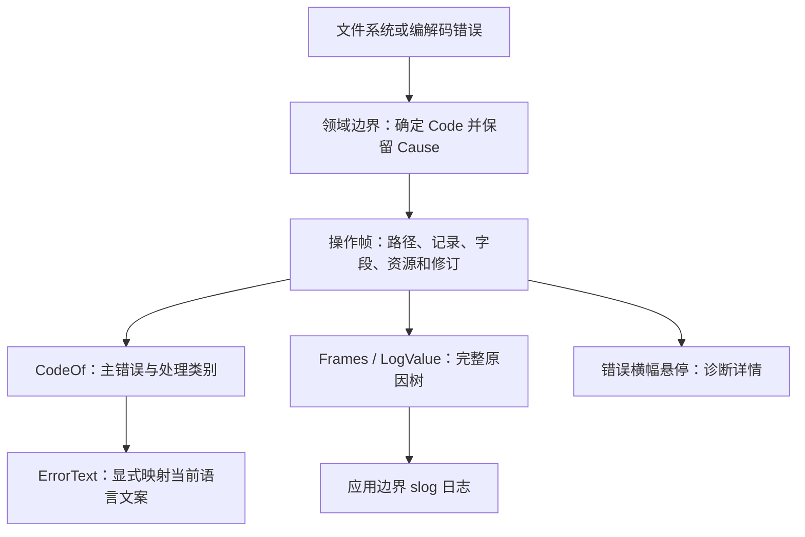

# 结构化错误

当前实现使用零外部依赖的 [`fault`](../fault/error.go) 包。错误码由发现问题的包定义；操作边界补充上下文；UI 显式映射中英文文案。领域核心不依赖 catalog，也不把 `Error()` 的文本当成协议。

文章区分机器处理所需的稳定分类与排障所需的操作上下文，并建议在语义边界转换错误、保留原因。本项目据此实现 Go 的错误链和错误树，保留标准库 [`errors.Is`、`errors.AsType` 与 `errors.Join`](https://pkg.go.dev/errors) 的行为。

## 数据模型与处理约定

| 名称 | 含义 | 使用方 |
| --- | --- | --- |
| `fault.Code` | 稳定 `ID` 与处理类别 `Kind`，本身实现 `error`；各领域定义自己的值 | 领域规则、UI 文案映射 |
| `fault.Error` | 一个操作帧：`Code`、`Op`、`Context`、`Cause` | 操作边界、诊断 |
| `fault.Context` | 路径、表、记录、字段、资源、字节范围、值范围与修订等命名字段 | 日志和高级诊断 |
| `fault.CodeOf(err)` | 最外层语义错误码；遇到 `errors.Join` 时以第一个非 nil 原因为主 | 程序处理决策 |
| `fault.Frames(err)` | 从外到内深度优先遍历全部操作帧，包含次要原因 | 读取领域上下文 |
| `fault.LogValue(err)` | 保留字段和原因树的 `slog.Value` | 应用边界日志 |

可选数字使用指针或可选结构体，确保记录 ID `0`、偏移 `0` 和修订 `0` 都能表示。上下文只包含已知事实，不保存完整 ROM、PNG 或文本草稿。`Error()` 是不随 UI 语言变化的诊断文本，可以调整格式；禁止解析它来做业务判断或选择翻译。

| `Kind` | 处理含义 | 当前例子 |
| --- | --- | --- |
| `InvalidInput` | 修改输入后重新执行 | 字段值越界、非法十六进制、PNG 颜色不符合限制 |
| `InvalidData` | 检查源数据、布局或资源 | 无效表指针、损坏地图、图像解码失败 |
| `Unsupported` | 选择受支持的版本或格式 | 未支持版本、头像扩展、文本控制码 |
| `Conflict` | 重新读取或显式解决冲突 | 过期预览、外部修改、已存在目标、引用不再匹配 |
| `NotFound` | 检查资源位置 | 文件不存在、未找到模拟器 |
| `Permission` | 调整权限或选择可写目标 | 文件无写权限、系统拒绝访问 |
| `Capacity` | 减少资源大小或改变操作 | 写入超过 ROM 的 32 MiB 上限 |
| `IO` | 查看具体文件操作与原因 | 备份目录被普通文件占用、未知文件系统错误 |
| `Canceled` | 结束本次操作 | 标准库取消错误 |
| `Unknown` | 保留诊断信息，不能据此推断恢复方式 | 未分类的外部错误 |

类别用于描述调用方可以采取的处理方向，具体动作仍由操作决定。当前没有自动重试；特别是写入冲突必须重新读取或由用户显式选择解决方式。文章中的临时／永久重试状态尚无对应业务需求，未引入。

## 添加上下文与语义转换

`fault.Wrap(err, op, context)` 保留主错误码，成功时返回 nil。在一次用户操作、跨包调用或文件 I/O 阶段补充上下文，避免每个内部 helper 都重复相同信息。

`fault.New(code, op, context, cause)` 用于语义转换。例如地图解压失败，对调用方的主错误是 `game.invalid_map`，底层仍保留 `gba.invalid_graphics`：

```go
return fault.New(ErrMap, "game.decompress_map", fault.Context{
    Resource:   label,
    ResourceID: new(int(id)),
}, err)
```

调用方通过 `fault.CodeOf(err)` 得到 `game.invalid_map`；`errors.Is(err, gba.ErrGraphics)` 仍然可以检查底层原因。`errors.Is` 搜索整棵树，因此不能靠依次枚举多个候选错误来决定哪个是主错误。无须重新解释语义时只添加操作帧。

保存失败与临时文件清理失败通过 `errors.Join(primary, cleanup)` 合并。即使主错误无法分类，也不允许次要错误覆盖它的类别。OS 的 `*fs.PathError` 原样保留，仍可用 `errors.AsType[*fs.PathError]` 提取系统操作与路径。

操作名为稳定的包内标识，例如 `rom.backup`、`rom.replace`、`game.plan_text`；不是翻译 key，也不与函数名强制绑定。当前通过明确操作名记录逻辑路径，不捕获运行时堆栈或源码位置。



## 已接入行为

- `rom` 的打开、读取、关闭、保存、备份、替换和临时文件清理带操作与路径。编辑错误保留失败字节范围或期望／当前修订。保存复查发现源文件消失时，主错误仍为外部修改冲突，并保留文件不存在的原因。
- `game` 的字段／批量编辑、手动布局、原始字节、表搬迁、文本、PNG 素材和地图入口带对应上下文。批量校验指出第一个失败记录；验证完成后才一次性提交。
- `space` 的追加、搬迁、分配与引用校验带范围或引用地址。容量上限与失效引用有不同类别。
- 地图、头像、职业卡和 PNG 解码不再丢弃底层原因。文本规划保留未知控制码、缺少参数和编码失败各自的错误码；截断 PNG 属于图像解码失败，尺寸限制仍单独报告。
- [`ErrorText`](../internal/components/errtext.go) 使用显式 `Code.ID → catalog 函数` 映射，切换语言后重新解析文案。未知错误保留通用提示与诊断文本，不尝试把字符串匹配成 catalog key。
- 桌面文件操作在应用边界记录结构化日志，核心包不记录日志。全局错误横幅的悬停提示提供诊断详情；字段级提示继续显示本地化文案。没有新增独立诊断面板。

## 验证与扩展

[`game/errors_workflow_test.go`](../game/errors_workflow_test.go) 通过实际会话验证批量失败的字段上下文、失败原子性、过期草稿及重新读取后的恢复；通过打开失败验证 OS 原因、主次错误优先级与结构化日志。地图、文本和素材现有场景验证具体错误分类及原因保留。

[`rom/errors_workflow_test.go`](../rom/errors_workflow_test.go) 用真实临时文件验证备份阶段失败不发布保存点、不改变磁盘文件、清除临时文件，修复目录后能保存；删除原路径后必须报告冲突，另存后能重开同一快照。测试不运行 UI 或模拟器。

新增错误时，在发现问题的包中定义 `fault.Code`，选定调用方可以使用的 `Kind`，在语义边界保留原因，再为该 ID 添加显式文案映射。需要新上下文时扩展命名字段；不要引入任意字符串键的参数包、解析诊断文本或为依赖类型逐个复制错误分类。
