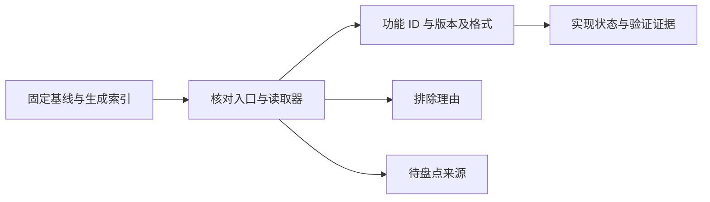

# 旧版来源与兼容边界

覆盖基线固定在子模块提交 `8e3557912ddab708d11bf85ad311b41bb6630fd1`。来源索引用于回查旧代码，人工维护的能力及状态见[覆盖矩阵](coverage.md)。当前行为盘点尚未完成，不报告整体功能完成百分比。

## 生成来源索引

在仓库根目录执行 `just inventory`，默认输出 `.cache/legacy-inventory.csv`。需要其他位置时传入 `-root`、`-out`。生成结果不纳入版本管理；旧版基线或扫描规则改变后重新生成。

[来源索引生成器](../cmd/legacy-inventory/main.go) 扫描 `.csproj` 的独立编译项、`Program.cs` 中显式检查的 CLI 参数、配置目录 TXT 和静态可提取的窗口调用者。当前共 17,376 项，包括 312 个表单、13 个用户控件、105 个其他源码项，以及 12 个不同 CLI 参数。CLI 计数包含启动和 DEBUG 参数。

TXT 共 16,934 个。按文件名前缀分类，其中 4,185 个以 `PATCH_` 开头，12,749 个归入其他 TXT。后者的 `config` 标签只表示没有匹配该前缀，其中也可能有补丁定义、游戏文本、汇编符号和说明文档。

按目录统计，`config/data` 有 422 个 TXT，`config/patch2` 有 16,509 个，`config/translate` 有 3 个。游戏、语言和补丁历史版本分别计数，文件数不等于功能数。

生成器将所有 `assessment` 固定写成 `unassessed`。这个值不表示新版实现状态，也不应手工修改。正则提取的调用者不构成完整调用图，动态跳转、菜单子操作、二进制素材、非 TXT 格式及独立工具仍需人工核对。

## 从来源到能力

来源条目不是任务单元。一个窗口可能包含导入、编辑、扩表、导出等多种行为，多个窗口也可能共同实现一次用户操作。按用户可完成的操作建立稳定功能 ID，再关联版本、入口、读取器和格式。

| 来源范围                             | 处理方式                                                     | 当前盘点边界                                                                     |
| ------------------------------------ | ------------------------------------------------------------ | -------------------------------------------------------------------------------- |
| 表单、菜单和公共控件                 | 核对菜单子动作、事件处理器、右键操作及共用读取器，再映射功能 | 已实现领域有具体来源；其余按覆盖表的功能组和独立缺项继续核对，未逐个关闭所有入口 |
| CLI 参数                             | 分别记录启动行为、产品命令与 DEBUG 参数                      | 参数清单见下节，输入输出、退出码和附属文件仍需逐命令核对                         |
| 游戏布局、枚举、事件编码             | 作为领域规则随对应功能接入                                   | 不按 TXT 文件或语言副本计数；当前只迁移具体功能需要的定义                        |
| 社区补丁与资源包                     | 核对格式读取器、依赖、版本条件及相对资源引用                 | 检测部分特征不代表已实现安装、配置、卸载或兼容全部包                             |
| 二进制、图像、音频及其他非 TXT 文件  | 跟随导入导出、补丁及外部工具工作流核对                       | 生成器未枚举，尚不能据 CSV 声明盘点完成                                          |
| 旧编辑器 UI 文案                     | 从旧版迁移任务中排除                                         | 新 UI 自行维护翻译；游戏规则说明和资源元信息不在此排除范围                       |
| 历史补丁版本、不同语言副本、说明文档 | 核对语义后归并或说明排除理由                                 | 不仅按文件名判断重复，也不为每个副本创建功能                                     |

每个功能组关闭盘点前，需要说明：哪些来源映射到哪些功能，哪些被排除及原因，是否仍有未判断的菜单、格式或动态入口。当前表只划定核对范围，尚未建立全部来源条目的逐项映射。

## CLI 参数范围

依据 [Program.cs](../FEBuilderGBA/FEBuilderGBA/Program.cs) 中显式检查的参数；主程序的位置参数打开不等于兼容旧命令行。

| 类别       | 参数                                                                                             | 需要核对的契约                                                       |
| ---------- | ------------------------------------------------------------------------------------------------ | -------------------------------------------------------------------- |
| 启动       | `--lastrom`、`--rom`                                                                             | 最近文件恢复、显式路径与优先级                                       |
| 产品命令   | `--lint`、`--rebuild`、`--pointercalc`、`--translate`、`--makeups`、`--songexchange`、`--disasm` | 对应领域操作、输入格式、输出文件、失败与退出行为                     |
| DEBUG 路径 | `--translate_batch`、`--testonly`、`--test`                                                      | 先判断是否属于对外契约，再记录兼容或排除理由；不能计入已完成产品能力 |

## 旧版 TXT 与新版兼容边界

TXT 的处理方式取决于内容及对外契约。新版保留规则含义和社区资源读写能力，不要求复刻 `bin/Debug/config` 目录或逐文件对应。

旧 UI 文案不计入迁移任务，新版根据自己的交互编写。游戏规则说明、枚举含义和社区补丁元信息仍作为领域内容评估。

| 内容                     | 已检查的旧版实例                                                  | 新版处理原则                                                                                   |
| ------------------------ | ----------------------------------------------------------------- | ---------------------------------------------------------------------------------------------- |
| 旧编辑器自身的界面文案   | `config/translate` 等界面翻译资源                                 | 不迁移、不计入功能覆盖任务；新版 UI 独立编写文案，由 MyGo catalogs 管理                        |
| 枚举及版本相关说明       | `data/ai1_FE8.en.txt` 包含 AI 值、说明和 J/U 条件                 | 值与适用条件进入领域数据，显示文案与规则分离                                                   |
| 指令编码与参数定义       | `data/event_FE8.en.txt` 包含字节模板、参数类型、指针语义和说明    | 用结构化领域定义表达，按数据规模选用 Go 表或可校验的数据文件；不能只提取翻译文本               |
| 社区补丁定义             | `PATCH_*.txt` 等文件中的 `TYPE`、`PATCHED_IF`、`EA`、`EDIT_PATCH` | 实现旧格式兼容读取，转换为内部补丁定义，分别处理检测、配置和安装；无需让核心模型沿用旧键值文本 |
| 写入 ROM 的游戏文本      | `patch2/FE8U/skill20220703/0xe00.txt` 等补丁附带文本              | 按游戏资源及 ROM 编码处理，与编辑器的 MyGo i18n 分开                                           |
| 汇编符号、说明与历史副本 | `*.sym.txt`、README、多个日期版本的 SkillSystem 目录              | 按对应工具工作流使用，保留所需来源及版本信息，不为每个文件建立独立迁移任务                     |

补丁的相对路径引用也要兼容。例如 `FE6/AllInstrumentEA/Patch_AllInstrument.txt` 引用 `FE7U/AllInstrumentEA` 下的 `.event` 和 `.bin`。导入必须保留或解析这些关系，不能只收集 TXT 或扁平化目录。

该文件也说明，大小写敏感的 `PATCH_` 前缀不能识别全部补丁。索引分类需结合读取器和文件内容核对。

当前已有 FE8U 表布局和字段定义直接使用 Go 数据结构；完整事件定义加载和社区补丁安装仍未实现。后续实现这些能力时，再按对应工作流引入格式适配，不因来源索引列出了文件就提前复制全部旧资源。

## 维护方式

功能 ID、状态和已知缺口由覆盖矩阵维护，本页维护来源盘点规则与兼容边界。新增格式来源链接使用[固定版本](sources.md)。生成 CSV 的 `assessment` 保持生成器默认值，不用它保存人工判断，也不在本页复制逐功能实现状态。
