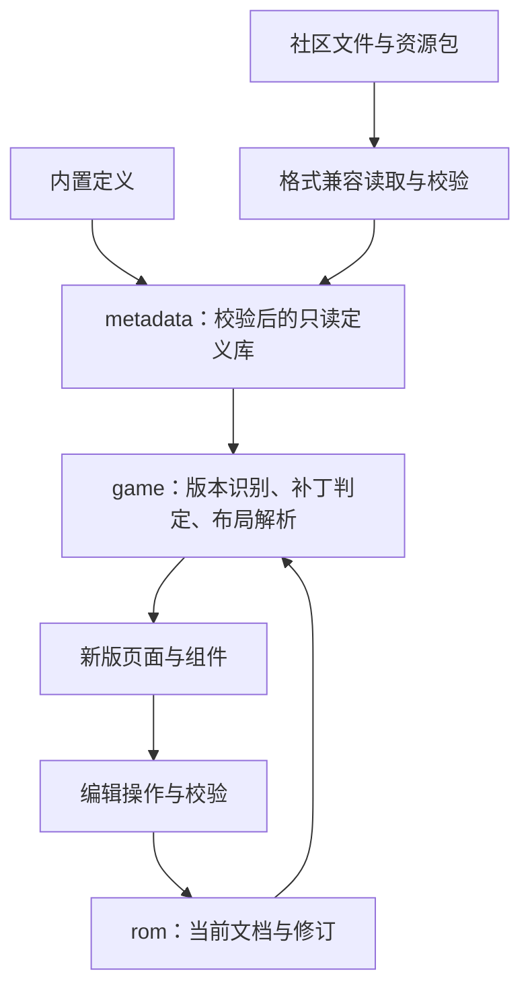

# 游戏元数据层设计

状态：设计方向已确认，暂缓实施。当前只记录职责、边界和后续接入原则；不创建元数据包、定义文件或转换工具，不迁移现有 Go 定义。等具体功能需要共享或导入这些定义时，再按该功能的范围实施。

关联：[重建计划](rebuild-plan.md)、[覆盖矩阵](coverage.md)。

## 目的与现状

元数据指描述游戏格式和规则的数据，例如字段宽度、表定位规则、事件参数类型和补丁适用条件。它用于统一维护多游戏版本与补丁差异，并让社区格式通过适配进入同一套领域模型。

当前 [Field 与 Table](../febuildergba-go/internal/game/session.go)、[FE8U 表定义](../febuildergba-go/internal/game/fe8u.go) 和 [表解析](../febuildergba-go/internal/game/tables.go) 已具备部分基础。现有实现继续使用；元数据层不是当前编辑器运行或继续开发的前置条件。

未来包名暂定 `internal/metadata`，表示游戏定义库。具体类型、接口和 JSON 字段在首次实际接入时确定，不预先建立通用配置框架。

## 数据边界

| 内容                                                         | 归属与用途                                             |
| ------------------------------------------------------------ | ------------------------------------------------------ |
| 游戏版本标识、适用条件、关联的表与编码规则                   | 元数据，用于选择定义                                   |
| 表尺寸、字段偏移与类型、枚举、位标志、引用目标、候选指针位置 | 元数据，用于解释布局及校验编辑                         |
| 事件指令编码、参数类型、长度与指针语义                       | 元数据，用于事件编解码与引用识别                       |
| 补丁检测条件、依赖、冲突、布局影响、安装资源引用             | 元数据；检测、解释与安装执行分别处理                   |
| 定义来源、适用版本、补丁包版本                               | 元数据，用于追溯和修正                                 |
| 当前人物数值、名称、图像、游戏文本                           | ROM 或资源包中的实际内容，由对应编解码器处理           |
| 当前 ROM 的表地址、命中的补丁、有效字段集合、解析错误        | 单个 ROM 会话的解析结果                                |
| 撤销历史、脏状态、保存点、控件草稿                           | 文档或编辑状态                                         |
| 编辑器界面布局与文案                                         | 新版 UI 与 MyGo i18n；旧 UI 文案不迁移、不计入覆盖任务 |

例如，“FE8U 人物等级位于记录的 `+0x0B`，占 1 字节”属于元数据；“当前人物等级为 5”属于 ROM 内容；“这份改版的人物表实际位于哪里”由游戏适配结合 ROM 解析。

游戏规则说明、枚举含义和补丁作者信息可以作为领域内容保留。游戏文本与 UI 翻译分别处理。补丁附带的图像、脚本、二进制及游戏文本继续作为资源保存，定义库记录其引用，无需把全部内容塞进 JSON。

## 职责与数据流

以下为后续接入方向，图中的元数据加载与兼容导入尚未实现。

- `metadata` 提供类型化定义及查询，不依赖 MyGo、窗口或当前打开的 ROM，不直接写入 ROM。
- `game` 结合定义与 ROM 快照解析有效布局。现有 `Adapter` 的职责继续保留，具体接口在接入时调整。
- 页面使用会话提供的字段、记录与诊断；界面如何分组、展示和编辑由新版 UI 决定。
- Huffman、LZ77、资源搬迁、引用更新和补丁安装等算法由 Go 实现。数据描述支持的参数与规则，不引入任意脚本执行或通用表达式引擎。
- 编辑操作统一经过领域校验及 `rom.Document`，继续使用现有的修订检查、撤销重做、保存和备份机制。

## 存储与加载

首次接入优先采用可版本管理的 JSON、Go 类型校验、`go:embed` 打包和内存索引，使用标准库。JSON 负责数据表示，核心消费经过校验的 Go 定义，不在各层传递任意键值字典。

具体迁移时，已迁移定义以 JSON 为唯一维护来源，删除相应的重复 Go 数据定义；算法仍保留为 Go 实现。未进入当前功能范围的定义继续沿用现有实现，不要求一次迁移全部规则。

定义使用与语言无关的稳定 ID；领域含义、数值编码和适用版本分别表达，避免用显示名称或旧文件名充当跨定义关联键。记录格式版本与数据版本，明确加载器支持范围；具体版本字段在首次接入时确定。

加载时至少检查：

- 支持的格式版本、已知字段及正确的数据类型，避免拼写错误被静默忽略。
- 重复 ID、失效引用、非法字段宽度、偏移和记录边界。
- 依赖缺失或循环、重复且未说明组合关系的定义。
- 当前支持的指令、检测条件及布局变更种类；无法解释的内容产生带定义 ID 和来源的诊断。

这些检查保证定义本身一致。对当前 ROM 的地址、长度、指针和写入范围检查仍由游戏适配及文档执行。

加载完成的定义库只读，可供多个窗口共享。当前不设计热更新、在线规则服务或元数据编辑界面。若以后需要更换定义版本，应明确会话绑定和缓存失效方式，再扩展该能力。

暂不引入 SQLite。文件数量本身不构成数据库需求；只有实际查询、索引或维护工作流显示出收益时再评估，并保持存储实现与领域访问接口分离。

## 版本、补丁与会话隔离

共享定义只描述各版本及补丁的规则。每个 ROM 会话根据自身字节、已识别条件和手动布局得到有效定义及实际地址，不修改共享的基础定义。

补丁组合使用明确的适用条件、依赖和组合规则。两个补丁修改同一布局且没有明确组合方式时，报告受影响的冲突，不使用加载顺序决定覆盖结果。

ROM 修改或撤销可能改变指针、版本标头和补丁特征，相关解析结果需要随文档修订重新计算或失效。多个窗口即使使用同一游戏定义，也保持各自的有效布局和诊断。

未命中已知补丁本身不限制编辑。只有具体字段或操作的地址、长度、布局等无法确定或不合法时，停止该次自动写入；手动布局与原始字节入口仍遵守原有边界校验。

## 旧资源与外部格式

旧 TXT 的字段语义通过兼容读取转换为内部定义，不把旧目录结构、文件数量或界面控件命名变成新版模型。仅迁移当前功能实际需要的数据；完整兼容的范围按工作流在覆盖矩阵中维护。

补丁包中的相对路径、依赖、游戏版本条件以及 `.event`、`.bin` 等关联资源属于格式语义，导入时需要保留或完整解析。无法解释且会影响行为的定义应明确报告，不能静默丢弃后继续安装。

[旧版来源索引](../febuildergba-go/README.md#覆盖索引) 按需在本地生成，用于回查出处；它不是运行时数据库，也不作为元数据生成器的输入规范。重复语言文件和历史补丁版本应先核实语义，再决定如何归并，不能只按文件名合并。

## 何时实施与如何接入

元数据层保持暂缓实施。新增游戏适配需要共享版本定义、事件编辑需要指令集合，或社区补丁导入需要统一规则模型时，结合具体需求启动；不因这份设计已存在就提前抽取全部定义。

届时按需求逐步推进：

1. 从已有 FE8U 人物、职业和道具定义中提取本次需要的数据，保持当前读取、编辑及写入结果。
2. 用实际需求验证边界：版本扩展时接入 FE8J 等第二个版本；事件或补丁需求则接入对应的代表性定义与资源包。
3. 将后续枚举、事件和补丁数据随各自功能接入，不批量复制全部旧资源。
