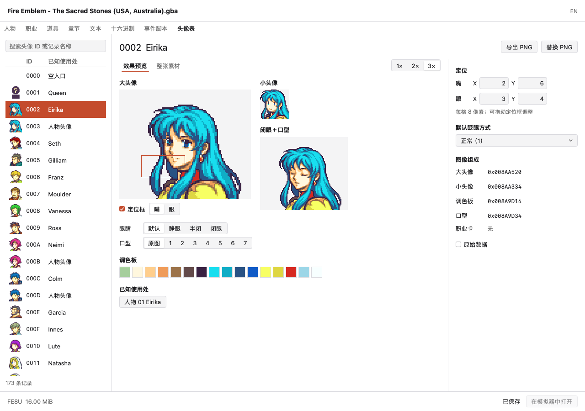

# 头像编辑页

本文维护五版原生头像页的交互和字段语义，支持范围见[覆盖矩阵](coverage.md)。截图来自 MyGo 页面和原版 FE8U 数据。

## 页面组织

人物 ID 与头像 ID 独立，例如人物 01 引用头像 02。人物页决定使用哪份资源，头像表管理这份共享资源的组成、定位和显示方式。

左侧列表显示小头像、ID 和已知使用者。中间显示大头像、小头像和表情检查图，右侧提供定位、默认眨眼、部件地址及高级入口。

窄窗口将右侧设置排在预览下方，各主要区域均可滚动。

另见[窄窗口](images/portrait-editor-narrow.png)、[整张素材](images/portrait-editor-sheet.png)和[FE6 页面](images/portrait-editor-fe6.png)。

## 视觉规则

页面使用现有系统字体、强调色和中性底色。像素图与定位框显示编辑对象及部件位置。

| 颜色      | 用途                   |
| --------- | ---------------------- |
| `#FFFFFF` | 页面与主工作区         |
| `#F4F4F6` | 输入区及透明图预览底   |
| `#D8D8DE` | 输入边界与分隔         |
| `#1D1D1F` | 主要文本与字段值       |
| `#6B6B6B` | 说明、单位和不适用项   |
| `#C44B2C` | 当前选择、焦点与定位框 |

正文、辅助文字和头像标题的字号分别为 13、12、20。ID 和坐标使用等宽数字，地址使用等宽字体。名称、标签和说明左对齐，数值右对齐。

区块间距为 16，组内为 6 至 8。图像按整数倍放大，表情由用户手动切换。

大头像、小头像和表情检查图使用不同尺寸，分别用于定位、辨认和检查表情。

## 部件与表情

- 主视图支持 1×／2×／3×，可切换效果预览和整张 PNG 素材。
- FE7／FE8 提供默认、睁眼、半闭、闭眼，以及原图和七个口型；闭眼＋口型检查图独立显示。
- FE6 提供原图与五个主图内口型，没有独立眼睛或默认眨眼控件。
- 预览帧、缩放、素材视图和定位框设置只保存在窗口中，不修改 ROM 或历史。眼睛和口型属于同一控制组，组内间距为 6。
- 已知使用处显示目标记录种类、ID 和名称，字段名放入提示；无名称时保留种类与 ID。
- 调色板显示 16 色，颜色 0 标为透明。颜色修改仍通过完整 PNG 预览和应用流程进行。
- 空入口、缺少部件和损坏引用分别处理。主图、小头像和素材表独立读取；某个表情帧不可用时保留可读主图并显示原因。
- 职业卡仅提供自身预览、调色板和有效资源入口，不显示眼口定位或表情控件。

## 定位与历史

| 原生布局               | 记录长度 | 嘴 X／Y  | 眼 X／Y  | 默认眨眼 |
| ---------------------- | -------- | -------- | -------- | -------- |
| FE6                    | 16       | +12／+13 | 不存在   | 不存在   |
| FE7U／FE7J／FE8U／FE8J | 28       | +20／+21 | +22／+23 | +24      |

坐标每格 8 像素，叠加部件为 32×16 像素。点击坐标输入框会选择对应的嘴或眼定位框，拖动按格对齐。

输入允许原生无符号字节范围 0 至 255，已有值超出可见区域时也保留。图上拖动限制在可见头像内。

有效数值输入立即写入文档，非法或不完整输入保留草稿，切换预览方式后仍可继续。上下键微调，Cmd+Z／Cmd+Shift+Z 使用 ROM 历史。拖动时只改变窗口预览，松开后把 X、Y 一起写入，一次撤销恢复两个坐标。

眨眼选择器提供正常 1 和闭眼 6，其他值原样显示。高级区可编辑原字节。

结构化写入只修改已确认字段，保留指针、其他记录和未解释字节。写入对象记录文档身份、revision 和窗口布局。修订、布局或表入口变化后，必须重新读取才能写入。

## 素材与地址

PNG 导入导出使用完整素材表。导入时校验颜色，预览共享影响，再应用或取消。应用形成一次历史操作，保留眼口坐标和眨眼方式。换图后可检查表情与定位，修改定位会使先前的 PNG 预览失效。

部件列表显示主图、小头像、口型、调色板和职业卡的 ROM 文件地址。地址可聚焦，点击或 Enter 查看通过范围校验的原始字节。Cmd/Ctrl+C 或右键菜单复制完整地址。

空指针显示无资源，损坏指针显示原因。高级区显示记录字节和指针位置，修改使用现有十六进制编辑器。

头像表跟随实时表指针，保留表内空洞，省略末尾空记录；最多发现 4096 条，连续 1000 个空记录停止。引用中的损坏记录仍可见，避免一个坏部件隐藏后面的有效记录。缩略图按可见行加载并随文档修订失效。

已知 MUG_EXCEED／HALFBODY 格式保留既有静态预览；其定位和完整素材写入不按原生布局推断。新建头像 ID、头像表扩展、自定义引擎及自动表情播放尚未接入。

## 人物与职业页

身份区并列显示大头像和小头像，直接提供头像 ID 输入与"前往头像表"。修改引用不再需要先切关联数据；进入头像表时选择目标并保留完整列表上下文。

人物头像 ID 为零时解析当前默认职业的头像，界面标明继承来源，保留人物原值零。默认职业仍可能被章节部署覆盖，预览不代表特定场景中的实际单位。

人物小头像值为零时沿用实际头像，非零时使用通用小头像。界面显示原值和来源。

读取器单独解析五版原生通用图像、调色板表，该值独立于普通头像表 ID。可读取的像素提供字节入口。通用小头像扩展补丁不按原生表解释，专用 PNG 编辑器尚未接入。

## 实现边界与验证

- [editor.go](../game/portrait/editor.go)：独立部件读取、原生帧组合、可写字段、修订绑定与原子定位。
- [records/portrait.go](../game/records/portrait.go) 选择人物／职业引用与职业回退；[portrait/record_preview.go](../game/portrait/record_preview.go) 消费选择并解码小头像与原生通用资源。
- [table.go](../game/portrait/table.go)：有界索引、空洞、损坏记录及已知使用处。
- [portraits](../internal/pages/portraits)：缩略图列表、预览、定位输入、拖动、资源导航与 PNG 工作流。
- [records](../internal/pages/records)：人物／职业身份区和引用入口。

领域流程使用独立字节样本验证五版图块位置、表情帧、部件损坏、未知字节、原子历史、过期写入、手动布局、头像表搬迁、PNG 与定位的相互失效、职业回退、通用小头像及保存重开。固定预期使用独立构造的合成样本；可选集成流程从 `.rom/` 中实际可编辑的头像选择入口，验证定位修改和 PNG 替换。

MyGo 交互复核使用临时探针，覆盖五版输入、非法草稿、帧选择、拖动、撤销重做、PNG 预览／应用、宽窄窗口、中英文和资源跳转。不新增永久 UI 测试，不执行游戏内验证。

## 核对来源

- [旧版头像编辑](../FEBuilderGBA/FEBuilderGBA/ImagePortraitForm.cs)及 [FE6 头像编辑](../FEBuilderGBA/FEBuilderGBA/ImagePortraitFE6Form.cs)。
- [旧版人物页](../FEBuilderGBA/FEBuilderGBA/UnitForm.cs)及 [通用小头像](../FEBuilderGBA/FEBuilderGBA/ImageGenericEnemyPortraitForm.cs)。
- FE6 原生 `FaceInfo`、`GetUnitFid`、`GetUnitChibiId`、`GetFactionFaceImg`；FE7 `PInfo`／`JInfo`；FE8 `FaceData`、`GetUnitPortraitId`、`GetUnitMiniPortraitId` 和眼口绘制。仓库、固定提交和文件链接见[核对来源](sources.md#原生结构与语义)。
