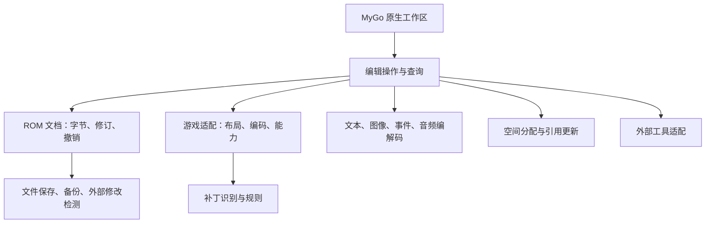

# FEBuilderGBA 原生 Go 重建计划

本文定义目标、依赖顺序和开发规则。当前能力见[实现记录](implementation-status.md)，逐项状态见[覆盖矩阵](coverage.md)。

## 已确认的目标

| 项目 | 决策 |
| --- | --- |
| 覆盖基线 | 当前 `FEBuilderGBA/` 子模块提交 `8e355791` 的功能，建立逐项覆盖清单；后续上游新增功能另行安排。 |
| 最终范围 | 完整覆盖旧版能力，覆盖 FE6、FE7J/U、FE8J/U，以及原有导入导出、补丁、诊断、重建、工具集成等工作流。 |
| 实现 | 编辑器及内置领域能力用 Go 重建，界面使用 MyGo 原生 `ui`。独立的原生模拟器、汇编器、编译器可以作为外部工具。旧 Windows/.NET 实现作为参考，不作为新版运行前提。 |
| 平台 | 首阶段面向 macOS；核心与平台无关，Windows、Linux 后续适配。 |
| 文档模型 | 直接打开、编辑和保存 ROM。工程目录与“资源构建 ROM”不作为主要模型。 |
| 编辑与保存 | 有效修改进入内存文档，Cmd+S 保存，支持另存为、统一撤销重做、完整操作回滚和保存前备份。磁盘外部变更需明确处理。 |
| 写入判定 | 根据版本、已知补丁和表指针提供编辑；未命中补丁名单本身不限制编辑。具体检查发现非法地址、无效长度、明确布局冲突或无法确定写入位置时，停止该次自动写入。保留显式指定地址/布局及原始字节编辑，统一检查边界和记录撤销。 |
| 兼容 | 兼容旧版对外文件格式、社区资源，以及旧版支持的已有改版 ROM。新版内部实现可以重设计。 |
| 扩展 | 面向后续游戏版本和补丁规则的内部扩展边界；不要求动态代码插件。 |
| 交互 | 全面重设计。一个窗口对应一个 ROM，允许多个独立窗口；窗内编辑标签页共享同一文档和撤销历史，按需显示属性、引用、错误及历史面板。保留地址、指针、原始数据等高级操作。 |
| 首个功能版本 | 先贯通 FE8U 的人物、职业、道具编辑及保存，随后继续完整覆盖。 |
| 语言 | 简体中文、英文。界面语言与游戏文本编码分别处理。 |

领域核心能够脱离 UI 运行。旧版已有命令行能力进入覆盖盘点，新增命令行产品能力另行安排。

## 实现依据

- [旧版项目文件](../FEBuilderGBA/FEBuilderGBA/FEBuilderGBA.csproj)：.NET Framework 4.0、WinForms。
- [当前 Go 入口](../febuildergba-go/main.go)：已经接入 MyGo 原生 ROM 工作区；领域核心位于 `internal/rom` 和 `internal/game`。当前依赖为 MyGo `v0.6.3`。
- [InputFormRef](../FEBuilderGBA/FEBuilderGBA/InputFormRef.cs)：字段绑定、UI、空间分配和写入逻辑集中；新实现需要把领域规则从控件命名中提取出来。
- [ROM](../FEBuilderGBA/FEBuilderGBA/Rom.cs)、[Undo](../FEBuilderGBA/FEBuilderGBA/Undo.cs)、[保存流程](../FEBuilderGBA/FEBuilderGBA/MainFormUtil.cs)：ROM 字节、撤销、备份、附属信息和文件保存需要统一协调。
- [人物编辑](../FEBuilderGBA/FEBuilderGBA/UnitForm.cs)：依赖文本读取，并识别技能系统和魔力拆分等补丁。
- [FE8U](../FEBuilderGBA/FEBuilderGBA/ROMFE8U.cs)、[FE6](../FEBuilderGBA/FEBuilderGBA/ROMFE6JP.cs)：存在表尺寸、指针定位、文本和章节布局差异；部分表会搬迁，不能全部按原版固定地址处理。
- [补丁加载](../FEBuilderGBA/FEBuilderGBA/PatchForm.cs)、[事件汇编](../FEBuilderGBA/FEBuilderGBA/EventAssemblerForm.cs)：需要兼容旧补丁定义，并为外部工具提供原生接入方式。
- [重建导出](../FEBuilderGBA/FEBuilderGBA/ToolROMRebuildMake.cs)、[重建应用](../FEBuilderGBA/FEBuilderGBA/ToolROMRebuildApply.cs)：结构化重排涉及未知二进制数据、指针和空间分配，不能仅靠重新编码已知字段实现。
- [外部修改监视](../FEBuilderGBA/FEBuilderGBA/ROMUpdateWatcher.cs)、[RAM](../FEBuilderGBA/FEBuilderGBA/RAM.cs)：文件外部变更和模拟器内存访问需要重新设计平台边界。旧版 GDB 实现的平台依赖需要重新适配。

[旧版来源索引](legacy-inventory.csv) 记录来源条目，功能拆分与实现状态维护在[覆盖矩阵](coverage.md)。

## 架构方向

以下边界落实已确认的编辑、保存、兼容与扩展要求。具体包名、接口方法和数据表示随实际用例收敛，后续版本适配应持续检验这些边界。

- **ROM 文档**表示一次打开的 ROM 及其编辑状态。每个文档拥有自己的字节、版本识别结果、撤销历史和保存基点，不依赖全局的“当前 ROM”。解析缓存从字节及修订状态派生。
- **编辑操作**表示用户的一次完整改动，例如批量修改道具、导入头像或安装补丁。操作涉及多处字节、长度和指针时，需要一起成功或一起撤销。UI 不直接获得可随意修改的底层字节切片。
- **游戏适配**描述版本识别、字段布局、指针解析、文本编码和能力差异。普通布局使用数据描述；复杂编码和行为使用 Go。FE8U 首个闭环之后，尽早用 FE8J 和 FE6 检验边界。
- **元数据层**统一表达游戏格式与规则定义，方向见 [游戏元数据层设计](metadata-design.md)。设计已确认，当前暂缓实施；等版本扩展、事件或补丁等具体功能需要时再接入，不作为当前工作的前置重构。
- **补丁规则**描述已知改动的检测条件及其对布局、字段和能力的影响。检测、解释和安装分开；相关编辑器按识别到的规则调整字段和布局，并检查本次写入条件。未匹配补丁规则本身不阻止编辑。
- **空间与引用管理**负责有依据的可用区间、对齐、扩容、共享资源和引用更新。原始字节恰好像指针、或一片字节为 `00`/`FF`，都不能单独证明可以移动或复用该区域。
- **文件与工具适配**负责平台行为。外部工具在隔离副本上执行，结果经过差异与结构检查后作为一个编辑操作导入；失败不得留下半次修改。
- **i18n**使用稳定消息标识和参数化文本，UI 与诊断分别提供中英文。新版 UI 按自己的交互设计编写文案，不迁移旧编辑器的界面翻译，也不要求文案逐项对应。资源 ID、字段定义、格式协议和 ROM 输出不受界面语言影响；游戏规则说明及社区资源自带的多语言元信息与编辑器界面文案分别处理。

优先使用 Go 标准库和已经选定的 MyGo。新增依赖需有具体能力需求，不因预设架构引入通用插件框架、脚本引擎或大型状态管理层。内部接口可以随实现调整；已发布的文件契约和社区格式需要明确兼容策略。

## 实施阶段

阶段表示主依赖顺序。各阶段按游戏版本记录已实现、未实现与不适用项。

| 阶段 | 工作内容 |
| --- | --- |
| 0：覆盖盘点与原生交互 | 固定旧版基线，枚举菜单、表单、命令行、格式、配置数据和外部工具，建立功能矩阵；接入 MyGo 原生控件。 |
| 1：FE8U 基础编辑 | ROM 文档、识别和边界校验、保存／另存为、撤销重做、备份及外部变更处理；人物／职业／道具基本字段、名称、关联跳转、搜索、中英文工作区和模拟器启动。 |
| 2：版本扩展与可变长写入 | 接入 FE8J、FE6 和 FE7J/U；实现空间分配、引用记录、表扩展、可变长资源写入及更多补丁布局。 |
| 3：文本与静态图像 | 文本写入、控制码、字库、导入导出及翻译；调色板、头像、图标、背景、CG、地图图块和压缩。 |
| 4：章节、地图与事件 | 章节配置、地图绘制、地形、地图变化、事件单位、AI、商店、支援、事件脚本和世界地图。 |
| 5：补丁管理与汇编工具链 | 补丁定义、条件与依赖、安装／配置／卸载、技能系统、EA 脚本、ARM 工具、符号、UPS 等格式。 |
| 6：动态图像与音频 | 战斗／地图动画、魔法效果、OAM；歌曲、音色、MIDI/WAV 导入、播放和资源管理。 |
| 7：诊断、修复、重建与高级调试 | FELint、引用查询、差异／合并、备份恢复、问题报告、ROM 重排、反汇编及模拟器内存调试。基础诊断和原始数据查看按需提前交付。 |
| 8：完整覆盖与发布 | 补齐功能矩阵、原有格式和命令行能力；macOS 分发与更新、可访问性、性能及 Windows/Linux 平台适配。 |

关键顺序约束：

1. 补丁识别从阶段 1 开始；补丁管理界面主要在阶段 5 交付。
2. 撤销、文件一致性和修改范围从首个写入操作开始建立，后续所有导入和工具都复用。
3. 版本扩展在阶段 2 接入，不等全部 FE8U 功能完成后再处理版本差异。
4. 文本写入、图像导入、地图扩容和补丁安装都依赖空间及引用管理；它们可以分别提供固定长度的早期能力，但不能绕过共同写入机制。
5. 外部模拟器启动在阶段 1 交付；跳章与实时调试作为独立产品能力安排。
6. 高级 ROM 重排保留为完整覆盖目标；普通打开和保存不自动重排 ROM。

## 功能矩阵与任务拆分方式

阶段 0 建立逐项矩阵，每条至少包含：

| 字段 | 用途 |
| --- | --- |
| 稳定功能 ID、旧版入口和来源 | 防止漏项，并支持回到旧实现核实行为。 |
| 游戏版本与补丁前提 | 区分通用能力、版本差异与具体改版规则。 |
| 对外格式及附属文件 | 记录社区兼容契约，包括注释、符号等非 ROM 数据。 |
| 新版入口和领域操作 | 保持新交互与旧能力可对应，允许多个旧窗口合并。 |
| 前置能力 | 标明文本、压缩、空间、工具或其他编辑器依赖。 |
| 状态及已知差异 | 待盘点、待实现、实现中、部分实现、已实现；不适用需说明原因。 |

任务按完整用户操作拆分，例如导入头像并保存。每完成一个操作，同步记录适配版本、格式兼容、失败行为和实现状态。

## 编辑行为

### 编辑与保存

字段有效修改立即进入内存文档；普通字段不再多一次“写入 ROM”按钮。Cmd+S 明确保存到磁盘，提供另存为；批量修改和资源导入作为一个完整撤销操作。保存采用同目录临时文件及替换策略，并保留可恢复的旧版本。磁盘文件被外部修改时提示重新载入或另存，避免静默覆盖。

输入法组合文本、尚未完成或非法的输入仍属于控件草稿，不能作为有效字段变更提交。长任务基于明确的文档修订执行，完成时检查结果是否仍适用于当前修订。

### 改版识别与写入判定

当前基线的实现依据：

- `ROM.LoadLow` 按 ROM 标头和最小长度选择游戏实现，另有 `LoadForceVersion`；这不是对整个改版布局的认证。
- `PatchUtil.SearchSkillSystemLow` 和 `MagicSplitUtil.SearchMagicSplitLow` 通过已知字节特征识别补丁。没有匹配时返回 `NO`，未单独返回“未知补丁”状态。
- `UnitForm_Load` 根据识别结果显示技能入口和魔力拆分字段，属于局部能力适配。
- `U.FindROMPointer` 在候选指针中查找，有的重载额外检查结构；检查失败会逐级回退，最终可能返回第一个候选。
- `InputFormRef.WriteHandler` 检查受保护地址、表范围、ID 0 和对齐。部分检查支持配置成直接允许、询问或拒绝；其范围检查在原始边界不明时也存在放行路径。这些检查不等于对结构化布局正确性的保证。

在检查的核心路径中，没有发现统一的“已识别改版可编辑、未知改版只读”分类，也不能假定可以可靠发现所有未知改动。

新版沿用游戏版本规则、已知补丁识别和通用表编辑，不以“未命中补丁名单”作为只读条件。仅在具体检查发现非法地址、无效长度、明确的布局冲突或无法确定本次写入位置时，停止该次自动结构化写入并给出原因；高级用户可以显式指定布局/地址后重新检查，或使用原始字节编辑。原始修改也经过边界检查和统一撤销。

保留未知字节不等于能安全搬迁它们；引用不明确时，不自动移动未知结构。未知自定义布局可能超出自动识别范围。

### 工作区组织

一个窗口对应一个 ROM，允许同时打开多个独立窗口；窗口内以导航、编辑标签页和属性/引用面板组织功能。人物、道具、地图等视图共享同一文档和撤销历史。错误、历史、地址信息按需展开；常用操作支持键盘，避免通过大量模态窗口完成日常编辑。

## 推进与维护

按阶段依赖推进可交付操作，具体起点以[覆盖矩阵](coverage.md)的未完成项为准。算法、包名和控件细节随实现调整；新增产品范围或改变对外契约时另行确认。每次功能交付更新覆盖矩阵。
