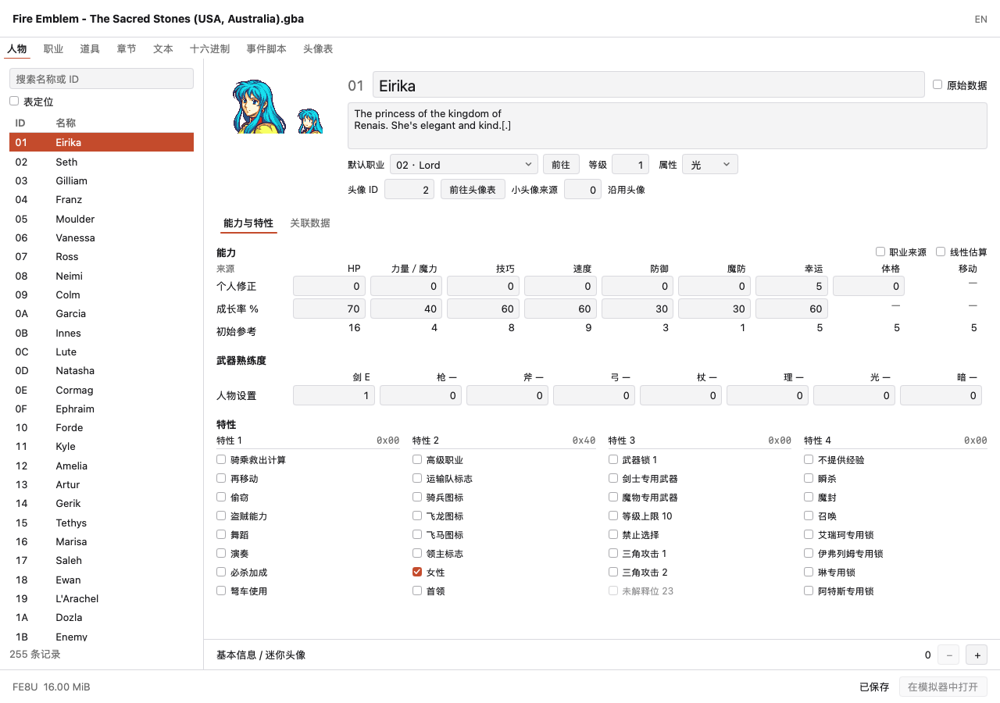
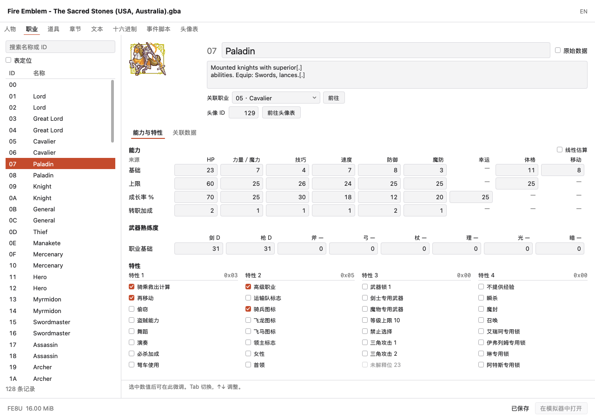

# 人物与职业编辑页

本文维护人物与职业页的交互和字段语义，功能状态见[覆盖矩阵](coverage.md)。截图来自当前已接入的 MyGo 页面。

## 页面与数据来源

人物页显示个人修正、成长率和默认职业的参考能力，职业页显示基础、上限、成长率及转职加成。左侧提供搜索、多选、批量编辑和表定位，右侧分为能力与特性、关联数据两个标签页。

顶部并列显示头像预览与名称／简介，名称和简介的输入框左边缘对齐，记录 ID 作为次要信息显示。职业、等级、属性和头像引用在下方共用字段网格，宽窗口分两列，窄窗口按字段组纵向排列；“原始数据”开关位于页内标签栏。

普通数值的有效输入立即修改内存文档，非法或不完整输入保留为草稿。名称和描述先预览，再原子应用。字段检查器位于底部，人物页和职业页分别保留侧栏宽度和记录状态。

以下截图来自 MyGo v0.6.3 实际页面，使用原版 FE8U 的人物 01 Eirika、职业 07 Paladin 数据：

另见[关联数据](images/record-editor-resources.png)、[窄窗口](images/record-editor-person-narrow.png)和[独立头像表](images/record-editor-portraits.png)。

## 能力矩阵

能力按 HP、力量／魔力、技巧、速度、防御、魔防、幸运、体格和移动固定横排。字段缺失的单元格显示 `—`，全局规则不作为本记录的字段显示。

人物默认显示个人修正、成长率和一行初始参考。打开线性估算后，该行改为目标等级的估算值。打开职业来源后，增加职业基础行。

职业默认显示基础、上限、成长率和转职加成，估算由用户打开。FE6 没有转职加成字段，不显示这一行。

参照和估算数值使用正常正文色，以无边框文字表达只读；灰色用于帮助、来源和不适用项。区块间距为 16，组内主要为 4 至 6，保留紧凑数值行。窄窗口只对过宽矩阵局部横向滚动，特性组调整为两列。

### 字段范围

已依据 FE6／FE7／FE8 原生人物和职业结构核对：

- 人物初始等级及个人修正按有符号字节解释；人物成长率为无符号字节。
- 职业基础、上限、成长率和经验计算参数按有符号字节解释。
- FE7／FE8 的转职加成为无符号字节，FE6 对应位置不生成此组字段。
- 武器熟练度为无符号字节，特性保留完整 32 位编码。

读写按字段范围校验，保留其他字段及未知字节。

### 参照与估算

人物使用 `class_id` 指定的默认／参照职业。章节部署可以覆盖职业，界面结果不代表实际出场状态。职业记录的 `promotion_id` 显示为"关联职业"；FE8 的高级单位自动成长会用它取得低阶参照职业，实际转职分支是独立规则。

初始参考按原生规则计算。常规能力是职业基础加人物修正，幸运来自人物，体格包含人物修正，移动来自职业。职业缺失或引用无效时显示原因，普通字段仍可编辑。

线性估算公式为 `参考初值 + 成长率 × 成长次数 / 100`。人物成长次数等于目标等级减初始等级。职业直接输入成长次数，使用职业成长率。

计算以整数保存百分之一单位，显示时保留有效小数。职业幸运等字段没有起算基值时，不显示绝对估算值。

估算不计上限、转职、随机升级、难度加值或事件变化。参照设置只保存在窗口，不写 ROM、不进入 ROM 历史，输入框使用自己的文本撤销。

## 武器熟练度

武器区显示武器名称、当前有效等级和精确原值。点击标题或数值后，在底部字段检查器选择等级。

- 直接改数值会更新等级。
- 改选等级写入该版本的最低熟练度；选择原等级保留等级内进度。
- 人物原值 0 沿用默认职业，非零值覆盖职业值，即使它更低。
- 继承来源和原始值含义在字段帮助及当前等级选择器中显示。
- FE6 的 D／C／B／A 最低值为 51／101／151／201，FE7／FE8 为 31／71／121／181，S 均为 251。

## 特性

四组复选框分别对应四个原生字节。组头显示十六进制字节值，勾选只修改对应位，保留其余 31 位，并形成一次文档历史操作。

定义按版本区分，例如同一位置在 FE8 为召唤、FE7 为掉落道具。没有确认语义的位显示位号并保持结构化只读；高级区保留原始编码入口。

人物复选框只修改人物标志，不把职业效果写入人物位。游戏根据实际部署职业组合双方特性，移动消耗和技能等规则另有数据来源。

## 头像表与图像操作

人物／职业身份区直接提供头像 ID 输入与"前往头像表"，并列显示主图、小头像及职业回退来源。小头像显示沿用或原生通用来源，通用资源提供实际像素字节入口。PNG 导入导出集中在独立头像表。

头像表统一列出人物头像和职业卡，支持：

- 按头像 ID、0x 前缀或已知使用者名称搜索。
- 主图、小头像与表情检查，整张素材、缩放、定位框、眼口坐标及默认眨眼编辑；FE6 按独立原生布局提供口型与嘴定位。
- 数值即时写入与原子拖动历史，原始记录及有效部件地址跳转。
- PNG 导出、替换预览、共享使用处、应用／取消和既有原子历史。
- 跳回引用此资源的人物或职业。
- 跟随当前 ROM 的头像表指针；保留表内空洞，省略末尾空记录，最多发现 4096 条并以连续 1000 条空记录作为探索边界之一。

PNG 控件共用 [components.AssetEditor](../internal/components/asseteditor.go)，道具图标和头像表使用同一流程。仍不提供新建头像 ID、头像表扩展或自定义引擎写入。

五版定位、表情、拖动历史及小头像来源的规则和截图见[头像编辑页](portrait-editor-design.md)。

## 关联数据

关联页集中显示名称／描述文本 ID、排序、动画调色板、访问分组或对话语气等已确认版本字段；头像和小头像引用位于身份区。职业行走速度提供枚举选择，未知值保留数值。

人物支援和职业战斗动画、移动消耗、地形回避／防御／魔防指针按当前表布局读取，区分空入口与损坏引用；有效资源提供经过范围检查的字节跳转。FE6 不生成不存在的雨／雪入口。

支援、转职分支、技能、战斗动画和移动、地形表的专用编辑器仍待实现，进度见覆盖矩阵。未知偏移和补丁字段不提供结构化编辑。

## 交互与边界

数值右对齐并使用等宽数字；地址和原始字节使用等宽字体。系统字体与已有强调色保持一致。Tab 遍历可编辑控件，上下键微调数值；普通数值使用 ROM 历史，名称、正文、搜索和估算设置使用对应文本历史。

[records.Page](../internal/pages/records/page.go) 负责导航、多选和表布局，recordform 提供人物、职业详情及数值、文本控件。[portraits.Page](../internal/pages/portraits/page.go) 处理头像资源编辑。页面通过回调导航，app 打开原生文件对话框。

`game` 提供字段、位定义、武器等级与继承、只读能力参照、资源指针和头像索引。UI 使用这些结果，不解析偏移或通过显示名称推断规则。当前只增加具体功能需要的定义，尚未迁移完整 metadata 库。

## 验证范围

合成样本的领域流程覆盖五版字段范围、位掩码、武器门槛与继承、同等级保留进度、参照与估算、未知位、布局变化、表搬迁、头像表发现与引用、原子历史、保存重开及继续编辑。固定预期使用合成样本，可选集成流程使用 `.rom/` 中动态发现的输入；纯布局调整无需专门测试。

开发模式的 ROM 路径恢复见[开发说明](development.md#开发启动)。

## 核对来源

- 当前规则：[fields.go](../game/fields.go)、[record_traits.go](../game/record_traits.go)、[record_weapons.go](../game/record_weapons.go)、[record_abilities.go](../game/record_abilities.go)、[record_resources.go](../game/record_resources.go)、[portrait_table.go](../game/portrait_table.go)。
- 旧版工作流：[UnitForm.cs](../FEBuilderGBA/FEBuilderGBA/UnitForm.cs)、[ClassForm.cs](../FEBuilderGBA/FEBuilderGBA/ClassForm.cs)、[GrowSimulator.cs](../FEBuilderGBA/FEBuilderGBA/GrowSimulator.cs)、[ImagePortraitForm.cs](../FEBuilderGBA/FEBuilderGBA/ImagePortraitForm.cs)。
- 武器门槛：[InputFormRef.cs](../FEBuilderGBA/FEBuilderGBA/InputFormRef.cs) 的 `GetWeaponClass`／`GetWeaponClassRev`，以及 FE8 原生 `bmitem.h` 的 `WPN_EXP_*`。
- 原生结构与使用方式：fe6／fe7_us 的 `include/unit.h` 与 `src/unit.c`，fireemblem8u 的 `include/bmunit.h` 与 `src/bmunit.c`；固定提交和文件链接见[核对来源](sources.md#原生结构与语义)。
- 特性说明：旧版 `unitclass_checkbox_FE6/FE7/FE8.en.txt` 与原生属性定义；未知含义不开放结构化修改。
- 分层与元数据原则：[metadata-design.md](metadata-design.md)。
