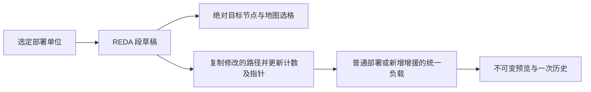
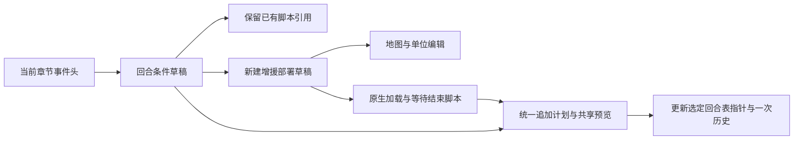
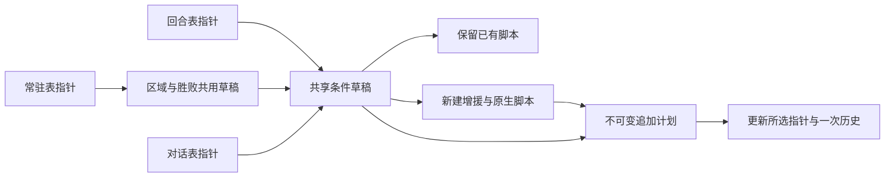
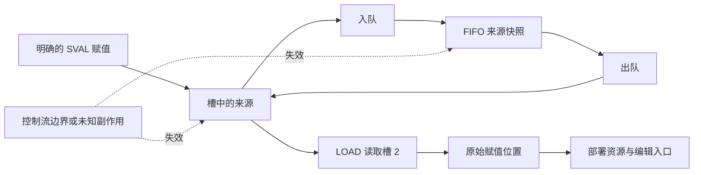

# 章节、地图与事件

本文维护当前格式、写入语义和限制；功能状态见[覆盖矩阵](../coverage.md)，操作步骤见[使用指南](../user-guide.md)。旧版与原生代码的固定版本见[核对来源](../sources.md)。

当前入口：章节布局（`game/chapter/format.go`）、资源协调（`game/chapter/editor.go`）、部署草稿（`game/deployment/draft.go`）、事件条件（`game/event/conditions.go`）、条件编辑（`game/event/conditions_edit.go`）和脚本读取（`game/event/script.go`）。

`event.Table` 区分回合、常驻、对话和地点表，`event.Condition` 保留原生条件并区分脚本、奖励及其他资源；`event.ConditionDraft`／`event.ConditionEdit` 管理草稿和不可变写入计划。UI 位于 `internal/pages/chapters` 和 `internal/pages/eventeditor`。

## 五版章节配置

依据 `ROMFE8U/JP`、`ROMFE7U/JP`、`ROMFE6JP`、`MapSettingForm`、`MapSettingFE7Form`、`MapSettingFE7UForm`、`MapSettingFE6Form` 及各 Designer 的字段宽度；图块双 ID 依据 `ImageUtilMap.DrawMap`。从"章节"标签页进入，共用记录、字段与文档历史。

| 能力                       | 版本／依据                      | 行为与限制                                                                                                                                                                                          |
| -------------------------- | ------------------------------- | --------------------------------------------------------------------------------------------------------------------------------------------------------------------------------------------------- |
| 列表、名称、搜索与多选     | 五版原版及可定位的已有表        | 实际指针和章节名偏移，单表失败不关闭其他编辑器；原版读取 FE8U/J 各 79 条、FE7U 67 条、FE7J 69 条、FE6 45 条，不以这些数量限制已搬迁表                                                               |
| 版本布局与表结束           | 已知指针、完整记录；最多 256 条 | FE8U/J／FE7J 148 字节、FE7U 152 字节、FE6 68 字节；FE6 通过 `0x2BB12 = 0x2048` 识别 72 字节布局。保留旧版无内部名称指针时的资源／文本回退判定                                                       |
| 天气、迷雾与基本配置       | 已确认字段                      | 战前准备、标题图像、战斗背景、可破坏墙壁 HP、胜利音乐阈值等；按字段存储范围校验，其他字节保持不变                                                                                                   |
| 地图与事件资源 ID          | 原版资源布局                    | 图块、调色板、地图图块配置、地图、地图变化、图块动画、章节与世界地图事件 ID；两组图块 ID 分开编辑，已由 FE6／FE7 原版验证；静态地图组合预览、布局绘制、尺寸调整及变化资源编辑；其余资源内容保持独立 |
| 音乐 ID 与线路差异         | FE6 单字节；其他版本双字节      | 我方／敌方／友军音乐、FE7 线路及序章音乐、FE6 世界地图与开场音乐；不包含音频播放或导入                                                                                                              |
| 关联文本 ID 与正文跳转     | 现有文本表                      | 章节名、胜利条件文案、FE7 标题文字／占卜、FE6 势力名称／世界地图地名；字段旁可前往通用文本页，共享影响预览包含章节并可跳回记录。文案不改变胜利判定事件                                              |
| 手动布局、原始字节与表搬迁 | 已知字段、完整范围和确认引用    | 搬迁保留结束记录、旧数据及未知引用目标，更新已确认入口及内部引用；章节表也进入空间与文本入口的保护范围，记录数不扩展                                                                                |
| 批量、撤销重做与保存重开   | 共用 ROM 文档                   | 五版固定章节验证搬迁、字段精确修改、标题文本、历史、保存重开及继续编辑；另验证 FE6 72 字节尾部保留及手动布局                                                                                        |

章节表缺少内部名称指针时，按旧版读取位置检查字节与文本 ID。旧变量 weather 检查偏移 12，FE6 为 11。实际天气字段位于偏移 18，FE6 为 17。新版保留原结束判定的位置，不将其用于限制天气值。

地图绘制、部署与条件事件分别见下文各节；脚本工作流见[通用事件脚本](#通用事件脚本)，其他范围与剩余工作见[覆盖矩阵](../coverage.md)。

## 五版章节地图

依据 `ImageUtilMap.DrawMap`／`GetChipsetID`、`MapPointerForm.PlistToOffsetAddr` 及五版 `ROMFE*` 指针位置。资源指针列表在旧版称为 PLIST；新版逐类读取当前入口，允许各类使用独立列表。GBA 背景图块解释位于 `gba/background.go`，章节资源组合位于 `game/maps/map.go`。

| 能力                    | 版本／依据                            | 行为与限制                                                                                                                      |
| ----------------------- | ------------------------------------- | ------------------------------------------------------------------------------------------------------------------------------- |
| 按章节组合资源          | FE8U/J、FE7U/J、FE6；有效当前章节布局 | 两个图块 ID、调色板、图块配置与地图布局的实时指针；第二组 ID 为零时省略，FE6 原版双图块资源已验证；支持手动定位及搬迁后的章节表 |
| 4bpp 背景图块与地图合成 | 有界 LZ77、512 字节 BGR555 调色板     | 10 位图块索引、水平／垂直翻转、16 组调色板及不透明背景色零；地图按四个 8×8 图块组合为 16×16 格子                                |
| 格子坐标与地形          | 完整图块配置及地形段                  | 原始地图单元值与地形 ID；地形按 `0x2000 + (mapWord >> 2)` 读取，保留未知 ID；地形名称、属性与编辑尚未接入                       |
| 缩放、平移、网格与选择  | 章节详情中的静态基础地图              | 50%／100%／200%／400%、滚动／拖动平移、重置视图及格子选择；拖动结束不触发选格，坐标按当前缩放和平移换算                         |
| 文档修订与章节上下文    | 当前会话、章节 ID 与实际记录地址      | 修改、原始字节、撤销重做及手动布局后的刷新；配置预览切换章节时清除格子选择和平移；绘制草稿按章节保留                            |
| 资源诊断与范围检查      | 原生上限宽 60、高 63、总计 1536 格    | 无效入口、损坏／过大压缩流、半个图块、调色板越界、不完整布局、非法图块／地形引用的拒绝；错误只显示于地图区域，配置字段仍可编辑  |

底图是静态预览，部署视图叠加当前组的单位序号。预览不模拟迷雾、图块动画或事件执行；变化编辑可单独叠加所选记录；原生尺寸限制之外的扩展引擎也未适配。

### 布局草稿与写入

`game/maps/map_draft.go` 的 `maps.Draft` 保存布局、当前图块集和本地历史；`game/maps/map_plan.go` 的 `maps.Edit` 是绑定文档身份、修订和表布局的不可变写入计划。地图编辑由章节页面组合，复用现有地图缩放、平移和选格。

地图布局为 LZ77 流，解压后先是单字节宽、高，再是逐行的小端 16 位图块值。绘制保持宽高与未修改格子；尺寸调整改变宽高和行步长，按锚点保留相应图块。两者都保留已读出的解压尾部字节。写入依据旧版 `MapEditorForm.WriteMapData`；宽高、图块值与地形查找另核对固定原生来源的 `UnpackChapterMap`、`InitBaseTilesBmMap` 和 `RefreshTerrainBmMap`，见[来源](../sources.md#地图布局)。

图块选择器按原生编号排列可读取的 16×16 定义；无法解析的图块不会成为画笔。吸管读取当前格子，选择后回到画笔。一次拖动画笔或矩形填充形成一步草稿历史，采样之间补齐格子；非法图块或越界输入不会部分修改草稿。地形随图块定义读取，绘制不改写地形表、图像、调色板或图块配置。

预览区分两种共享关系：共用同一个 PLIST 指针项的章节一起更新；不同指针项即使指向同一份旧地图，也继续保留原资源。引用列表来自当前章节表，不宣称覆盖自定义代码或完整全局引用。规划前按每个共享章节自己的图块集验证新布局；选定指针项与已知记录、资源范围重叠，或同时被已确认的其他资源类型使用时拒绝写入。各类 PLIST 根指针分别读取，包含图块动画、地图变化及 FE6 世界地图入口的交叉使用检查。

应用将重新压缩的布局追加到 ROM，并只更新选定的地图指针项；资源、指针和文件长度进入同一条文档历史，旧压缩数据和其他独立入口保留。应用后的文档撤销重做包含文件长度；保存重开后可以继续绘制和调整尺寸。文档或适用布局变化后，未应用草稿保留并停止写入，需要明确丢弃重读。

### 尺寸与坐标影响

`game/maps/map_draft.go` 的 `maps.Anchor` 表示九个对齐锚点。扩展用当前合法图块填充，裁剪丢弃范围外的格子；中心对齐将奇数差额多出的一行或一列放在右侧或下方。宽、高分别为 1–60、1–63，总面积不超过 1536；当前完整解压内容的读取上限为 3074 字节，包括保留尾部。非法尺寸、锚点或填充图块不会产生部分修改。一条绘制或尺寸操作保存前后布局快照，混合撤销重做时同时恢复宽高、行步长和未知尾部。

尺寸变化不平移部署、路径或事件坐标。`game/maps/map_plan.go` 的 `maps.Impact` 保存坐标资源、所属章节、入口、记录／节点及范围；对比旧、新边界，分别记录此前越界、调整后越界、新排除格数和新纳入格数。一个原本部分越界的矩形仍可能新增越界，不能只按此前是否越界分类。只检查同一地图入口会更新的章节，独立入口保留的章节不纳入影响。相同章节内重复发现的同一资源坐标合并展示。

静态检查复用已确认的部署发现与条件解析，覆盖部署起点、FE6／FE7 编码终点、FE8 各 REDA 绝对节点、区域触发、已确认地点坐标和地图变化外包矩形。地点表中的未知类型或命令另报不完整提示；商店及随机宝箱的已确认坐标仍纳入检查。地图变化读取其独立的实时 PLIST 根，空指针表示无表，资源 ID 0 本身不表示空。原生条目为 12 字节，ID 为负的字节（`80…FF`）终止；矩形检查不根据图块内容或运行状态判断是否会执行。

`game/chapter/map_resize.go` 只检查章节上下文可确认的脚本线性前段：显式移动、镜头／光标坐标，以及 FE6／FE7 有显式起点的手动移动路径。路径按编码步骤展开，不模拟地形、碰撞或实际单位状态。调用、分支、ASM、未知指令使相应脚本后续上下文不再可确认；被调用入口、动态或负值坐标、需要当前单位位置的路径另列提示。切换到其他章节地图的原生指令之后不再归入当前地图。已有低速度路径操作数可能被原生坐标扫描器再次解释，遇到时也停止推算。

影响与不完整提示随 `maps.Edit` 一起冻结，返回的列表为副本。检查最多记录 4096 个影响、访问 65536 个坐标，达到限额或资源无法读取时显示不完整提示。同章节、同资源类型及同错误码的提示合并，地址为首个发现位置。越界本身不禁止保存，原生事件可能刻意使用图外位置；布局合法性、共享图块集、入口冲突、容量及过期检查仍由写入计划执行。此检查不等于全局引用索引或游戏运行验证。

### 地图变化资源与引用

`game/maps/changes.go` 的 `maps.ChangesDraft` 保存变化表和每项图块的不可变草稿历史；`game/maps/changes_plan.go` 的 `maps.ChangesEdit` 冻结写入字节、共享用途和引用报告。五版均使用变化资源自己的实时 PLIST，实际空指针可创建新表，资源 ID 0 可指向有效表。

每条记录为 12 字节：偏移 0 为变化 ID，1–4 为 X、Y、宽、高，5–7 为未解释字节，8–11 为逐行小端 uint16 图块载荷指针。任一负的 ID 字节（80–FF）终止。读取有界，载荷须完整且半字对齐；保留原顺序、重复 ID、未解释头字节及实际可读的结束字节。新 ID 限于 0–127 且唯一；编辑后的矩形须在所有共用入口章节的地图内，非零图块须能被各章图块集解释。已有未修改记录不会被顺带规范化。

图块值 0 表示保留当前地图格子；所选项预览以底图为基础，不模拟运行时叠加顺序。原生按 ID 查找首条记录；按坐标先取最后一个覆盖矩形的 ID，再按 ID 取首条记录。ID 与记录索引不能互换，已有重复 ID 的目标变化需要单独报告。

位置变化不改图块相对排列；尺寸变化保留左上交集，新增格子为 0。笔画、矩形、属性及增删复制各形成一步历史。计划追加完整变化表，只追加已改变的图块载荷；未修改或直接复制的载荷继续使用旧指针。只更新所选 PLIST 项，共用此项的章节一起变化，独立指针项与旧字节保留。表、载荷、指针和文件长度一次提交／撤销；已确认变化表和载荷也进入地图入口的重叠保护。容量、过期及共享解释失败不留下部分修改。

`game/event/script_map_changes.go` 定义原生操作并解释脚本上下文；`game/maps/change_references.go` 提供原生 ID／坐标目标模型；`game/chapter/map_references.go` 关联章节资源并审核共享引用。

| 操作                 | FE6                            | FE7J／FE7U                                 | FE8J／FE8U                          |
| -------------------- | ------------------------------ | ------------------------------------------ | ----------------------------------- |
| 按 ID 应用           | 29，第二字为 ID，-1 用事件参数 | 5D／5F，-1 用事件参数                      | `20 27`，16 位有符号参数            |
| 按坐标应用           | 2A，第二字低两个字节为 X/Y     | 5E／60，首字高两个字节为 X/Y               | ID -1 取槽 B 的两个无符号半字       |
| 立即／静默／水面阴影 | 无相应编辑定义                 | 5F／61、60／62、62／64                     | 由事件状态控制显示，不复用 FE7 编码 |
| 刷新地图             | 无相应编辑定义                 | 61／63，可选择水面阴影                     | 独立地图演出操作                    |
| 恢复原始底图         | 无对应恢复定义                 | 高位取消前一 ID 的启用状态，不等于恢复底图 | `21 27`，仅恢复已启用变化的整个矩形 |

FE7 普通、静默与水面阴影指令的参数高位取消 ID−1。静默指令高位为 1 时不启用当前 ID，并且不刷新地形或重绘；立即指令不支持此高位标志。各个 -1 事件参数变体独立定义，避免与高位含义混淆。FE6／FE7 坐标未命中时退回事件参数，报告为动态目标；FE8 坐标未命中是原生事件错误。

FE8 的 -2 取行动单位位置，-3 使用队列中的 ID；队列项按原生有符号半字消费，已知字面量的高半字不影响 ID。队列仅在已确认初始化和来源时解析，最多 30 项；新直接 ID 仍为 0–127。槽 B 和队列来源改变时，即使消费指令字节不变，也重新校验目标。FE8 的这两种指令不修改槽或队列。

显式加载地图建立后续章节上下文；调用、分支、标签、未知指令和章节结束会使其失效。独立发现的被调用入口不假定调用者地图。已有原编码可保留，修改直接目标须在可确认上下文中找到记录；参数修改还检查已知共享脚本的章节，不能确认的内部重叠入口拒绝新目标改写。

变化表审核只扫描共用该 PLIST 项的章节脚本，按确认上下文归属目标。最多访问 65536 条指令、列出 4096 项引用，限额及读取失败均留提示；同章节、同错误码合并提示。报告冻结旧／新目标并标识重复 ID 改指另一条记录；原本存在的目标消失时 `Applicable()` 为假，应用返回 `game.map_change_reference`。不自动改写脚本，也不把局部扫描当作全局索引；引擎自动触发、未列入扫描的其他章节跳入及动态执行仍有边界。

## 五版章节初始部署

依据 `EventUnitForm`、`EventUnitFE7Form`、`EventUnitFE6Form`、`EventCondForm`、五版 `ROMFE*` 和 `event_FE6/7/8.en.txt` 编码及真实原版 ROM。FE8 部署包含独立移动段；FE7／FE6 的起终点直接保存在记录内。资源和入口分开建模，以实际指针位置区分编辑目标。

| 能力                     | 版本／依据                  | 行为与限制                                                                                                                                                                                                                                               |
| ------------------------ | --------------------------- | -------------------------------------------------------------------------------------------------------------------------------------------------------------------------------------------------------------------------------------------------------- |
| 部署入口与版本差异       | 五版有效章节及事件资源表    | FE8 20 字节、FE7／FE6 16 字节记录；按当前章节地址与实时事件资源指针读取难度、路线和遭遇战入口，支持空入口创建、手动章节布局和搬迁后的章节表。FE6 入口名称按原版阵营记录校核                                                                              |
| 开场及条件事件引用       | 已确认的原生指令及操作数    | 有界静态发现、直接加载、FE8 已知内存槽加载辅助事件、调用与前向标签；跟随地图切换，仅列出当前章节资源。不执行分支、ASM 或动态调用；未知指令、动态引用和限额显示不完整提示，已识别入口仍可编辑。每组最多 256 单位，发现最多 128 入口、16 层调用、8192 指令 |
| 单位属性及位置           | 原版记录字段                | 人物、职业、领队、等级、阵营、自动成长、起点、末段终点、四个道具和四个 AI 字节；FE8 原始位置标志放在高级字段。按位修改保留相邻位和未知字节；未知 ID 保留数值，职业 0 继承人物职业                                                                        |
| 新增、复制、删除         | 可读取的选定部署入口        | 包括将已有部署清空和创建原来为空的入口。保留结束数据；操作只改变草稿，预览应用后一次进入 ROM 历史                                                                                                                                                        |
| FE8 完整移动路径         | 有效计数及 8 字节移动段     | 绝对目标、6 位配置、同步人物／进度和前置延迟，新增／复制／删除／重排、零路径创建和末段删除清空指针；编辑最多 16 段，未知位与未修改路径保留；地形寻路和运行动画待实现                                                                                     |
| 地图与列表联动           | 可读取的基础地图            | 阵营色序号标记、起点／终点切换、列表及地图选中、同格循环选择、选格设置位置。FE8 同步等待独立于绝对终点，路径模式支持节点折线、选格定位与重叠节点循环；不是运行游戏后的部署状态                                                                           |
| 预览、共享影响和原子写入 | 同一文档、修订和章节布局    | 末尾追加、选定指针更新、已知共享章节展示、草稿冲突及重新读取。其他指针继续使用旧资源；共用同一指针位置的章节一起变化，其他事件使用处尚未完整索引。已知部署范围纳入表搬迁、文本入口和素材目标保护                                                         |
| 历史、保存重开及失败隔离 | 共用 ROM 文档和 32 MiB 上限 | 已由五版合成及固定原版章节验证字段、路径、增删复制、资源别名、撤销重做、保存重开和继续编辑；另外验证空入口、手动布局、章节搬迁、损坏路径、无终止记录、动态／递归事件和容量失败                                                                           |

已识别的部署资源均可编辑，包括初始部署和回合、区域、胜败、对话事件中的部署。回合条件与增援创建见下节，常用指令见通用脚本部分。

更多指令、出击菜单和游戏状态模拟尚未实现。部署入口或静态引用的数量不等于实际开场单位数。

## FE8 完整部署移动路径

`game/deployment/paths.go` 以 `deployment.MovementStep` 保存完整 8 字节快照。原生 REDA 缓冲区有 4 组、每组 16 段；未修改的超长路径可保留，编辑路径或创建增援时最多 16 段。

依据旧版 `EventUnitForm.MakeUnitCoordList` 以及 FE8 原生 `struct REDA`、`CopyEventMoveREDAs`、`sub_807A294`、`MuCtr_ExecREDA_807A358` 和 `SetMuConfig`。两个版本使用相同的 8 字节格式；以原版序章赛特的固定六段路径校核。同步人物字段用于等待其移动进度，坐标保持绝对值。

| 能力                   | 版本／依据                    | 行为与限制                                                                                                                                                                                |
| ---------------------- | ----------------------------- | ----------------------------------------------------------------------------------------------------------------------------------------------------------------------------------------- |
| 原生段字段             | FE8U／FE8J 的 20 字节部署记录 | 6 位 X／Y、6 位移动配置、8 位同步人物、16 位等待段和延迟，保留位 18 至 23 及其余未修改字节；同步人物 0 不等待，等待段 FFFF 表示等待整条移动结束；延迟按原生有符号计时器解释，保留高位编码 |
| 段增删与排序           | 原生缓冲区最多 16 段          | 新增、按完整 8 字节复制、删除和上下移动，空路径建立默认段，最后一段删除清空计数与指针；已有超长路径可原样保留，修改后必须缩至上限                                                         |
| 编码目标与节点选择     | 可读取的章节基础地图          | 折线与编号节点、所选单位／节点定位、列表滚动、重叠循环、选格设置、缩放／平移与边界裁剪；显示编码目标，不模拟逐格寻路、碰撞或落点调整                                                      |
| 部署和增援共用原子写入 | 当前文档、修订和布局          | 部署路径快照、独立副本、修改路径追加与选定入口更新；原路径和独立引用保留，事件负载复用同一打包，路径修改递增本地 generation，使旧预览失效；支持撤销重做与保存重开                         |

FE6／FE7 的部署继续支持起终点，多段事件移动通过[手动移动路径](#fe6fe7-手动移动路径)编辑。路径动画和自定义移动引擎尚未接入。领域、文件与临时界面复核不代表实际游戏执行验证。

## 五版回合增援

回合条件和脚本分别保存。读取与编码规则依据旧版 `EventCondForm`、`event_FE6/7/8.en.txt`、五版 ROM 及 FE8 `EvCheck02_TURN`。静态发现只解释已确认的指令，新建增援生成最小原生脚本。

| 能力                         | 版本／依据               | 行为与限制                                                                                                                                                                                                             |
| ---------------------------- | ------------------------ | ---------------------------------------------------------------------------------------------------------------------------------------------------------------------------------------------------------------------- |
| 原生回合条件表               | 五版有效章节事件头       | 实时回合表指针、空入口、四字节零结束记录、最多 256 条。FE7 类型 1 为 12 字节、其他记录为 16 字节；FE8／FE6 为 12 字节。保留其他类型、未知参数及独立脚本引用，损坏记录拒绝写入                                          |
| 起止回合与触发条件           | 类型 2 原生记录          | 起止回合、16 位阶段、完成标志及 FE7 路线／难度。阶段 00／40／80 与单位阵营分开；保留未知阶段与路线值。结束回合 0 为仅起始回合、FF 为无上限，非零完成标志用于阻止重复执行并在执行前设置。其他条件类型仅保留／查看／删除 |
| 新增与删除回合增援           | 现有文档及章节布局       | 同页新建部署、地图定位、字段编辑和增删复制；生成原生加载单位、等待移动、事件结束脚本。新条件、脚本、部署和修改的 FE8 路径在一次历史中提交；已有脚本的部署组可跳转部署页单独修改                                        |
| 回合脚本关联部署             | 已确认的原生指令         | 各回合事件独立有界发现，列出已识别部署入口，未知／动态／ASM 不模拟且保留原脚本。普通部署页也列出类型 2 的后续回合入口。常用指令编辑见通用脚本章节，条件执行及其他触发类型待实现                                        |
| 原子追加与共享影响           | 同一文档、修订和手动布局 | 完整条件表复制、最小脚本／部署追加及选定回合表指针更新，预览列出共用此指针入口的已知章节；独立入口继续使用旧表。旧条件、脚本及部署资源保留，回合表和已识别脚本、指针、部署、路径纳入空间保护                           |
| 历史、重开、上下文与失败隔离 | 五版合成和固定原版章节   | 已覆盖目标字段及原字节保留、FE7 混合记录、脚本字面量、不可变预览、文档／修订／布局冲突、共享／独立指针入口、章节搬迁／手动定位、空表、无结束记录、容量与空间保护，以及撤销重做、保存重开、继续编辑和删除               |

回合增援暂不提供条件类型转换、已有任意脚本重写或游戏状态模拟。合成样本的领域检查验证编码、指针和文件历史，不代表游戏运行验证。

## 五版区域触发事件

依据旧版 `EventCondForm.InitAlways`、五版固定原版条件、FE8 `EvCheck0B_AREA`、FE6 `EvtListCmd_Area` 与 FE7U 原版汇编 `0x08078650`。共用回合条件的读取、草稿、计划与原子提交；区域编辑类型 `0B`，同表标志及已确认全灭条件在胜败页编辑，其他条件原样保留。

| 能力               | 版本／依据           | 行为与限制                                                                                                                                                 |
| ------------------ | -------------------- | ---------------------------------------------------------------------------------------------------------------------------------------------------------- |
| 原生常驻条件表     | 五版有效事件头       | 事件头 +12 指针、固定 12 字节记录、四字节零结束、空入口及最多 256 条；未知条件保持字节和脚本引用，损坏表拒绝写入                                           |
| 区域与完成标志     | 类型 0B              | 四个有符号坐标和完成标志；包含两个端点，FE8 接受倒序，FE6／FE7 倒序为空范围；标志 0 可重复触发，单次触发需显式选用未使用的非零标志                         |
| 范围叠加与选择     | 静态基础地图         | 原生有效范围、地图边界裁剪、序号和选中范围、重叠循环选择、选格设置端点；新建增援同时叠加单位标记，缩放和平移沿用地图视图                                   |
| 区域增援与部署关联 | 现有章节及布局       | 新增／删除及独立敌军部署草稿，复用人物／道具／AI 和位置；生成加载、等待、结束脚本，已有脚本只提供已识别部署跳转；普通部署页也发现类型 0B 引用              |
| 共享预览与原子历史 | 同一文档、修订和布局 | 完整常驻表、新脚本、部署和修改路径的不可变追加计划；只更新选定指针位置，列出已知共用章节，保留独立入口及旧资源；已识别区域表、脚本、部署和路径纳入空间保护 |

`event.Table` 区分回合、常驻、对话和地点表，`event.Condition` 保存原生条件，`event.ConditionDraft`／`event.ConditionEdit` 处理草稿和提交。

引擎检查条件时读取活动单位位置，编辑器不模拟移动或条件执行。FE6、FE7 的困难专用区域及其他未支持条件保留原始记录，不提供类型转换或任意脚本重写。领域和文件回归只验证编码与文件行为，游戏内触发尚未验证。

## 五版人物对话事件

依据旧版 `EventCondForm.InitTalk`／`ROMFE*.eventcond_talk_size`、FE8 `EvCheck03_CHAR`、FE6 `EvtListCmd_Talk`、FE7U 原版 `0x080783F4`，以及各版原生文本模板和固定章节样本。人物对话有方向；双向关系需保留两条条件。

| 能力                 | 版本／依据                   | 行为与限制                                                                                                                                                                                                             |
| -------------------- | ---------------------------- | ---------------------------------------------------------------------------------------------------------------------------------------------------------------------------------------------------------------------- |
| 对话表与人物关系     | 事件头 +4                    | FE6 类型 4 的 12 字节记录与 FE7／FE8 类型 3 的 16 字节记录，空入口、四字节零结束和最多 256 条；ASM 及未知条件只保留、查看或删除                                                                                        |
| 双方人物和标志       | 已确认的普通对话条件         | 人物 ID／名称搜索、发起者／目标跳转、完成标志和附加条件；FE7／FE8 发起者 0 通配，FE6 精确匹配双方；FE7 模式 1／2 限制路线、3 要求标志，模式只改低字节；FE8 模式 1／2 禁止触发，模式 3 要求标志；未知值与未使用字节保留 |
| 普通对话脚本         | 已有可读取的主表 ROM 文本 ID | ID／全文搜索、短摘要选择、正文预览和文本页跳转，按版本生成普通文本展示、清理和结束脚本；新建条件与脚本一起预览、追加和原子应用；完成标志 0 可重复，单次对话需显式选用未占用的非零标志                                  |
| 已有事件资源跳转     | 有界静态发现                 | 确认过的直接文本操作数、FE8 已知槽值和调用中的文本，以及部署入口跳转；保留已有脚本并提示不完整发现；普通部署页发现普通对话中的已识别部署；原脚本的招募、阵营、道具等效果保持原样                                       |
| 草稿、共享与资源保护 | 同一文档、修订和布局         | 共享指针位置的章节预览、独立头别名保留、不可变计划、一次历史、空表与增删、冲突重新读取和保存重开；条件表、已识别脚本、部署、路径及指针纳入空间保护                                                                     |

普通对话模板引用已有文本，头像和发言位置由文本控制指令决定。模板不生成招募效果，也不新建文本 ID 或重写任意脚本。

全局事件反向引用索引尚未实现，文本共享预览只列出已知记录字段。文件检查未验证游戏运行。

## 五版章节胜败条件

结束事件指针在 FE6、FE7、FE8 分别位于事件头 `+24`、`+60`、`+76`，按当前章节布局读取。新增失败条件优先复用本章游戏结束事件，缺失时选择可读取的原生入口。

依据 `EventCondForm.InitAlways`、五版固定原版条件、FE8 `EvCheck01_AFEV`／`EvCheck0E_`、FE6 `EvtListCmd_Flag`／`EvtListCmd_Func`／`func_fe6_0806C2F8` 与 FE7U 原版 `0x080781B4`／`0x08079FE8`。结束事件指针为 FE6 `+24`、FE7 `+60`、FE8 `+76`，均按当前章节事件头定位。

| 能力                 | 版本／依据                 | 行为与限制                                                                                                                                                                             |
| -------------------- | -------------------------- | -------------------------------------------------------------------------------------------------------------------------------------------------------------------------------------- |
| 标志判定和完成标志   | 常驻表类型 01              | FE8 32 位判定与 FE6／FE7 低 16 位判定；保留 FE6／FE7 未使用高字节。FE8 的 0、0x64 无条件成立，FE6／FE7 的这两个值为假；完成标志执行前检查并设置，0 可重复、3 为胜利标志                |
| 已确认全灭回调       | FE6 类型 0D，FE7 类型 0E   | 回调识别及完成标志、关联脚本修改，FE6 检查包含友军，FE7 检查敌军；其他 ASM 条件只保留、查看或删除                                                                                      |
| 首领／全灭／失败模板 | 可读取的结束或游戏结束事件 | 首领标志 2＋胜利标志 3＋本章结束事件；FE8 全灭标志 6，FE7J/U 原生回调 0x0807AA5D／0x08079FE9，FE6 原生回调 0x0806C2F9；失败模板默认判定 0x65，优先复用本章游戏结束事件；不重写已有脚本 |
| 文案和实际规则       | 当前章节及已识别脚本       | 分别显示文案 ID 和实际条件，支持文案、脚本、文本及部署跳转。多个文本引用共用选择器和一处预览。关联事件可选本章已识别引用或原生标记 1，后者只设置完成标志                               |
| 两页草稿和原子历史   | 与区域页共用常驻表指针     | 一份 EventDraft、一份完整表追加计划、共享章节预览、独立头别名保留、原顺序与未知字节保留、撤销重做和保存重开；结束事件脚本、部署、路径及指针加入空间保护                                |

首领标志由死亡对话或脚本设置，模板不指定首领人物。原有胜利入口、死亡事件和引擎规则继续生效，不会自动替换占领或回合等入口。FE8 的全灭和失败还受原生引擎检查影响。

未知 ASM、任意脚本重写、自定义引擎、逐人物死亡判定、占领与生存模板、完整事件反向引用索引仍待实现。文件和界面检查未验证游戏内触发。

## 五版地点事件

依据固定旧版 `EventCondForm.InitObject`／`SupportOtherSeries` 及原生地点执行器，详见[来源](../sources.md#地点条件与执行)。`game/event/locations.go` 解释地点类型及关联数据，复用条件表的草稿、不可变计划和原子历史。

五版入口均为章节事件头 `+8`，每条 12 字节，四字节零结束；空指针可创建新表，最多 256 条。偏移 0 是条件类型，2 是完成标志，4 的含义由条件和命令共同决定，8／9 是无符号 X／Y。FE6／FE7 地点命令读取偏移 10 的单字节；FE8 的类型 5／6／7／10 读取半字，门类型 8 仍读取单字节。未修改的高字节和未知条件完整保留。

| 地点           | 条件类型 | FE6／FE7 命令 | FE8 命令 | 偏移 4 与行为                                         |
| -------------- | -------- | ------------- | -------- | ----------------------------------------------------- |
| 民家／村庄访问 | 5／6     | 0E            | 10       | 脚本引用；类型 6 还执行该坐标的地图变化               |
| 占领点         | 5／6     | 0F            | 11       | 脚本引用；新增使用类型 5、完成标志 3 和本章结束事件   |
| 村庄中心       | 5／6     | 1D            | 20       | 原生按坐标应用地图变化；不把偏移 4 当作脚本           |
| 直接奖励宝箱   | 7        | 12            | 14       | 两个半字：道具值、金币数量；不含脚本指针              |
| 门             | 8        | 10            | 12       | 脚本引用；原生标记 1 表示应用坐标处地图变化并设置标志 |
| 事件／随机宝箱 | 5        | 12            | 14       | FE6／FE7 为事件脚本；FE8 为随机奖励表，只读保留       |
| 商店           | 10       | 13–15         | 16–18    | 货物列表引用，只读保留；不进入脚本发现                |

`ConditionTarget` 表达偏移 4 的原生含义，`Condition.OperandKind` 供发现与导航消费，`LocationKind` 表达已确认的地点类型；页面不根据文案推断字节规则。只有确认的脚本目标参与文本／部署发现、脚本导航和搬迁。商店及 FE8 随机奖励表按各自双字节条目有界查找结束标记，将确认范围加入空间保护；未知目标不作为可搬迁资源。

直接奖励保留两个原生半字。金币标记在 FE6／FE7／FE8 分别为 `6F`／`76`／`77`。FE8 的新道具值限于 1–255，新金币数量要求 256–65535，避免共用奖励脚本将其解释为另一种奖励；FE6／FE7 使用独立道具与金币脚本，新道具值为 1–65535，金币数量为 0–65535。已有未修改的特殊编码仍保留。坐标整体修改和两个奖励半字的组合修改先校验再更新草稿。

可新增民家、村庄、直接奖励宝箱、门和占领点，复制任意完整记录或删除选定记录。新增访问选择已有可读文本 ID，生成普通对话脚本，也可改选已有章节脚本；占领缺少本章结束事件时拒绝创建。复制的新对话草稿独立持有文本选择，复制已有记录继续引用原资源。类型转换、自动标志分配、地图变化创建、商店货物和随机奖励编辑不包含在这些操作中。

地点页以地图和当前记录属性并列展示，窄窗口上下排列，地图可适应画布。列表与地图按记录序号联动，重叠地点可循环选择；新增或设置位置先进入明确的落点状态，再由地图点击更新草稿。取消落点不修改草稿，切换章节、页面会清除待执行操作，切换记录会取消位置设置。关联文本显示摘录，完整控制标记保留在文本编辑器中，脚本选择折叠在“更换关联脚本”内。地图裁剪预览报告地点越界，不自动平移坐标。已有地点脚本可跳转文本及部署；修改关联脚本后先应用草稿，再通过已提交入口进入脚本页。门、宝箱及村庄需要的地图变化须已有，当前不模拟原生交互或审核全部自动地图变化引用。

应用追加完整地点表及新生成的脚本，只更新所选事件头中的地点指针；共用该指针位置的章节一起更新，独立事件头即使指向相同旧表也保留。旧表、载荷及未知字节不回收。计划绑定文档身份、修订和章节布局，容量、冲突和非法输入不会留下部分写入。领域及动态 ROM 文件流程验证撤销重做、保存重开与继续编辑，不代表游戏内触发验证。

## 通用事件脚本

`game/event/instructions.go`、`game/event/scene_commands.go` 和 `game/event/unit_commands.go` 定义已确认指令，`game/event/script_draft.go` 与 `game/event/script_plan.go` 处理草稿、重定位与写入。

依据旧版 EventScript 及五版 event 配置、FE6／FE8 原生事件执行器和固定原版字节。按入口保留别名，未知与 ASM 不参与结构重写。

| 能力                   | 版本／依据               | 行为与限制                                                                                                                                  |
| ---------------------- | ------------------------ | ------------------------------------------------------------------------------------------------------------------------------------------- |
| 章节入口与调用导航     | 五版当前章节布局         | 开场、结束、回合／对话／常驻／已确认地点脚本及已发现调用，地址／来源搜索、空入口显式创建及文本／部署跳转；每章最多 512 入口、32768 指令预算 |
| 有界指令列表           | 原生指令边界             | 地址、原始字节及常用指令；单段最多 8192 指令，ASM 和未知行只读，边界或结束不完整时整段只读                                                  |
| 常用参数编辑           | 已确认版本定义           | 文本、加载单位、等待、标志、标签、调用／FE6 跨脚本跳转，FE7 标志分支及 FE8 槽赋值／比较；原地址按位修改，保留未知字节                       |
| 插入、复制、删除和排序 | 整段已确认且可静态重定位 | 稳定指令 ID、标签校验及已声明内部调用调整，追加完整脚本并更新所选入口；其他独立入口保留原脚本，动态调用及不明内部地址拒绝搬迁               |
| 共享预览与原子历史     | 当前文档、修订和布局     | 参数修改展示已知共享／内部入口，结构修改展示同一指针位置；不可变计划、资源冲突保护、旧预览失效、冲突重新读取、撤销重做及保存后继续编辑      |

### 常用剧情指令

编码依据固定旧版 `event_FE6/7/8.en.txt`，语义交叉核对 FE6 `src/event.c`、FE7U `src/event.c`／`asm/event.s`、FE8 `src/eventscr.c`／`src/eventscr_utils.c`，提交与链接见[核对来源](../sources.md#事件剧情指令)。FE7 日美版分别采用对应的原生操作码，不按显示名称推导编码。

| 操作       | FE6                            | FE7J／FE7U                                           | FE8J／FE8U                                           |
| ---------- | ------------------------------ | ---------------------------------------------------- | ---------------------------------------------------- |
| 按人物移动 | `0F`；两个 16 位坐标           | `24/26` 普通、`25/27` 指定速度；两个有符号 16 位坐标 | `40 2F`；有符号速度、人物选择值与两个有符号 8 位坐标 |
| 阵营变更   | `2B`；阵营 `00/40/80`          | `63/65`；阵营 `00/40/80`                             | `22/23/24 34` 分别加入我方／友军／敌军               |
| 道具奖励   | `26` 行动单位、`27` 指定人物   | `59/5B` 行动单位、`5A/5C` 指定人物                   | `20 37` 接收者，读取槽 3 的道具值                    |
| 金币奖励   | —                              | —                                                    | `21 37` 接收者，读取槽 3 的数量                      |
| 音乐与音效 | 播放、暂换、恢复、淡出、音效   | 播放、暂换、恢复、淡出、音效                         | 播放、暂换、恢复、音效；负 ID 读取槽 2               |
| 背景与场景 | 背景、隐藏／恢复场景、黑白渐变 | 背景、隐藏／恢复场景、黑白渐变                       | 背景、隐藏／恢复场景、黑白渐变、执行位开关           |

FE6／FE7 坐标按编码保存；原生解释器将最高位为 1 的 16 位坐标归为 `-1`。FE7 指定速度移动为 16 字节，包含末尾速度字；旧版目录另有冲突的 12 字节模式，长度以原生分发表和执行器为准。FE8 人物参数 `0/-1/-2/-3` 分别选择领队、活动单位、槽 B 坐标处的单位、槽 2 中的人物；负移动速度直接放置。FE6／FE7 的道具值 0 使用事件参数，指定接收者为 0 时使用传入人物；FE8 奖励先用已有槽赋值指令准备槽 3，不将相邻指令合并成隐含字段。

参数范围、符号和引用类型由领域定义提供给页面。黑白渐变速度在原生进程中保存为有符号 16 位值，新值限制为 `1…32767`，避免零或负速度停滞；已存在的未修改编码保持原样。页面中的人物／道具名称选择只填写 ID，仍可输入原生数值。参数修改仅写对应指令，结构修改沿用完整已知指令和静态重定位检查；未知指令与 ASM 不因此获得搬迁许可。

### 镜头、光标与单位条件

编码与语义核对同一固定版本的原生解释器，入口见[核对来源](../sources.md#事件剧情指令)。FE6 的两个单位分支以及 FE7 的存活分支、清除光标未列入原有长度表，现按原生分发表补齐。FE7J 的 `45` 在旧版目录中存在 ASM 描述冲突；原生分发表与执行器对应“无出场我方人物时跳转”，不含 ASM 指针。

| 操作                       | FE6                  | FE7J／FE7U                        | FE8J／FE8U                                           |
| -------------------------- | -------------------- | --------------------------------- | ---------------------------------------------------- |
| 镜头坐标／人物             | `0B/0C`；16 位坐标   | `1D/1E`、`1F/20`；无符号 8 位坐标 | `20/21 26`；有符号 8 位坐标、人物选择值              |
| 镜头居中                   | —                    | 坐标 `20/22`                      | 坐标／人物 `28/29 26`                                |
| 60 帧闪烁光标              | 坐标／人物 `2C/2D`   | 坐标／人物 `64/65`、`66/67`       | —                                                    |
| 持续高亮／清除             | 坐标 `2E`、清除 `2F` | 坐标 `66/68`、清除 `67/69`        | 坐标／人物 `20/21 3B`，发光 `24/25 3B`，清除 `22 3B` |
| 无存活／出场我方人物时跳转 | `1D/1E`              | `44/45`、`46/47`                  | —                                                    |
| 存在／存活／出场／阵营     | —                    | —                                 | `20/22/23/25 33`，结果写入槽 C                       |

镜头普通模式使目标进入画面，居中模式受地图边界限制；FE8 的子操作位选择居中方式，不表示瞬移。FE8 镜头和光标任一坐标为负时，两个坐标都改从槽 B 读取，低 16 位为 X、高 16 位为 Y。人物参数复用原生选择值。FE6／FE7 光标坐标保留有符号 16 位编码，与 FE7 镜头的无符号 8 位坐标分开建模。

FE6／FE7 闪烁光标阻塞事件约 60 帧并自行结束；持续光标需显式清除。FE8 普通和发光高亮都持续到清除。人物高亮取创建时的位置，不跟随其后移动。等待仍是独立指令。

FE6／FE7 两个单位分支都只搜索我方队伍：无存活人物，或无存活且已出场人物时跳转；存活敌军／友军也会触发。FE8 检查存在与存活适用于任意阵营，找不到单位时返回 0；出场与阵营查询要求单位存在，否则原生事件报错。出场查询检查未出场标志及非负 X 坐标；阵营结果为 `0/1/2`（我方／友军／敌军），不是部署中的 `00/40/80`。槽 C 的结果由显式比较指令消费，不合并相邻指令或推断游戏状态。

单位分支进入既有标签校验。FE8 可搜索结束后的前向标签；FE6／FE7 的标签搜索越过提前返回 `01`，遇到普通结束 `00` 停止。FE6 的 `06`、FE7 的 `0A` 是独立的清除跳过状态指令，各占一个字，不能与后面的字合并成结束指令。未解释子操作、保留位及 ASM 仍阻止结构重写；已确认参数可单独编辑并保留邻接字节。

### 单位加载与槽引用

`game/event/unit_loads.go` 定义 FE8 加载及队列指令，`game/event/script_slots.go` 保存字面量来源，供脚本草稿与部署发现共用。定义按具体工作流提取；编辑器不执行游戏状态或计算任意槽表达式。

| 编码             | 原生行为与编辑约束                                                                                                                       |
| ---------------- | ---------------------------------------------------------------------------------------------------------------------------------------- |
| `40 2C`（LOAD1） | 低字节加载参数：0 跳过已死亡我方人物，1 允许，2 保留赛特／拉切尔／梅尔／希尼亚斯的原生例外并采用剧情单位处理。保留未修改编码和高位字节。 |
| `41 2C`（LOAD2） | 原生执行器强制参数为 2，编码参数不改变行为；新加载我方单位会被标为剧情单位，可由原生清理流程移除。                                       |
| `42 2C`（LOAD3） | 使用部署的位置等模板数据，按当前我方队伍替换人物／职业；参数规则同 LOAD1。页面不将模板人物解释为运行时队伍。                             |
| `20/21/22 07`    | 指定槽入队／槽 1 入队／队首出队到指定槽。队列是通用数值 FIFO，不天然表示部署地址。                                                       |

LOAD 的地址操作数按有符号 32 位值解释，任意负编码均读取槽 2；界面提示使用 `0xFFFFFFFF`。直接地址仍需位于 ROM 并通过部署范围检查。RAM 地址不成为可搬迁的 ROM 资源。等待单位移动是独立指令。

原生槽范围为 0 至 D；槽 0 在每条指令前归零，槽 D 保存队列长度，紧邻队列为 30 个字。新增槽参数限制在该范围，已有越界编码保留但不提供来源推断。只有显式将槽 D 设为 0 后，才从空队列追踪入队／出队。队列保存来源快照，后续改写输入槽不会改写已排队的来源；非零计数重设使队列来源失效；无法确认长度的入队／出队、空队列出队或超过追踪上限会清除槽及队列来源。

脚本页从当前入口逐条追踪直接赋值、队列传递及能证明数值不变的槽运算。加零、减零、与零按位或／异或、移位零和自身 AND／OR 可保留字面量来源；一般计算清除目标来源，写槽 D 使队列来源失效。标签、分支、调用、ASM、未知指令和未建模副作用会清除来源；检查单位等已确认操作只使写入的槽 C 失效。部署发现沿用既有的有界调用及加载辅助脚本入口，调用返回后不保留槽状态。相邻指令、形似地址的数值和其他入口的运行上下文均不能证明引用。

可证明的槽 2 加载跳到实际 SVAL 地址字所在的部署入口，界面显示来源位置；多个加载使用同一字面量时共同引用该位置。选择已有部署会将当前 LOAD 改成直接指针，不改写原赋值或其他加载。部署编辑则更新选定来源字，其余独立引用和旧资源保留。结构修改后按新指令位置重新解析来源；未知来源仍拒绝自动搬迁。

预览不仅校验 LOAD 操作数，也检查赋值／出队变化对后续加载的影响。来源消失或指向无效部署时整体失败；多处脚本字节、入口和文件长度继续一起提交、一起撤销。

### 槽运算、执行控制与单位状态

`game/event/script_slots.go`、`game/event/control_commands.go` 和 `game/event/unit_commands.go` 定义 FE8 的十种槽运算、计数器、执行模式、按键屏蔽、游戏状态查询及单位状态修改。三个运算槽编号共享一个 16 位参数字，各占 4 位；修改一个槽只改对应位段，未解释高位保持只读。除法、余数及移位消费运行时槽值，编辑器不推断除数或执行结果。

计数器编号为 0–7，设置值为 0–15。运行模式、章节、难度、回合、敌军／友军数量、地图种类、教程、金币、触发标志及通关后状态写槽 C；单位访问组、活动单位、坐标、职业和幸运查询也写槽 C。单位显隐、HP、行动状态、出场状态及清理指令的槽输入在帮助中明确；页面不根据显示人物推断运行时状态。

FE8 四种等待的新值为 1–32767，默认 1 帧；零值在原生等待处理中可能无法前进。未修改的旧编码保留，FE6／FE7 的等待单独遵循各自解释器。FE8 ENDB 清除活动事件队列，与普通结束分别显示。

### 路线、选择与对话

`game/event/control_commands.go` 接入 FE6／FE7 跳过状态及行动单位分支，FE7 另有路线、难度、选择结果、教程、回合、出场及死亡标志一次性判定。FE7 两个选择分支实际都在结果不是 YES 时跳转；不能沿用旧版目录中的相反含义。死亡判定仅在我方人物已死亡且标志未设置时置位并继续，其他情况跳转。分支目标参加统一标签校验。

`game/event/route_commands.go` 为 FE7 的路线文本和部署声明独立资源操作数。两路文本按海克托尔／其他路线选择；四路部署区分海克托尔／其他路线及普通／困难难度。普通加载允许零地址跳过对应分支，当前队伍模板的每个分支都须有有效部署。过滤加载固定为三个字，部署指针位于偏移 8；困难限定参数非零不改变长度。

`game/event/scene_commands.go` 定义 FE8 音乐渐变与音量、背景／CG／教程／文本框模式、继续对话、气泡清理及地图恢复。音乐渐变速度占指令首字的低 4 位；资源契约与字段名称分开，多个文本或部署引用分别校验和导航。

### FE6／FE7 手动移动路径

`game/event/script_movement.go` 定义人物／坐标处单位的移动路径，以及 FE7 按阵营选择两条路径、我方按坐标而其他阵营按路径移动。此字节码与 FE8 部署的 REDA 记录不同。

原生移动缓冲区固定复制 64 字节，须包含完整参数及末尾停止（`04`）。已确认步骤包括四向移动、四向转身、停顿、迷雾碰撞、速度和镜头跟随开关。停顿新值为 1–127；速度新值为 16–127，因为原生终点计算不会跳过速度参数，较小参数会被再次解释为命令。`FF` 在动画执行器和坐标扫描器中的解释不一致，未知命令及无法证明停止边界的路径不自动重写。

路径草稿附属于稳定指令 ID 和资源操作数，复制、删除、重排时一起处理。每条修改路径追加完整 64 字节并以停止字节补足，只更新选定操作数；旧路径、未知尾部和其他独立引用保留。参数修改仍影响共享同一脚本的入口，脚本结构修改则只更新选定入口。多条路径、脚本内容、入口和文件长度使用同一不可变计划与文档历史。

世界地图／战斗演出、自定义引擎、ASM 修改、任意控制流重建、运行模拟和完整全局引用索引不包含在这些已确认流程中；其他未解释指令保持只读。合成样本、真实 ROM 文件流程和临时界面检查不代替游戏内执行验证。
