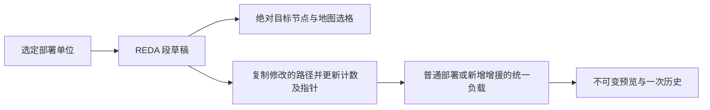
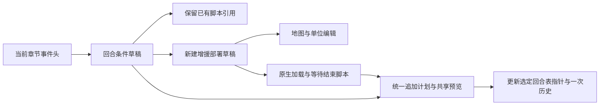
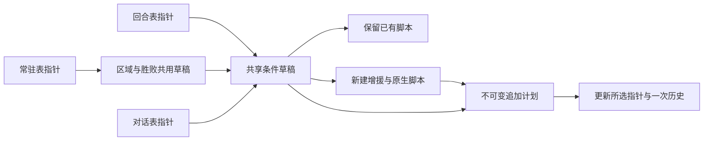

# 章节、地图与事件

本文维护当前格式、写入语义和限制；功能状态见[覆盖矩阵](../coverage.md)，操作步骤见[使用指南](../user-guide.md)。旧版与原生代码的固定版本见[核对来源](../sources.md)。

当前入口：[chapters.go](../../game/chapters.go)、[deployments.go](../../game/deployments.go)、[deployment_events.go](../../game/deployment_events.go)、[deployment_edit.go](../../game/deployment_edit.go)、[event_conditions.go](../../game/event_conditions.go)、[event_edit.go](../../game/event_edit.go)、[event_dialogue.go](../../game/event_dialogue.go)、[event_objectives.go](../../game/event_objectives.go) 和 [scripts.go](../../game/scripts.go)。

`EventTable` 区分回合、常驻和对话表，`EventCondition` 保留原生条件及独立脚本；`EventDraft`／`EventEdit` 管理草稿和不可变写入计划。UI 位于 [chapterview](../../internal/components/chapterview) 和 [eventeditor](../../internal/pages/eventeditor)。

## 五版章节配置

依据 `ROMFE8U/JP`、`ROMFE7U/JP`、`ROMFE6JP`、`MapSettingForm`、`MapSettingFE7Form`、`MapSettingFE7UForm`、`MapSettingFE6Form` 及各 Designer 的字段宽度；图块双 ID 依据 `ImageUtilMap.DrawMap`。从"章节"标签页进入，共用记录、字段与文档历史。

| 能力                       | 版本／依据                      | 行为与限制                                                                                                                                                            |
| -------------------------- | ------------------------------- | --------------------------------------------------------------------------------------------------------------------------------------------------------------------- |
| 列表、名称、搜索与多选     | 五版原版及可定位的已有表        | 实际指针和章节名偏移，单表失败不关闭其他编辑器；原版读取 FE8U/J 各 79 条、FE7U 67 条、FE7J 69 条、FE6 45 条，不以这些数量限制已搬迁表                                 |
| 版本布局与表结束           | 已知指针、完整记录；最多 256 条 | FE8U/J／FE7J 148 字节、FE7U 152 字节、FE6 68 字节；FE6 通过 `0x2BB12 = 0x2048` 识别 72 字节布局。保留旧版无内部名称指针时的资源／文本回退判定                         |
| 天气、迷雾与基本配置       | 已确认字段                      | 战前准备、标题图像、战斗背景、可破坏墙壁 HP、胜利音乐阈值等；按字段存储范围校验，其他字节保持不变                                                                     |
| 地图与事件资源 ID          | 原版资源布局                    | 图块、调色板、地图图块配置、地图、地图变化、图块动画、章节与世界地图事件 ID；两组图块 ID 分开编辑，已由 FE6／FE7 原版验证；静态地图组合预览已接入，资源内容编辑待实现 |
| 音乐 ID 与线路差异         | FE6 单字节；其他版本双字节      | 我方／敌方／友军音乐、FE7 线路及序章音乐、FE6 世界地图与开场音乐；不包含音频播放或导入                                                                                |
| 关联文本 ID 与正文跳转     | 现有文本表                      | 章节名、胜利条件文案、FE7 标题文字／占卜、FE6 势力名称／世界地图地名；字段旁可前往通用文本页，共享影响预览包含章节并可跳回记录。文案不改变胜利判定事件                |
| 手动布局、原始字节与表搬迁 | 已知字段、完整范围和确认引用    | 搬迁保留结束记录、旧数据及未知引用目标，更新已确认入口及内部引用；章节表也进入空间与文本入口的保护范围，记录数不扩展                                                  |
| 批量、撤销重做与保存重开   | 共用 ROM 文档                   | 五版固定章节验证搬迁、字段精确修改、标题文本、历史、保存重开及继续编辑；另验证 FE6 72 字节尾部保留及手动布局                                                          |

章节表缺少内部名称指针时，按旧版读取位置检查字节与文本 ID。旧变量 weather 检查偏移 12，FE6 为 11。实际天气字段位于偏移 18，FE6 为 17。新版保留原结束判定的位置，不将其用于限制天气值。

部署记录、地图联动及回合增援见下节。新增章节、地图绘制、其他触发条件和完整事件脚本仍待实现。

## 五版章节地图预览

依据 `ImageUtilMap.DrawMap`／`GetChipsetID`、`MapPointerForm.PlistToOffsetAddr` 及五版 `ROMFE*` 指针位置。资源指针列表在旧版称为 PLIST；新版逐类读取当前入口，允许各类使用独立列表。GBA 背景图块解释位于 [background.go](../../gba/background.go)，章节资源组合位于 [maps.go](../../game/maps.go)。

| 能力                    | 版本／依据                            | 行为与限制                                                                                                                      |
| ----------------------- | ------------------------------------- | ------------------------------------------------------------------------------------------------------------------------------- |
| 按章节组合资源          | FE8U/J、FE7U/J、FE6；有效当前章节布局 | 两个图块 ID、调色板、图块配置与地图布局的实时指针；第二组 ID 为零时省略，FE6 原版双图块资源已验证；支持手动定位及搬迁后的章节表 |
| 4bpp 背景图块与地图合成 | 有界 LZ77、512 字节 BGR555 调色板     | 10 位图块索引、水平／垂直翻转、16 组调色板及不透明背景色零；地图按四个 8×8 图块组合为 16×16 格子                                |
| 格子坐标与地形          | 完整图块配置及地形段                  | 原始地图单元值与地形 ID；地形按 `0x2000 + (mapWord >> 2)` 读取，保留未知 ID；地形名称、属性与编辑尚未接入                       |
| 缩放、平移、网格与选择  | 章节详情中的静态基础地图              | 50%／100%／200%／400%、滚动／拖动平移、重置视图及格子选择；拖动结束不触发选格，坐标按当前缩放和平移换算                         |
| 文档修订与章节上下文    | 当前会话、章节 ID 与实际记录地址      | 修改、原始字节、撤销重做及手动布局后的刷新；切换章节清除原格子选择和平移，不保留旧章节位图                                      |
| 资源诊断与范围检查      | 原生上限宽 60、高 63、总计 1536 格    | 无效入口、损坏／过大压缩流、半个图块、调色板越界、不完整布局、非法图块／地形引用的拒绝；错误只显示于地图区域，配置字段仍可编辑  |

底图是静态预览，部署视图叠加当前组的单位序号。迷雾、图块动画、事件变化、地图绘制和地图写入仍待实现，原生尺寸限制之外的扩展引擎也未适配。

## 五版章节初始部署

依据 `EventUnitForm`、`EventUnitFE7Form`、`EventUnitFE6Form`、`EventCondForm`、五版 `ROMFE*` 和 `event_FE6/7/8.en.txt` 编码及真实原版 ROM。FE8 部署包含独立移动段；FE7／FE6 的起终点直接保存在记录内。资源和入口分开建模，以实际指针位置区分编辑目标。

| 能力                     | 版本／依据                  | 行为与限制                                                                                                                                                                                                                                               |
| ------------------------ | --------------------------- | -------------------------------------------------------------------------------------------------------------------------------------------------------------------------------------------------------------------------------------------------------- |
| 部署入口与版本差异       | 五版有效章节及事件资源表    | FE8 20 字节、FE7／FE6 16 字节记录；按当前章节地址与实时事件资源指针读取难度、路线和遭遇战入口，支持空入口创建、手动章节布局和搬迁后的章节表。FE6 入口名称按原版阵营记录校核                                                                              |
| 开场及条件事件引用       | 已确认的原生指令及操作数    | 有界静态发现、直接加载、FE8 已知内存槽加载辅助事件、调用与前向标签；跟随地图切换，仅列出当前章节资源。不执行分支、ASM 或动态调用；未知指令、动态引用和限额显示不完整提示，已识别入口仍可编辑。每组最多 256 单位，发现最多 128 入口、16 层调用、8192 指令 |
| 单位属性及位置           | 原版记录字段                | 人物、职业、领队、等级、阵营、自动成长、起点、末段终点、四个道具和四个 AI 字节；FE8 原始位置标志放在高级字段。按位修改保留相邻位和未知字节；未知 ID 保留数值，职业 0 继承人物职业                                                                        |
| 新增、复制、删除         | 可读取的选定部署入口        | 包括将已有部署清空和创建原来为空的入口。保留结束数据；操作只改变草稿，预览应用后一次进入 ROM 历史                                                                                                                                                        |
| FE8 完整移动路径         | 有效计数及 8 字节移动段     | 绝对目标、6 位配置、同步人物／进度和前置延迟，新增／复制／删除／重排、零路径创建和末段删除清空指针；编辑最多 16 段，未知位与未修改路径保留；地形寻路和运行动画待实现                                                                                     |
| 地图与列表联动           | 可读取的基础地图            | 阵营色序号标记、起点／终点切换、列表及地图选中、同格循环选择、选格设置位置。FE8 同步等待独立于绝对终点，路径模式支持节点折线、选格定位与重叠节点循环；不是运行游戏后的部署状态                                                                           |
| 预览、共享影响和原子写入 | 同一文档、修订和章节布局    | 末尾追加、选定指针更新、已知共享章节展示、草稿冲突及重新读取。其他指针继续使用旧资源；共用同一指针位置的章节一起变化，其他事件使用处尚未完整索引。已知部署范围纳入表搬迁、文本入口和素材目标保护                                                         |
| 历史、保存重开及失败隔离 | 共用 ROM 文档和 32 MiB 上限 | 已由五版合成及固定原版章节验证字段、路径、增删复制、资源别名、撤销重做、保存重开和继续编辑；另外验证空入口、手动布局、章节搬迁、损坏路径、无终止记录、动态／递归事件和容量失败                                                                           |

已识别的部署资源均可编辑，包括初始部署和回合、区域、胜败、对话事件中的部署。回合条件与增援创建见下节，常用指令见通用脚本部分。

更多指令、出击菜单和游戏状态模拟尚未实现。部署入口或静态引用的数量不等于实际开场单位数。

## FE8 完整部署移动路径

[deployment_paths.go](../../game/deployment_paths.go) 以 `MovementStep` 保存完整 8 字节快照。原生 REDA 缓冲区有 4 组、每组 16 段；未修改的超长路径可保留，编辑路径或创建增援时最多 16 段。

依据旧版 `EventUnitForm.MakeUnitCoordList` 以及 FE8 原生 `struct REDA`、`CopyEventMoveREDAs`、`sub_807A294`、`MuCtr_ExecREDA_807A358` 和 `SetMuConfig`。两个版本使用相同的 8 字节格式；以原版序章赛特的固定六段路径校核。同步人物字段用于等待其移动进度，坐标保持绝对值。

| 能力                   | 版本／依据                    | 行为与限制                                                                                                                                                                                |
| ---------------------- | ----------------------------- | ----------------------------------------------------------------------------------------------------------------------------------------------------------------------------------------- |
| 原生段字段             | FE8U／FE8J 的 20 字节部署记录 | 6 位 X／Y、6 位移动配置、8 位同步人物、16 位等待段和延迟，保留位 18 至 23 及其余未修改字节；同步人物 0 不等待，等待段 FFFF 表示等待整条移动结束；延迟按原生有符号计时器解释，保留高位编码 |
| 段增删与排序           | 原生缓冲区最多 16 段          | 新增、按完整 8 字节复制、删除和上下移动，空路径建立默认段，最后一段删除清空计数与指针；已有超长路径可原样保留，修改后必须缩至上限                                                         |
| 编码目标与节点选择     | 可读取的章节基础地图          | 折线与编号节点、所选单位／节点定位、列表滚动、重叠循环、选格设置、缩放／平移与边界裁剪；显示编码目标，不模拟逐格寻路、碰撞或落点调整                                                      |
| 部署和增援共用原子写入 | 当前文档、修订和布局          | 部署路径快照、独立副本、修改路径追加与选定入口更新；原路径和独立引用保留，事件负载复用同一打包，路径修改递增本地 generation，使旧预览失效；支持撤销重做与保存重开                         |

FE6／FE7 的部署继续支持起终点，多段事件移动、路径动画和自定义移动引擎尚未接入。领域、文件与临时界面复核不代表实际游戏执行验证。

## 五版回合增援

回合条件和脚本分别保存。读取与编码规则依据旧版 `EventCondForm`、`event_FE6/7/8.en.txt`、五版 ROM 及 FE8 `EvCheck02_TURN`。静态发现只解释已确认的指令，新建增援生成最小原生脚本。

| 能力                         | 版本／依据               | 行为与限制                                                                                                                                                                                                             |
| ---------------------------- | ------------------------ | ---------------------------------------------------------------------------------------------------------------------------------------------------------------------------------------------------------------------- |
| 原生回合条件表               | 五版有效章节事件头       | 实时回合表指针、空入口、四字节零结束记录、最多 256 条。FE7 类型 1 为 12 字节、其他记录为 16 字节；FE8／FE6 为 12 字节。保留其他类型、未知参数及独立脚本引用，损坏记录拒绝写入                                          |
| 起止回合与触发条件           | 类型 2 原生记录          | 起止回合、16 位阶段、完成标志及 FE7 路线／难度。阶段 00／40／80 与单位阵营分开；保留未知阶段与路线值。结束回合 0 为仅起始回合、FF 为无上限，非零完成标志用于阻止重复执行并在执行前设置。其他条件类型仅保留／查看／删除 |
| 新增与删除回合增援           | 现有文档及章节布局       | 同页新建部署、地图定位、字段编辑和增删复制；生成原生加载单位、等待移动、事件结束脚本。新条件、脚本、部署和修改的 FE8 路径在一次历史中提交；已有脚本的部署组可跳转部署页单独修改                                        |
| 回合脚本关联部署             | 已确认的原生指令         | 各回合事件独立有界发现，列出已识别部署入口，未知／动态／ASM 不模拟且保留原脚本。普通部署页也列出类型 2 的后续回合入口。常用指令编辑见通用脚本章节，条件执行及其他触发类型待实现                                        |
| 原子追加与共享影响           | 同一文档、修订和手动布局 | 完整条件表复制、最小脚本／部署追加及选定回合表指针更新，预览列出共用此指针入口的已知章节；独立入口继续使用旧表。旧条件、脚本及部署资源保留，回合表和已识别脚本、指针、部署、路径纳入空间保护                           |
| 历史、重开、上下文与失败隔离 | 五版合成和固定原版章节   | 已覆盖目标字段及原字节保留、FE7 混合记录、脚本字面量、不可变预览、文档／修订／布局冲突、共享／独立指针入口、章节搬迁／手动定位、空表、无结束记录、容量与空间保护，以及撤销重做、保存重开、继续编辑和删除               |

回合增援暂不提供条件类型转换、已有任意脚本重写或游戏状态模拟。领域与真实 ROM 检查验证编码、指针和文件历史，不代表游戏运行验证。

## 五版区域触发事件

依据旧版 `EventCondForm.InitAlways`、五版固定原版条件、FE8 `EvCheck0B_AREA`、FE6 `EvtListCmd_Area` 与 FE7U 原版汇编 `0x08078650`。共用回合条件的读取、草稿、计划与原子提交；区域编辑类型 `0B`，同表标志及已确认全灭条件在胜败页编辑，其他条件原样保留。

| 能力               | 版本／依据           | 行为与限制                                                                                                                                                 |
| ------------------ | -------------------- | ---------------------------------------------------------------------------------------------------------------------------------------------------------- |
| 原生常驻条件表     | 五版有效事件头       | 事件头 +12 指针、固定 12 字节记录、四字节零结束、空入口及最多 256 条；未知条件保持字节和脚本引用，损坏表拒绝写入                                           |
| 区域与完成标志     | 类型 0B              | 四个有符号坐标和完成标志；包含两个端点，FE8 接受倒序，FE6／FE7 倒序为空范围；标志 0 可重复触发，单次触发需显式选用未使用的非零标志                         |
| 范围叠加与选择     | 静态基础地图         | 原生有效范围、地图边界裁剪、序号和选中范围、重叠循环选择、选格设置端点；新建增援同时叠加单位标记，缩放和平移沿用地图视图                                   |
| 区域增援与部署关联 | 现有章节及布局       | 新增／删除及独立敌军部署草稿，复用人物／道具／AI 和位置；生成加载、等待、结束脚本，已有脚本只提供已识别部署跳转；普通部署页也发现类型 0B 引用              |
| 共享预览与原子历史 | 同一文档、修订和布局 | 完整常驻表、新脚本、部署和修改路径的不可变追加计划；只更新选定指针位置，列出已知共用章节，保留独立入口及旧资源；已识别区域表、脚本、部署和路径纳入空间保护 |

`EventTable` 区分回合、常驻和对话表，`EventCondition` 保存原生条件，`EventDraft`／`EventEdit` 处理草稿和提交。

引擎检查条件时读取活动单位位置，编辑器不模拟移动或条件执行。FE6、FE7 的困难专用区域及其他未支持条件保留原始记录，不提供类型转换或任意脚本重写。领域和文件回归只验证编码与文件行为，游戏内触发尚未验证。

## 五版人物对话事件

依据旧版 `EventCondForm.InitTalk`／`ROMFE*.eventcond_talk_size`、FE8 `EvCheck03_CHAR`、FE6 `EvtListCmd_Talk`、FE7U 原版 `0x080783F4`，以及各版原生文本模板和固定章节样本。人物对话有方向；双向关系需保留两条条件。

| 能力                 | 版本／依据                   | 行为与限制                                                                                                                                                                                                             |
| -------------------- | ---------------------------- | ---------------------------------------------------------------------------------------------------------------------------------------------------------------------------------------------------------------------- |
| 对话表与人物关系     | 事件头 +4                    | FE6 类型 4 的 12 字节记录与 FE7／FE8 类型 3 的 16 字节记录，空入口、四字节零结束和最多 256 条；ASM 及未知条件只保留、查看或删除                                                                                        |
| 双方人物和标志       | 已确认的普通对话条件         | 人物 ID／名称搜索、发起者／目标跳转、完成标志和附加条件；FE7／FE8 发起者 0 通配，FE6 精确匹配双方；FE7 模式 1／2 限制路线、3 要求标志，模式只改低字节；FE8 模式 1／2 禁止触发，模式 3 要求标志；未知值与未使用字节保留 |
| 普通对话脚本         | 已有可读取的主表 ROM 文本 ID | ID／全文搜索、短摘要选择、正文预览和文本页跳转，按版本生成普通文本展示、清理和结束脚本；新建条件与脚本一起预览、追加和原子应用；完成标志 0 可重复，单次对话需显式选用未占用的非零标志                                  |
| 已有事件资源跳转     | 有界静态发现                 | 确认过的直接文本操作数、FE8 已知槽值和调用中的文本，以及部署入口跳转；保留已有脚本并提示不完整发现；普通部署页发现普通对话中的已识别部署；原脚本的招募、阵营、道具等效果保持原样                                       |
| 草稿、共享与资源保护 | 同一文档、修订和布局         | 共享指针位置的章节预览、独立头别名保留、不可变计划、一次历史、空表与增删、冲突重新读取和保存重开；条件表、已识别脚本、部署、路径及指针纳入空间保护                                                                     |

普通对话模板引用已有文本，头像和发言位置由文本控制指令决定。模板不生成招募效果，也不新建文本 ID 或重写任意脚本。

全局事件反向引用索引尚未实现，文本共享预览只列出已知记录字段。文件检查未验证游戏运行。

## 五版章节胜败条件

结束事件指针在 FE6、FE7、FE8 分别位于事件头 `+24`、`+60`、`+76`，按当前章节布局读取。新增失败条件优先复用本章游戏结束事件，缺失时选择可读取的原生入口。

依据 `EventCondForm.InitAlways`、五版固定原版条件、FE8 `EvCheck01_AFEV`／`EvCheck0E_`、FE6 `EvtListCmd_Flag`／`EvtListCmd_Func`／`func_fe6_0806C2F8` 与 FE7U 原版 `0x080781B4`／`0x08079FE8`。结束事件指针为 FE6 `+24`、FE7 `+60`、FE8 `+76`，均按当前章节事件头定位。

| 能力                 | 版本／依据                 | 行为与限制                                                                                                                                                                             |
| -------------------- | -------------------------- | -------------------------------------------------------------------------------------------------------------------------------------------------------------------------------------- |
| 标志判定和完成标志   | 常驻表类型 01              | FE8 32 位判定与 FE6／FE7 低 16 位判定；保留 FE6／FE7 未使用高字节。FE8 的 0、0x64 无条件成立，FE6／FE7 的这两个值为假；完成标志执行前检查并设置，0 可重复、3 为胜利标志                |
| 已确认全灭回调       | FE6 类型 0D，FE7 类型 0E   | 回调识别及完成标志、关联脚本修改，FE6 检查包含友军，FE7 检查敌军；其他 ASM 条件只保留、查看或删除                                                                                      |
| 首领／全灭／失败模板 | 可读取的结束或游戏结束事件 | 首领标志 2＋胜利标志 3＋本章结束事件；FE8 全灭标志 6，FE7J/U 原生回调 0x0807AA5D／0x08079FE9，FE6 原生回调 0x0806C2F9；失败模板默认判定 0x65，优先复用本章游戏结束事件；不重写已有脚本 |
| 文案和实际规则       | 当前章节及已识别脚本       | 分别显示文案 ID 和实际条件，支持文案、脚本、文本及部署跳转。多个文本引用共用选择器和一处预览。关联事件可选本章已识别引用或原生标记 1，后者只设置完成标志                               |
| 两页草稿和原子历史   | 与区域页共用常驻表指针     | 一份 EventDraft、一份完整表追加计划、共享章节预览、独立头别名保留、原顺序与未知字节保留、撤销重做和保存重开；结束事件脚本、部署、路径及指针加入空间保护                                |

首领标志由死亡对话或脚本设置，模板不指定首领人物。原有胜利入口、死亡事件和引擎规则继续生效，不会自动替换占领或回合等入口。FE8 的全灭和失败还受原生引擎检查影响。

未知 ASM、任意脚本重写、自定义引擎、逐人物死亡判定、占领与生存模板、完整事件反向引用索引仍待实现。文件和界面检查未验证游戏内触发。

## 通用事件脚本

[script_schema.go](../../game/script_schema.go) 定义已确认指令，[script_edit.go](../../game/script_edit.go)、[script_pack.go](../../game/script_pack.go)、[script_plan.go](../../game/script_plan.go) 处理草稿、重定位与写入。

依据旧版 EventScript 及五版 event 配置、FE6／FE8 原生事件执行器和固定原版字节。按入口保留别名，未知与 ASM 不参与结构重写。

| 能力                   | 版本／依据               | 行为与限制                                                                                                                             |
| ---------------------- | ------------------------ | -------------------------------------------------------------------------------------------------------------------------------------- |
| 章节入口与调用导航     | 五版当前章节布局         | 开场、结束、回合／对话／常驻条件及已发现调用，地址／来源搜索、空入口显式创建及文本／部署跳转；每章最多 512 入口、32768 指令预算        |
| 有界指令列表           | 原生指令边界             | 地址、原始字节及常用指令；单段最多 8192 指令，ASM 和未知行只读，边界或结束不完整时整段只读                                             |
| 常用参数编辑           | 已确认版本定义           | 文本、加载单位、等待、标志、标签、调用／FE6 跨脚本跳转，FE7 标志分支及 FE8 槽赋值／比较；原地址按位修改，保留未知字节                  |
| 插入、复制、删除和排序 | 整段已确认且可静态重定位 | 稳定指令 ID、标签校验及已声明内部调用调整，追加完整脚本并更新所选入口；其他独立入口保留原脚本，动态调用及不明内部地址拒绝搬迁          |
| 共享预览与原子历史     | 当前文档、修订和布局     | 参数修改展示已知共享／内部入口，结构修改展示同一指针位置；不可变计划、资源冲突保护、旧预览失效、冲突重新读取、撤销重做及保存后继续编辑 |

更多事件指令、ASM 修改、自定义引擎、任意控制流重建、运行模拟和完整全局引用索引仍待接入。
