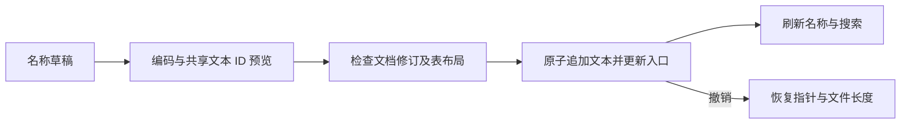

# 文本与静态图像

本文维护当前格式、写入语义和限制；功能状态见[覆盖矩阵](../coverage.md)，操作步骤见[使用指南](../user-guide.md)。旧版与原生代码的固定版本见[核对来源](../sources.md)。

当前入口：文本表（`game/text/table.go`）、解码（`game/text/decode.go`）、编码（`game/text/encode.go`）、文本替换（`game/text/replacement.go`）、控制指令（`game/text/controls.go`）、PNG 读取（`game/graphics/editor.go`）和图像替换（`game/graphics/replacement.go`）。

## 五版名称写入

名称不能带首尾空格，无法编码或不能原样读回的输入会被拒绝。原生 `0x1F` 名称填充符参与解码长度计算，不作为结束码。

名称写入依据 `FETextEncode.Encode`、`make_huffman_map`、`FETextDecode.huffman_decode` 和 `TextForm.WriteText` 的入口及编码规则。已有文本 ID 的指令编辑见下方通用文本部分。

| 能力                   | 版本／依据                                   | 行为与限制                                                                                                                                             |
| ---------------------- | -------------------------------------------- | ------------------------------------------------------------------------------------------------------------------------------------------------------ |
| 名称草稿与共享用途预览 | FE8U／FE8J／FE7U／FE7J／FE6；已有非零文本 ID | 人物、职业、道具详情；预览列出已知记录字段及原生战斗／死亡对话表引用，同一 ID 的其他用途也会变更                                                       |
| 按当前树压缩名称       | 英文 ASCII／日文 Shift-JIS；有效 Huffman 树  | 字符边界上的完整分词、低位优先编码及原生 0x1F 填充码；解码数据最多 4096 字节、32 位码长及 65536 位流，英文／日文保留七／八位结束码空间和三字节读取余量 |
| 紧凑职业名双向映射     | FE8J／FE7J／FE6 原版字形                     | 读写共用一份映射，拒绝有损字符转换，不替换为问号或近似字符                                                                                             |
| 追加文本并原子更新入口 | 有效主文本表指针；最多 32 MiB                | 四字节对齐追加、旧文本保留、修订与布局绑定、撤销重做及保存重开；独立文本 ID 的旧别名保持不变                                                           |
| 版本与字库边界         | 五版原版字符集                               | 五版基础名称写入已接入；已有文本 ID 的指令及参数编辑见通用文本组；自定义字库、更多补丁、anti-Huffman 写入和新建文本 ID 仍待实现                        |

## 五版描述正文编辑

描述保留首尾空白及半角字符，紧凑字形在连续正文中双向转换。`TextRole` 区分名称与描述，`TextValue` 保留正文、换行、控制码及完整 16 位参数。RAM 入口参与文本表范围判定，但不能从 ROM 解码或替换；单条错误不隐藏后续入口。

与名称共用文本表、Huffman 树、末尾追加、共享字段预览和历史；控制参数依据 `FETextDecode.append_string`、`TextForm.ParseTextList` 与 `text_escape_ALL.en.txt` 保留。

| 能力                           | 版本／依据                                        | 行为与限制                                                                                                               |
| ------------------------------ | ------------------------------------------------- | ------------------------------------------------------------------------------------------------------------------------ |
| 人物／职业／道具描述及使用描述 | FE8U／FE7U／FE8J／FE7J／FE6 原版；已有非零文本 ID | 多行正文草稿、预览、取消、应用；名称／描述／使用描述共享 ID 的字段一起列出                                               |
| 正文与控制单元无损往返         | 英文 ASCII／日文 Shift-JIS、换行及原有控制码      | 保留完整字符边界、紧凑字形与 16 位参数；支持可读指令、原始标记及已确认指令／参数修改；非法编码、未知扩展和不完整参数只读 |
| 追加描述并原子更新入口         | 有效主文本表指针与 Huffman 树                     | 复用已有写入机制；不改动未编辑文本，保留旧资源和独立 ID 别名；验证撤销重做、保存重开及继续编辑                           |
| 版本与字库边界                 | 五版原版字符集                                    | 五版描述及对应 UI 已接入；已有文本 ID 与控制指令共用通用文本编辑；自定义字库及新建文本 ID 尚未接入                       |

## 五版通用文本与控制指令

依据 `TextForm.Init`、`TextEscape`、`text_escape_ALL.en.txt` 和 `FETextDecode.append_string`。从"文本"标签页进入，复用已有 `TextEdit` 和文档历史。

| 能力                         | 版本／依据                                     | 行为与限制                                                                                                                       |
| ---------------------------- | ---------------------------------------------- | -------------------------------------------------------------------------------------------------------------------------------- |
| 浏览、搜索与 ID 定位         | 五版；连续有效的现有文本表                     | 正文与十六进制 ID 搜索，索引随文档修订更新；保留单条错误及 RAM 入口，ID 0 不编辑，恢复地址仅供读取                               |
| 可读指令及原始表示           | 原版共有指令及英文引号；Shift-JIS 字符优先识别 | `[A]`、`[Wink]`、`[LoadFace][0xNNNN]` 等标记、指令参考及 ROM 控制单元查看；完整 16 位参数、打包扩展指令与字面转义无损处理        |
| 指令增删与参数修改           | 已确认指令及当前 Huffman 树                    | 描述与通用文本；检查语法、版本、参数完整性、低字节与可编码性；未知指令或字符保留原始表示并只读，等价表示拒绝重复写入             |
| 草稿与共享影响预览           | 每个窗口／文本 ID                              | 跨记录草稿保留、原文冲突提示及重新读取；预览绑定修订与布局，已知记录字段及原生战斗／死亡对话表引用可跳回对应记录，全局事件脚本引用尚未完整索引 |
| 原子写入及历史               | 有效主入口；最多 32 MiB                        | 追加、入口更新、旧资源及独立别名保留、撤销重做与保存重开；五版固定对话验证指令增删及头像参数修改                                 |
| 表容量、自定义引擎与外部格式 | 后续功能                                       | 新建 ID、文本表扩展、自定义字库／引擎、anti-Huffman 写入、文本文件导入导出及游戏画面预览待实现                                   |

共享使用处由 `game/session.go` 合并记录与原生对话表的结果，包含 FE6 死亡记录中的终章文本。表引用规则见[战斗与死亡对话](battle-and-defeat-dialogue.md)；这不是全 ROM 的文本引用证明。

指令已识别时，参数仍须具有当前 Huffman 编码。例如 FE7U、FE6 原版没有头像参数 `0x0101` 的编码，FE6 原版也没有 `[Wink]` 的编码。预览会拒绝这些输入，不生成新的 Huffman 树。

## 五版静态素材 PNG 读写

道具图标可寻址区为 255 槽，每次替换复制 32,640 字节并更新已确认入口，以保留其他图标。头像定位与 PNG 写入相互使旧预览失效；先重新读取和预览，再应用另一类修改。

依据 `ImageItemIconForm`、`ImagePortraitForm.DrawPortraitSeet`／`BuildPortraitSeet`、`ImagePortraitFE6Form` 与 `ImageUtil`；覆盖五版原版的已有素材 ID。

| 能力                             | 版本／依据                       | 行为与限制                                                                                                                            |
| -------------------------------- | -------------------------------- | ------------------------------------------------------------------------------------------------------------------------------------- |
| PNG 导出与替换预览               | 五版；已有图标、普通头像及职业卡 | 原生文件对话框、实际写入颜色预览、已知共享字段列表、应用及取消；图标 16×16，头像完整素材表 128×112，职业卡保持原尺寸                  |
| 调色板与透明色                   | GBA 4bpp、BGR555                 | 图标严格使用原共享调色板；头像最多 15 种不透明色加透明色，新颜色转换为 GBA 颜色并预览；拒绝半透明和超限颜色                           |
| 静态头像及眼睛、嘴部、小头像图块 | FE7／FE8；FE6 独立布局           | 保留原有坐标及压缩方式；FE6 嘴部写入主图、小头像不压缩，FE7／FE8 嘴部独立、小头像压缩；空白区非透明像素被拒绝                         |
| 原子追加与资源入口更新           | 默认末尾追加；32 MiB 上限        | 图标复制整个可寻址图标区并更新已确认入口，保留其他图标；头像单独追加各部分及调色板；旧区与独立 ID 的别名保留，一次撤销恢复长度及指针  |
| 写入及验证边界                   | 有效素材指针、文档修订、窗口布局 | 预览绑定文档与布局；保护已知数据表和入口；验证保存重开及继续编辑；MUG_EXCEED、HALFBODY 等头像扩展仅保留已有预览，不提供完整素材表写入 |

