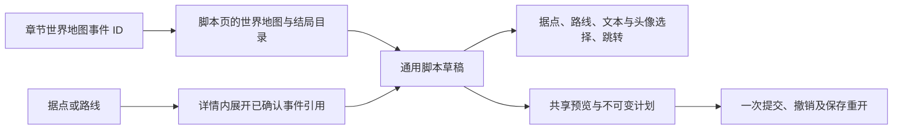

# 世界地图据点、路线与事件

原生 FE8J/U 据点、路线、道路与移动控制点由 `game/worldmap` 读取与编辑，`game/worldmap_sources.go` 提供当前章节、文本校验及会话资源保护。事件目录和已确认指令由 `game/event/worldmap_events.go`、`game/event/worldmap_commands.go`、`game/event/worldmap_scene.go` 接入通用脚本草稿。功能状态和未支持范围见[覆盖矩阵](../coverage.md#世界地图据点)，来源见[据点核对来源](../sources.md#世界地图据点)、[路线核对来源](../sources.md#世界地图路线与底图)和[事件核对来源](../sources.md#世界地图事件)。

## 版本与入口

FE8 的据点和道路用于可操作世界地图；游戏按当前主角路线与分支标志读取进入章节、后继据点，并由事件及运行状态控制显示与通行。FE6／FE7 的世界地图用于章节间叙事演出，图像与事件有各自入口，不采用这套据点与道路表。

旧版 FE8 主界面的“据点”打开 `WorldMapPointForm`，窗口包含据点字段与地图／道路预览；新版将对应字段组织为“世界地图 → 据点”。`WorldMap.Available()` 仅判断版本格式是否声明原生据点表，当前由 FE8J/U 声明；它不检测改版的剧情是否仍启用大地图行走。取消该玩法但保留数据的 FE8 改版仍可显示入口；实际读取和写入另行检查指针、边界及资源冲突。

## 据点与字段

按当前根指针定位原生 29 条、每条 32 字节的据点记录，不扫描形似指针的字节来推断扩表。FE6／FE7 不提供此编辑入口。根指针必须四字节对齐，完整表须位于 ROM 边界内。

| 偏移          | 字段        | 原生含义与编辑范围                                                                      |
| ------------- | ----------- | --------------------------------------------------------------------------------------- |
| +0            | 放置类型    | 字节；0 剧情推进、1 弗雷利亚、2 魔物出现据点、3 迷宫。进入条件还受剧情状态影响          |
| +1            | 遭遇类型    | 有符号字节；编辑原生值 1 无、2 魔物、3 迷宫                                             |
| +2／+3        | 图标        | 状态位 2 成立时使用 +2，否则使用 +3；普通输入接受原生图标 ID 0–16，已有扩展值保留       |
| +4／+5        | 章节        | 无符号字节；分别为艾瑞珂／艾弗拉姆路线。改动须引用当前有效章节布局中的记录              |
| +6            | 分支标志    | 有符号 16 位，交给原生 `CheckFlag`；0 恒不成立，原生数据也包含 -1。不模拟标志或剧情进度 |
| +8／+9        | 普通后继    | 有符号字节；按两条路线选择，-1 无下一站、0–28 为已有据点                                |
| +10／+11      | 分支后继    | 分支标志成立时替代普通后继，同样按路线选择                                              |
| +12／+16／+20 | 商店指针    | 武器店、道具店、秘密商店；由独立商店流程修改，据点草稿不写这些指针                      |
| +24／+26      | X／Y        | 有符号 16 位像素坐标；保留负坐标，不按章节地图格子解释，不自动移动道路和脚本路径        |
| +28           | 地名文本 ID | 无符号 16 位，改动须为可读取的已有文本或空 ID 0；文字内容通过通用文本页编辑             |
| +30           | 乘船位      | 仅修改 bit 0，其他位保留；两端据点均设置此位时原生移动器才选择乘船                      |
| +31           | 未解释字节  | 始终保留                                                                                |

已存在的超出普通编辑范围的值可读取、保持不变；修改其他字段不会要求先修复它们。草稿可恢复原字段值。普通后继输入使用 -1 表示原始字节 FF，坐标和标志使用有符号十进制或带 `0x` 前缀的数值。结构与范围由领域包声明，页面不通过控件标签推断规则。

旧版把 +2 标为“通关前”、+3 标为“通关后”，FE8U 反编译结构成员名也如此；但其实际绘制、命中与进入效果的选择分支在据点状态位 2 成立时使用 +2。新版按消费者和状态位命名为已通关／未通关图标，不直接复制旧标签。

## 草稿、引用与写入

每个据点拥有独立草稿，绑定文档身份、修订及解析布局。预览冻结字段的原值、新值和写入字节；继续修改草稿不会改变已生成的领域计划。无修改不生成计划。

修改已有据点采用原地写入，只写实际变化的字段，不搬迁据点表、不增加记录、不改变文件长度。写入前检查整条 32 字节记录与会话全部资源声明的交叠；当前据点自己的声明和由它容纳的商店指针允许通过，其他领域、独立货物载荷或根指针的冲突拒绝写入。`Format.Claims` 同时声明据点根、据点本体、商店指针宿主及有界货物范围，据点和商店复用同一套保护事实。

章节和文本引用仅在相应字段改变时校验。章节表或某个地名不可读取不阻止独立的坐标修改。所有字段一起提交、一次撤销；过期、跨文档、布局冲突和引用错误不改变 ROM 或历史。原地修改影响读取该据点的全部消费者；资源声明和文本使用处不构成完整全 ROM 引用证明。

地名引用加入通用文本共享用途，可从文本预览返回据点。据点可跳转两条路线的章节、后继据点及三个商店入口；未启用商店也可定位。据点与货物各自保留草稿，在任一流程应用后，另一流程已有修改会按文档修订失效。

## 页面行为

“世界地图”标签仅在存在此能力时显示。侧栏按地名或十六进制据点 ID 搜索，保留原生据点顺序。各据点的数值输入、非法状态和预览独立保存；无修改草稿自动跟随文档刷新，已有修改或非法输入在过期后保留，须显式放弃重读。

名称、坐标、两路线章节及后继条件直接展示；图标、放置、遭遇和乘船规则收在“其他据点规则”。章节和后继输入支持编号与名称候选，文本选择复用通用文本控件。字段组使用稳定身份，预览栏、非法提示出现和消失不重建输入历史。原始数据模式提供地址及字节入口。

世界地图的“据点”和“路线”标签分别保留各自草稿。据点页的“查看相连路线”按原生端点筛选路线；路线端点按钮和地图圆点可以返回据点。应用任一资源都会使其他已有修改的草稿按修订失效。

## 路线与移动控制点

路线根指针定位固定 32 条、每条 12 字节的原生记录，表本体四字节对齐。保持原生 ID 和顺序，不自动扩表。

| 偏移   | 字段           | 解释与写入                                                                 |
| ------ | -------------- | -------------------------------------------------------------------------- |
| +0     | 道路绘制流指针 | 修改道路时独立追加并重定向所选指针；修改连接和控制点不自动重绘道路         |
| +4／+5 | 两端据点       | 有符号字节，编辑范围为 0–28；进度方向由 +4 指向 +5，反向移动由游戏倒序处理 |
| +6／+7 | 未解释字节     | 原样保留                                                                   |
| +8     | 移动控制点指针 | 零表示无中间点；非零必须四字节对齐且完整可读                               |

每个中间点 8 字节：有符号 32 位进度、两个有符号 16 位像素坐标。进度代表整段行走时间的 1/4096，起点为 0、终点为 4096；编辑值须在 1–4095 内严格递增。任意负进度结束列表，已有结束记录的全部 8 字节保留。新建列表使用 `FFFFFFFF 00000000` 结束。原生移动器每单位保留 16 个坐标字，包含首尾据点，因此最多编辑 6 个中间点；超出或未终止的轨迹报告不可确认，不扫描后方字节扩容。

端点变化检查自连接、与其他路线重复的无向据点对及据点连接容量。原生邻接表容纳 7 个连接；据点 0 的消费者额外写入一个槽，故其上限为 6。此检查按全部 32 条路线计算，不依赖某次剧情是否刚好只开放其中一部分。它不证明特定事件时长下的插值正确：游戏还会将进度量化成帧，极接近的进度在很短的移动时间内可能重合。

`RouteDraft` 表示一条路线的端点、控制点与道路草稿，`RoutePlan` 冻结写入与预览。只修改端点时保留文件长度与移动指针；控制点变化时独立追加完整列表，只重定向所选路线的 +8。清空列表写零指针。旧载荷、未选定路线及未登记的独立引用原样保留，不据共享列表或空白字节推断空间可复用。预览列出仍引用旧轨迹的已知路线，这不是全 ROM 引用证明。

写入前按整条 12 字节路线检查会话资源声明；路线自身及其容纳的指针站点允许通过，其他据点、道路、控制点载荷、底图资源及根指针交叠均拒绝。已确认的资源范围和根指针由 `Format.Claims` 汇总；损坏的路线载荷至少保留可确认首部的保护。端点、道路与控制点指针、追加字节和文件长度一次提交、一次撤销。跨文档、修订／布局变化、引用冲突和容量不足均不产生部分修改。

道路图形或原控制点无法读取时，有效的路线记录仍允许独立修改端点；不可读取的原轨迹或道路不能通过自动编辑替换。道路编辑要求道路流、图块和调色板均可确认，底图损坏不阻止独立的道路编辑。已存在但未改动的异常字段不被自动归一化。

## 道路绘制

`RoadDraft` 由路线草稿持有，以 60×40 个 8×8 图块格保存最终道路；每格分别记录是否写入、图块编号及水平／垂直翻转。重复或跨行的原始写入按游戏顺序解析，同一格以最后一次写入为准。未写入的格子与显式透明图块不同：前者不影响之前绘制的道路，后者会覆盖该位置。画布只预览所选路线，不模拟多条路线的剧情开放及叠加顺序。

可从当前道路图块集选取画笔、取样保留翻转，或擦除格子；绘制不会替换图块集或调色板。领域操作连接稀疏鼠标采样点并先校验全部格子和图块，一次拖动只记录一次草稿撤销。松开前只显示笔画预览，Esc、切换路线、忙碌或过期会取消未完成笔画。方向键移动格子选择，空格执行当前画笔／擦除／取样。道路工作区取得焦点时，撤销／重做命令由道路草稿持有，空历史或过期状态不回退为 ROM 撤销；输入框仍使用自身文本历史。

保存按行合并真正相邻的已写入格子，每段写入 X／Y／长度／重复数 1 与对应半字，不填补空隙。空道路写入有效的 `FF 00 00 00` 结束流而非零指针。只有最终格子发生变化时才重新编码；未修改的道路保留原编码。新流独立追加，只更新所选路线的 +0，原道路及其结束尾字节、共享路线和未知独立引用保留。道路与轨迹使用同一追加计划，任一容量或资源冲突失败均不提交。

预览列出道路变化格数、仍使用旧道路的已知路线及合并后的追加范围。草稿继续修改、撤销或重做不会改变已经冻结的领域计划。

## 地图预览与路线操作

路线地图按日间／暗色选择显示底图、所选路线的道路草稿图块、全部据点的编号标记及草稿控制点。底图为 480×320，顺序排列 4bpp 图块，四组 BGR555 调色板；LZ77 调色板地图每行 32 字节，以低／高半字节选择前 60 个图块的调色板，余下四格属于行填充。道路使用独立的压缩图块和独立调色板，色零透明；读取图块索引和水平／垂直翻转。

道路流每组头为 X、Y、个数和重复数，后接 `个数 × 重复数` 个半字；消费者从 `Y×60+X` 连续写入，不在每次重复时另起一行。首字节 FF 结束。图形解析限定地图、资源和解压边界；无法确认时单独报告图像错误，端点表单仍可使用。底图和所选道路按文档、修订及布局缓存，过期草稿不与当前地图混合显示。

控制点连线表示顺序，不是游戏样条插值或单位运行轨迹模拟。可缩放和滚动地图，点击中间点选择它，启用“点击地图定位所选点”后修改该点坐标。点表支持有符号坐标、进度输入、选中点后插入、删除和重排；没有选中点时追加。重排保留点的进度，若顺序不再递增，预览拒绝提交，须显式修正。文本非法值跨路线保留，草稿与计划均按文档有效性失效。

本流程保留剧情解锁事件和据点后继设置；它们通过各自编辑器修改。道路图块集替换、路线／据点扩容及路线外部格式导入导出属于独立能力；保存重开和临时界面复核不表示游戏内移动、进入章节或事件触发已验证。

## 底图 PNG 替换

`game/worldmap/background.go` 维护原生 FE8J/U 底图。`BackgroundTone` 区分日间 `Daytime` 和暗色 `Darkened`，各自读取已声明调色板，共享像素与调色板地图；两者错误独立报告。导出为 480×320 索引 PNG，保留 64 个调色板位置及重复颜色；颜色零同样不透明。导入文件上限为 1 MiB，须保持索引 PNG，使用 0–63 号不透明颜色，每个 8×8 图块只能来自同一组 16 色（0–15、16–31、32–47 或 48–63）。真彩色、混组图块、透明／半透明、超限索引及错误尺寸会被拒绝，不进行自动分组或减色。PNG 中前 64 项之外未使用的调色板项不参与写入。

PNG 中已提供的调色板颜色按最近值转换为 BGR555，预览显示实际 GBA 颜色；未提供的位置保留原值。每项未使用的最高位、调色板地图每行末尾两字节、旧压缩流及尾部原样保留。只追加发生变化的像素、调色板或压缩调色板地图，并更新各自已声明的指针；未变资源保留原指针和编码。日间调色板还有重载和压暗两处已确认消费者：仍指向当前初始化色表时一起重定向，已独立改用其他色表时保留。日间替换不改写暗色入口，即使两者原先别名到同一载荷。所有变化与文件长度通过同一不可变计划提交，一次撤销恢复；原资源及独立别名不被覆盖，也不扫描其他形似指针的位置。

`Background` 是源资源的不可变副本；文件读取、PNG 编解码及生成 `BackgroundDraft` 在后台执行，回到 UI 线程后检查文档、修订、布局及页面身份，再生成 `BackgroundPlan`。写入入口通过会话资源声明检查，拒绝其他载荷及自身载荷重叠；无修改、容量不足、损坏源资源和过期计划均不写入。道路无法读取不阻止可确认的底图替换。

日间／暗色切换位于路线地图附近，PNG 文件操作与格式要求按需展开，成功导入后收起文件操作；预览、错误及应用后其他草稿失效的提醒始终保留在外。应用或取消后焦点回到文件操作入口。日间／暗色分别保留导入草稿，预览由所有路线共享，可切换原图／替换图，并叠加当前路线道路草稿、据点及控制点。取消不修改文档；应用后按统一修订规则使其他未应用草稿失效。底图不会移动据点、道路或事件坐标。日间替换后，暗色场景使用新像素与原暗色颜色；应先应用日间修改，再导出当前暗色底图配色。暗色导入要求所有像素索引与每图块的调色板分组完全不变，只追加 128 字节暗色调色板并更新其独立入口。日间／重载／压暗起始色表和独立引用均保留，不自动推导暗色颜色或模拟渐变过程。

## 道路图块集 PNG 替换

`game/worldmap/road_tileset.go` 的 `RoadTileset` 保存共享道路素材的不可变副本；`RoadTilesetDraft` 提供替换预览，`RoadTilesetPlan` 冻结原子写入。导出索引 PNG 每行 16 个 8×8 图块，宽 128 像素，按当前原生顺序排列；最后一行不足处填透明 0 号色。导入保持尺寸与图块数量，索引仅限 0–15，0 号色透明，其他已提供颜色必须不透明；末行空格必须仍为 0 号索引。拒绝真彩色、半透明、超限文件及错误尺寸，不自动重排或扩充图块。未提供的调色板项、0 号色原始字及各项未使用最高位保持不变；其他颜色按最近 GBA 颜色编码。

图块与调色板为所有原生路线共享，替换不修改任何道路流或图块编号。变化的图块重新 LZ77 编码后追加；变化的调色板独立追加，未变资源保持原指针和编码。图块初始化与返回地图时重载的两处已确认消费者仍共享当前图块时一起更新；独立重定向入口和未声明别名保持不变。入口保护、容量、文档／修订／布局校验与背景流程相同，全部载荷、指针和文件长度一次提交、一次撤销。背景或路线布局无法读取不阻止可确认的共享素材替换。

导入在同一地图叠加当前路线的道路草稿，也同步画笔图块和笔画预览；可切换路线查看共享影响，或关闭替换预览回看原素材。布局草稿与素材草稿独立，应用素材会使尚未提交的布局草稿失效。后台仅读取不可变资源，UI 线程接收结果时检查来源及页面身份；取消、迟到回调或过期操作不会改写文档。

## 事件目录与章节归属

FE8J/U 的开始表和进入章节表各有 59 个四字节脚本指针，按版本声明的根指针读取当前位置，不根据非零数量或相邻脚本猜测长度。零项是已声明的空入口，允许显式创建脚本。两条路线的结局通过独立指针进入同一编辑流程。目录根、完整边界或某个入口损坏分别报告；章节表不可读不阻止编辑独立目录中的有效脚本。

两张表都按章节字段 `world_map_events_id` 索引，不能直接使用章节编号。开始事件先找当前据点的下一剧情目的地，再取该据点对应路线的章节及其事件 ID；进入章节事件取当前章节的事件 ID。开场使用开始表 01。章节侧只按已有事件 ID 关联两类入口，不模拟目的地或剧情进度；同一 ID 可由多个章节共用。

`WorldMapScripts` 选择独立目录，`ScriptEntry.WorldMap` 标记世界地图上下文。关联章节是导航信息，不是战场地图上下文；地图变化指令仍需显式地图加载建立上下文，章节尺寸审核也不把世界地图像素当作战场格子。目录及章节入口复用有界脚本图：最多 512 个入口、32768 条指令预算，单段最多 8192 条；同一载荷只解码一次，保留指针入口及开始／进入章节等语义别名。

## 常用世界地图指令

| 原生操作码 | 可编辑操作                                                               | 关键约束                                                                         |
| ---------- | ------------------------------------------------------------------------ | -------------------------------------------------------------------------------- |
| 81–82      | 阻塞淡出至黑屏、结束世界地图显示                                         | 结束显示不终止事件解释器，仍需事件结束指令                                       |
| 83–89      | 镜头直接定位、移至据点／单位、滚动及等待                                 | 像素坐标；滚动起点 -1 使用当前镜头，新设时长为正值                               |
| 90–92      | 渐显开放、直接开放及关闭路线                                             | 原生路线 00–1F；不改变道路图块或端点                                             |
| 93–99      | 据点启用／禁用、显示动画、从路线未启用端点或后继规则选剧情据点、等待显示 | 原生据点 00–1C；运行时状态决定实际端点与后继                                     |
| 9A–9D      | 据点剧情位、更新标记及直接设置下一剧情据点                               | 各操作分别保留原生状态位与标记语义                                               |
| 9E–A7      | 职业／人物单位放置、移除、显示／隐藏、淡入淡出、设置据点／坐标           | 显示槽 0–6，阵营 0 蓝／1 红／2 绿；显示／隐藏另允许 -1 表示全部                  |
| A8–AC      | 坐标间直线移动、沿路线移动、暂停／继续及等待                             | 沿路线修改端点须有已确认连接与轨迹；等待 -1 表示全部单位                         |
| AD–AF、B1  | 调色板压暗、旁白背景展开及各自等待                                       | 压暗时长非正值直接应用目标调色板；展开时长为无符号半字，曲线参数按有符号半字消费 |
| B2–B3      | 对称扫描线展开画面及等待                                                 | 模式只消费低八位；2 为慢速，其余原生值为常速                                     |
| C0–C2      | 初始化显示、跳过行程及禁用后续转场                                       | 初始化需要已有世界地图进程；后两者设置流程标志，不终止当前脚本                   |
| C3         | 设置主角单位                                                             | 已是同一人物时不重新放置；已有职业单位时，人物 0 保留该单位                      |
| C4–C5      | 显示／清除头像                                                           | 两个头像槽；显示和清除的槽位偏移、延迟符号不同，详见下节                         |
| C6–C9      | 旁白文本、底部／顶部显示及隐藏                                           | 文本 ID 为两个半字按位或；正文等待复用普通文本等待指令                           |

持久化世界地图数据保留八个单位槽，但原生显示进程只创建七个，因此操作显示进程的输入使用 0–6。沿路线移动的时长按有符号半字解释；负值由原生程序根据端点距离乘绝对值计算时间，编辑不改写成正帧数。新设直线移动时长限制为正值：原生负值分支会把坐标用作据点索引，不能视为可靠的自动速度。等待移动的单位编号只使用低半字，未使用的高半字保留。

移动标志仅编辑低三位：移动前淡入、到达后淡出、脚步音；直线加速参数只编辑消费者使用的低八位。首部未使用半字、填充、其余标志位及未改参数保持原样。改变的人物／职业、据点和路线引用依据当前会话验证；其他未改字段不自动归一化。这些指令需要相应的世界地图运行状态，编辑器不证明执行顺序或实际移动效果。

## 旁白与头像编码

`C6` 的 +4、+6 两个无符号半字按位或成为直接文本 ID；它不采用普通 FE8 文本指令的高位槽引用规则。读取、预览和引用校验都使用合成值。修改时清除两半字中已取消的位，保留仍需使用的原位，新置位写入第一个半字；未改 ID 的原拆分完全保留。新引用须为当前可读取的非零文本，正文仍由文本编辑器独立修改。

`C4` 为 12 字节：+4 槽位、+6 头像 ID、+8 配置和 +10 延迟；消费者按有符号半字读取，配置随后转回无符号位集。输入限定槽位 0–1、正数头像 ID，新的头像引用须可读取且不是空条目或职业卡片。配置仅编辑低八位横坐标、bit 8–9 滑动、bit 10 镜像、bit 13–14 层级，其余位保留。层级 0–3 对应原生对象层级 3–6。显示延迟为零时立即执行，正值按帧倒数，负值进入延迟进程但不倒数。

`C5` 为 8 字节：槽位在 +2，配置在 +4，延迟在 +6，全部按无符号半字读取。只编辑配置的 bit 8–9；零沿用头像已有方向，1 向左滑出、2 向右滑出，3 保留双方向标志行为。显示的相同方向值分别表示从右／左滑入。不能把显示指令的偏移、符号规则或完整配置复制到清除指令。

脚本页提供头像编号／名称选择、原头像预览及资源跳转；预览不模拟位置、镜像、滑入、层级、延迟或台词演出。头像读取失败不阻止修改其他未依赖该资源的字段。旁白可选择已有文本并查看正文、跳转文本编辑器。`81` 在跳过事件时立即关闭显示；`82` 结束世界地图进程并重置背景，后续事件指令仍继续读取。`B0` 的原生隐藏背景流程存在缺陷，不作为普通隐藏指令开放结构编辑。

## 事件引用、写入与导航

世界地图页面只提供据点和路线标签；完整事件目录由事件脚本页的“世界地图与结局”选择项浏览。据点或路线的“查看引用事件”沿已确认参数及静态调用查找目录入口，在当前详情内展开关联章节与事件类型，可直接打开脚本。展开状态由各对象的页面状态保存，切换对象不会把其他对象的结果带入当前列表。未知指令、动态调用、损坏入口及遍历限额使搜索不完整；未列出不能证明未使用，也不推断某条路径一定执行。脚本页提供据点／路线候选和返回资源的按钮，各入口的草稿、非法输入及预览沿用通用脚本工作流。

参数修改在原地址按位写入，影响所有实际共享该代码的消费者；预览列出可确认的章节和独立目录入口。结构修改只有整段可重定位时才追加完整脚本并更新所选指针：共用同一指针位置的章节或目录角色一起变化，其他独立指针和旧载荷保留。空入口创建也遵循这一规则。未知指令、ASM 或不明内部引用继续阻止结构重写。

`Format.WorldMapClaims` 独立保护目录根、各指针、已解码代码和静态调用指针，损坏资源仍保护可确认的首部或目录前缀；章节表损坏不会撤销这些声明。写入复用 `ScriptPlan` 的不可变计划、共享审核、容量与资源冲突检查，并将代码、入口和文件长度作为一次文档历史。文档、修订或适用布局变化后拒绝旧计划。

其余世界地图指令、事件状态模拟、扩展目录、脚本外部格式及游戏内触发验证仍有独立边界，状态只在覆盖矩阵维护。
