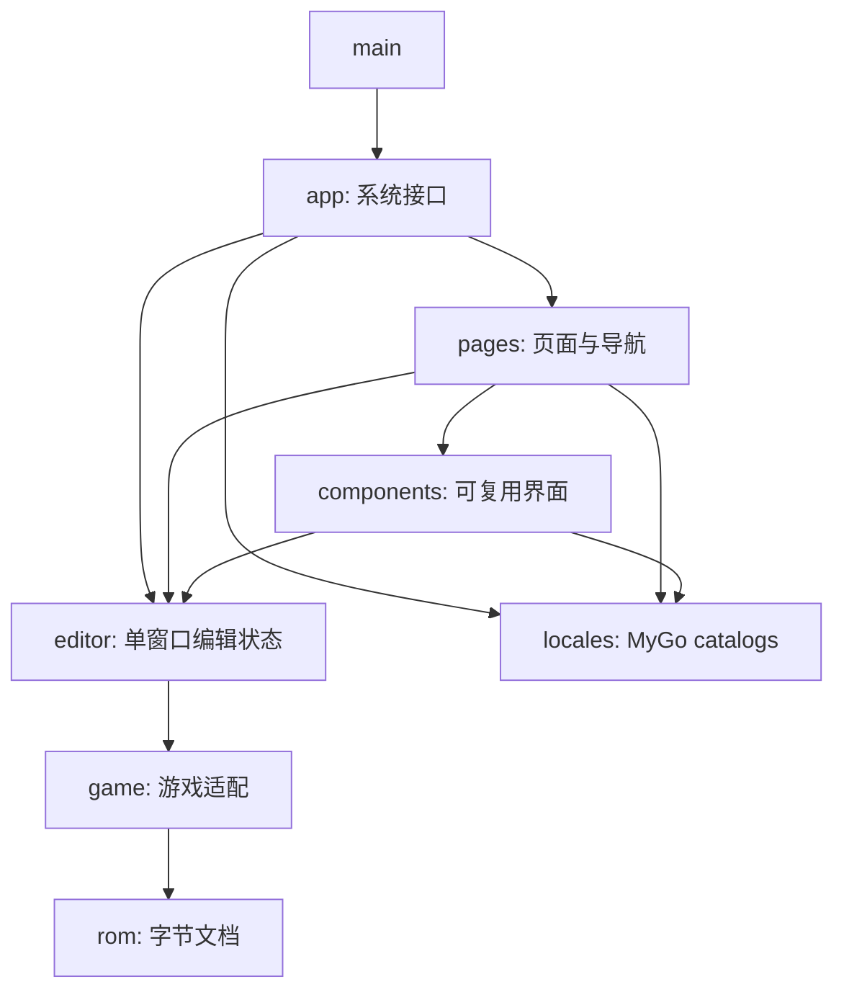

# FEBuilderGBA 原生编辑器

Go + MyGo 原生 UI，Go module 为 `github.com/woxQAQ/febuildergba-mygo`。当前实现 FE8U、FE8J 和 FE6 的人物、职业、道具基础字段编辑；FE8J／FE6 已完成日文原版的文件与 UI 验收，游戏效果单独待验收。尚未达到旧版完整功能覆盖。

完整范围和依赖顺序见 [重建计划](../docs/rebuild-plan.md)，实际状态见 [实现与验证记录](../docs/implementation-status.md)，按功能跟踪的验收见 [覆盖矩阵](../docs/coverage.md)。

## 运行

使用仓库要求的 Go 版本和 `go.mod` 中固定的 MyGo 依赖。在本目录执行：

```sh
go run .
# 也可以通过位置参数直接打开 ROM：
go run . /path/to/FE8U.gba
```

通过“文件 → 打开 ROM…”或 Cmd+O 使用系统文件对话框，每个 ROM 对应独立窗口。当前接受 FE8U、FE8J（至少 16 MiB）和 FE6（至少 8 MiB），最大 32 MiB。FE7J/U 适配按计划继续；FE6 翻译版的自定义字库尚未接入，标头能识别不代表名称显示正确。没有模拟器和旧版 C# 运行环境也可以使用基础编辑器。

- 顶部与系统标题栏合并，仅显示文件名、未保存状态和语言切换；打开、保存、另存为、撤销与重做统一使用原生菜单和快捷键。保留原生窗口按钮、圆角与阴影，文件名过长时自动省略，顶部空白区域可拖动窗口；全屏时自动收回窗口按钮的留白。
- 顶部标签页切换人物、职业、道具和十六进制编辑；记录列表支持名称或十六进制 ID 搜索。Shift 连选、Cmd/Ctrl 多选后，右侧显示字段选择与批量修改预览；点击应用形成一次可撤销操作。改变搜索会清空多选。
- 职业能力按基础、成长率、上限、转职加成并列显示；人物使用个人加值与成长率。没有对应字段的单元格显示 `—`。宽窗口将武器熟练度放在能力矩阵旁，窄窗口自动换行；其他属性采用标签与数值同行的布局。
- 有效字段输入立即进入内存文档；不完整或超范围的输入保留为草稿，并显示允许范围。Tab 切换字段，上下键微调；选中字段的加减按钮集中在编辑区底部。
- Cmd+Z / Cmd+Shift+Z 及原生“编辑”菜单按焦点选择撤销、重做：数值字段和记录视图操作 ROM 历史；搜索、批量值、表定位和未应用的十六进制草稿使用自己的文本历史。
- Cmd+S 保存，Cmd+Shift+S 另存为；Windows/Linux 对应 Ctrl，但这两个平台尚未验收。
- 人物和职业显示 ROM 内的头像／职业卡，道具显示实际图标；可用 `2×` 放大预览。修改素材 ID 或原始数据后，预览跟随文档修订刷新。
- “前往”定位关联职业；打开“原始数据”后，底部显示当前字段的地址、十六进制值及字节编辑入口，页面另显示高级字段与记录字节。素材的头像记录、图标字节和调色板也提供直接入口。
- “表定位”允许指定地址、记录大小和记录数，沿用当前游戏的字段定义。地址和记录大小需 4 字节对齐，范围必须完整容纳现有字段；这是当前窗口的解析设置，不改写 ROM 指针，也不随文件保存。可恢复自动定位。
- 十六进制编辑接受 ROM 偏移或 `08`／`09` 开头的 GBA 地址，每次读取 1–4096 字节。应用时保持长度不变，并检查读取后的文档修订；文档已改变时保留草稿，重新读取后才能应用。
- 右上角切换中文／英文，通过 MyGo 的 `App.SetLocale` 同步所有窗口、原生控件与系统菜单，并由框架保存语言偏好。首次运行按系统语言选择，未支持的语言回退到英文。

保存使用一致的字节快照，在同目录写临时文件后替换目标；磁盘 I/O 不持有文档状态锁。保存点对应实际写出的快照，期间的新修改仍保持未保存状态。修改前的完整文件保存在 `<ROM 文件名>.backups/`，备份目前不会自动删除。保存前及窗口重新聚焦时检查磁盘内容，发现外部修改后可重新载入或另存。关闭有未保存修改的窗口会询问保存、放弃或取消。

模拟器启动优先使用 `FEBUILDER_EMULATOR` 指定的可执行文件，其次使用 PATH 中的 `mgba`，macOS 还支持 `/Applications/mGBA.app`。参数通过独立 argv 传递，不通过 shell；指定值应为可执行文件路径，不能包含额外命令参数。试运行前需保存 ROM。

也可构建本地 macOS 应用和安装镜像：

```sh
go tool mygo build
open build/darwin-arm64/FEBuilderGBA.app
```

当前生成本地签名的开发产物；发行公证和分发验收尚未完成。

## 构建检查与真实 ROM 验收

按项目要求，不保留单元测试、测试框架入口或合成 ROM 生成器。开发检查使用构建和静态分析：

```sh
golangci-lint run ./...
go vet ./...
go tool mygo vet .
go tool mygo i18n check
go build ./...
CGO_ENABLED=0 go build ./...
```

本地真实 ROM 位于 `.rom/`，整个目录被 Git 忽略。当前验收语料为 FE8U 原版《The Sacred Stones》、`Vision_Quest_v3.gba`、`dream-of-five.gba`，以及 FE8J、FE6 日文原版；目录中的 FE7 和 FE6 翻译版尚未完成适配验收。使用临时副本进行编辑验收，保留原件；具体字节、表位置和已执行结果见 [实现记录](../docs/implementation-status.md) 和 [版本适配验收](../docs/version-adapters-acceptance.md)。

验收路径为：打开副本 → 单字段／批量修改 → 撤销重做 → 保存 → 重新打开 → 在 mGBA 中确认。手动表定位和十六进制操作复用同一文档历史。两份改版已完成文件与 UI 工作流检查；FE8U 原版及两份改版另已完成新游戏进入首章后的 HP、力量、武器威力与实际战斗对照，详见 [章节验收](../docs/rom-chapter-acceptance.md)。人物表等级的修改未改变这三个开场角色的部署等级，后者来自章节单位定义。其他字段的游戏场景及部分原生交互仍待验收。原生文件面板取消、关闭确认、组合输入与菜单焦点的实际结果及剩余条件见 [桌面验收](../docs/desktop-acceptance.md)。

两份 ROM 的 NarrowFont 窄字库已按实际字形匹配，Dream of Five 的道具名称现可正常显示与搜索；未知字形仍保留标记。人物头像、职业卡和道具图标的当前引用均已完成只读解码检查，图像导入、动画和其他自定义格式尚未完成。

阶段 0 的原生能力验证窗口：

```sh
go run ./cmd/ui-probe
```

窗口包含合成像素图块、缩放与坐标拾取、中文输入框和 10,000 行代码编辑器。它不读写 ROM，不是已实现的地图或事件编辑器。

## 覆盖索引

```sh
go run ./cmd/legacy-inventory
```

从旧版 `.csproj`、源码中的静态窗口调用和配置目录生成 [legacy-inventory.csv](../docs/legacy-inventory.csv)。索引仅记录来源，不能当作功能完成率；行为状态维护在覆盖矩阵中。生成器应从本目录执行，或显式设置 `-root`、`-out`。

## 工程组织

根目录的 `main.go` 只负责启动。页面组合、可复用组件、共享编辑状态与桌面系统接口分别组织：

```text
main.go
internal/
  app/                    窗口生命周期、原生菜单、文件对话框、模拟器启动
  pages/
    workspace.go          标签导航、页面组合和窗口动作回调
    empty.go              未打开 ROM 的页面
    records/              记录列表、搜索、多选、表定位和批量编辑
    hexeditor/            十六进制页面及其草稿
  components/
    chrome.go             主题、标题栏、状态栏与通知
    textdraft.go          尚未应用的文本输入与撤销焦点
    recordform/           字段布局、数值草稿、素材预览和字段检查器
  editor/                 单窗口共享编辑状态、撤销重做、数值与地址解析
  locales/                JSON catalogs、MyGo 生成的 API、领域标签与错误映射
  game/                   游戏适配、表与字段定义、文本和图像解码
  rom/                    字节文档、修改历史、保存与备份
  gba/                    GBA 图形编解码
cmd/
  ui-probe/               原生能力验证窗口
  legacy-inventory/       旧版来源索引工具
```



页面保留自己的筛选、选择和草稿状态；组件通过参数与回调接入页面，组件不导入页面或窗口协调层。`editor.State` 的修改在 UI 线程进行，后台 I/O 通过 `Window.Update` 回到窗口。`game`、`rom`、`gba` 不依赖 MyGo。新增游戏通过游戏适配接入，普通布局由字段定义描述。

## 国际化

`mygo.json` 将 `internal/locales` 配置为翻译目录：`en.json` 是源语言，`zh-Hans.json` 是简体中文。静态文案调用生成的类型化函数，动态字段 ID 和领域错误由 `labels.go` 映射到 catalog key；语言匹配、回退、复数与原生控件翻译由 MyGo 处理。

修改 JSON 后执行：

```sh
go tool mygo generate
go tool mygo i18n check
```

`catalog_gen.go` 与 JSON 一起纳入版本管理，普通 `go build` 无需预先执行生成命令。生成文件不要手工修改；`mygo dev` 和 `mygo build` 会自动重新生成。可用 `MYGO_LOCALE=zh-Hans go run .` 或 `MYGO_LOCALE=en go run .` 临时预览语言，该环境变量不会改写保存的语言偏好。
