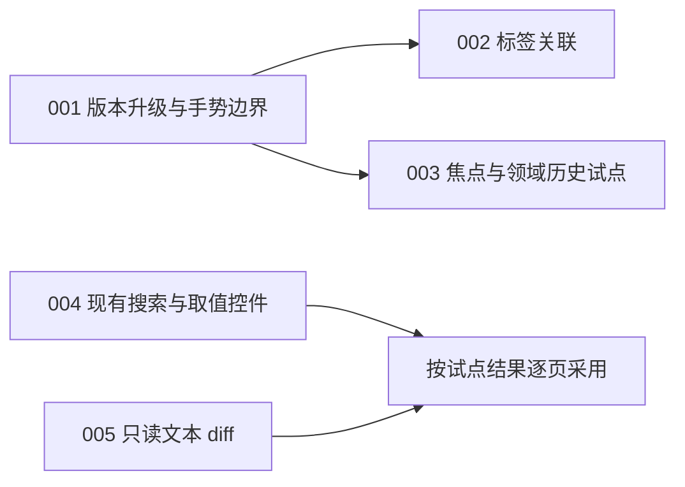

# MyGo 采用评估与实施计划

> 活动提案，核对日期：2026-11-07。固定项目基线：`2585e9f984bc31e34ade88b0b92580923b35e097`，依赖 `v0.7.4`。原生 UI 能力采用和版本升级分别评估，不用发布新增项限定框架采用范围。这些计划尚未实施，当前实现、依赖和产品功能状态分别以源码、`go.mod`、`docs/coverage.md` 为准。

## 阅读入口

| 文档                                                 | 范围                                                                                                       |
| ---------------------------------------------------- | ---------------------------------------------------------------------------------------------------------- |
| [原生 UI 能力与项目适配](mygo-ui-assessment.md)      | 对照官方完整 UI 能力族，判断现有使用、直接采用、局部试点、领域前提和不适用范围。涵盖旧版本已有控件和机制。 |
| [v0.7.4 → v0.8.3 升级评估](mygo-0.8.3-assessment.md) | 版本收益、输入行为变化、手势取消风险及固定源码快照的预检证据。                                             |

## 建议顺序与依赖

近期可独立推进版本维护和控件采用：升级需先处理手势取消；已有版本的 SearchField、Segmented 和 DiffView 可以在当前依赖上试点。依赖目标版 API 的标签关联与焦点查询，再接在升级之后。

| 计划                                        | 目标                                     | 优先级／工作量  | 依赖                       | 状态 |
| ------------------------------------------- | ---------------------------------------- | --------------- | -------------------------- | ---- |
| [001](001-upgrade-mygo-0.8.3.md)            | 固定 v0.8.3，适配手势取消                | P1／M           | 无                         | TODO |
| [004](004-use-native-search-and-choices.md) | 三处列表搜索与地图取值使用合适的标准控件 | P2／S–M         | 无，v0.7.4 已有 API        | TODO |
| [005](005-preview-text-import-diff.md)      | 试用只读文本导入差异比较                 | P2／M           | 无，v0.7.4 已有 API        | TODO |
| [002](002-bind-field-labels.md)             | 以 LabelledBy 关联记录字段标签           | P2／S           | 001，或已具备该 API 的分支 | TODO |
| [003](003-focus-history-spike.md)           | 验证默认文本焦点与显式领域历史归属       | P2／M，先 spike | 001，或已具备该 API 的分支 | TODO |

S、M 是包含有界复核的粗略工作量；spike 指先做有限试验，用实际行为决定是否采纳候选。编号保持稳定，不表示 004／005 必须等 003 完成。状态仅表示这些任务的实施情况，不复制产品功能覆盖状态。

## 后续候选与边界

道路 GridView、工具栏／焦点组、NumberCells 原生双击、按值选择器等见能力评估中的具体证据与适配条件；此轮没有实施，也未为每个可用控件创建任务。ColorPicker、导航历史、控制语言编辑器需要领域或产品设计前提。

不推荐将全部数值框改为浮点 NumberInput、把跨页草稿放进 Local、把结构化脚本替换成代码输入、把固定物理图集无条件改为自动换列 GridView，或仅为使用 API 引入动画与视觉效果。理由和可重新考虑的条件统一保留在能力评估。

## 执行和生命周期

执行者先阅读对应计划、`AGENTS.md` 和受影响领域文档，核对基线及并行工作区修改。升级预检只覆盖固定源码快照，不包含之后的日志开发；能力评估只提供源码分析，没有声称全部 UI 行为已验证。

运行证据区分默认领域测试、真实 ROM、临时 UI、原生平台及游戏内验证。按项目规则，UI 只做有界临时复核，完成后删除代码，不新增永久 UI 或模拟器测试。检查通过且没有未解决问题后结束验证。

计划完成或被替代后，按项目约定处理：有追溯价值的历史归档到 `docs/archive/` 并更新文档索引；不持续同步旧评估为当前实现，也不为同一变更另写实现总结。
